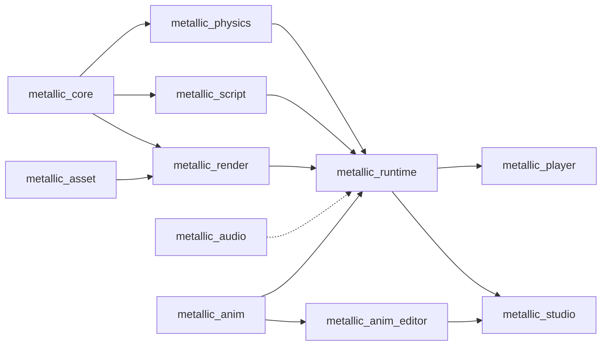

# Architecture

Planned design from the M1 plan; crates appear as their tasks land. When a public interface changes, update this file
and the crate docs in the same PR.

Arrows point from a dependency to its user (dotted: planned, not wired yet). Nothing below `runtime` knows about the
apps.

## Crates
- **metallic_core** (Task 2): the Roblox-style world. `World` owns a tree of Instances addressed by generational
  `InstanceId`; `Value` (Nil, Bool, Number, String, Vector3, Color3, UDim2, Ref); a class registry (`classes.rs`) with typed
  properties and defaults; `Signal<Args>` with opaque connection IDs shared across argument types (foreign IDs
  cannot disconnect a handler, identities are never reused, exhaustion panics before registration);
  `save_scene`/`load_scene` for the RON text format (one scene per file,
  only non-default properties, stable order). Also `deep_clone()` used by Play.
- **metallic_asset** (#76): file formats, with no GPU or world dependency. `SkinnedModel::from_glb(&[u8])` imports a
  skinned glTF 2.0 binary (`.glb`): one skeleton (joints sorted parents-first, inverse binds, rest pose), skinned meshes
  per level of detail (`<name>_LOD<n>`; positions, normals, UVs, up to 4 renormalised joint weights, material slot),
  material slots and animation clips (`Clip`, `Track`: translation/rotation/scale with STEP, LINEAR and CUBICSPLINE).
  Hostile files return `AssetError`, never panic: every accessor is bounds-checked, counts are capped (`MAX_JOINTS`,
  `MAX_VERTICES`, `MAX_KEYFRAMES`, ...), and the gltf crate's own validation runs only after our reference checks.
  Also `Pose` (local transforms, `blend`, `skin_matrices`). A separate crate because render (meshes) and runtime
  (skeleton, clips) both need it, and later player avatars and the animation system (#40) will too.
: `PhysicsWorld` wraps Rapier behind our own interface: `sync_from(&World)`,
  `step(&mut World, dt)` (1/240 s substeps), `velocity`/`angular_velocity`, `raycast`, `drain_touched`. Anchored parts that
  are moved or rotated become kinematic movers (linear + angular velocity). `CharacterController`, `spawn_character`
  and the Humanoid rules (death, respawn, checkpoints) live here.
- **metallic_meshgen** (#35, implemented): CPU mesh generation for every Part shape (glam only, no GPU). `generate(&MeshDesc)` turns shape, size in studs, bevel, LOD and shading into an indexed `MeshData` (positions, normals, tangents, two UV sets, optional baked AO) plus a `ColliderHint`; `MeshDesc::key()` is a stable cache key. Meshes are built at real size, so the instance transform carries no scale.
- **metallic_vfx** (#41, implemented): particle effects, trails and beams. Niagara-style module stack data model, a beginner `roblox::ParticleEmitter` front end, a deterministic seeded CPU simulator, a renderer-neutral depth-sorted quad draw list and RON effect files with presets. No GPU, no World knowledge.
- **metallic_vfx_editor** (#41, implemented): egui widgets for `metallic_vfx`: module stack, node canvas, curve and gradient editors, timeline and a live preview. Not wired into Studio yet.
- **metallic_physics2d** (#126, M3 early slice; standalone, not wired into the runtime yet): `PhysicsWorld2d` wraps
  rapier2d behind our own plain-data types (`Scene2d` of `BodyDesc`/`JointDesc` keyed by caller `BodyId`s, so it does
  not depend on how 2D maps onto Instances): `sync_from(&Scene2d)`, `step(&mut Scene2d, dt)` (fixed 1/60 s ticks with 4
  solver substeps; non-finite `dt` is an error), `raycast`, `drain_touched`, `drain_sensor_events`. Shapes include
  convex polygons, edge chains and merged tilemaps; one-way platforms, sensors, collision groups, revolute/prismatic/
  distance/weld joints. Platformer characters (`add_character`, `CharacterConfig`: coyote time, jump buffer, variable
  jump, wall slide/jump, drop-through, platform carry) run inside the fixed tick. Backend choice and the proposed 2D
  Instance classes: `docs/agents/126-physics2d.md`. Debug view: `--example physics2d_demo`.
- **metallic_script** (Tasks 6-7): `ScriptVm` is a sandboxed Luau VM (mlua; time budget, memory cap, forbidden globals,
  `task` library). `ScriptHost` runs server and client scripts over a shared `World`, exposes the Roblox-named API
  (documented in `docs/luau-api.md`) and RemoteEvent delivery. Instance member lookup retains mlua's owning string guard
  for valid UTF-8 keys; invalid UTF-8 keeps an owned lossy fallback. Output goes through `OutputSink`.
- **metallic_render** (Task 3): wgpu renderer. `Renderer::sync(&World)`, `render(target, camera, size)`; instanced shapes,
  PBR materials, cascaded shadows, sky, fog. `RenderContext` is built for a window (player) or from eframe (Studio).
  Skinned meshes (`skinned.rs`): `set_skinned(&[SkinnedInstance])` takes a model, its joint matrices and slot colours;
  the model is uploaded once (cached by `Arc` pointer), the joints go to a per-instance storage buffer (bind group 1),
  and `vs_skinned` (linear-blend skinning in `skin_common.wgsl`) feeds the same fragment shader and shadow passes as
  parts. The level of detail is picked from the projected height in pixels (LOD1 below 220 px, LOD2 below 80 px).
- **metallic_runtime** (Task 8): `Game::load(project_dir)` (reads `metallic.toml`: `name`, `main_scene`) or
  `Game::open(dir, scene, output)` / `Game::from_world(name, world, output)`, then `start`, `frame(&FrameInput, dt)`,
  `render(&mut Renderer, target, size)`, `paint_gui(&egui::Painter)` and `stop`. Ties world, physics, characters,
  scripts, the third-person `CameraController` and the in-game GUI (`gui.rs`: ScreenGui/Frame/TextLabel drawn with an
  egui painter with egui's bundled fonts; their licence texts are in `LICENSES/`).
  `InputState` turns keys, mouse and gamepad into `FrameInput`s without depending on a window library. Shared by
  player and Studio.
  The local character is drawn as the skinned default avatar (`avatar.rs`, `art/avatar/out/default_avatar.glb` built
  into the binary): feet `ROOT_HEIGHT` below the `HumanoidRootPart`, facing smoothed toward `Orientation.Y`. The
  physics body parts stay as invisible collision and touch proxies. `locomotion.rs` is a small built-in controller
  (idle / walk_slow / walk / run blended by speed with the clip rate following the distance covered, jump, fall, land,
  0.1-0.2 s crossfades); its only interface is `Locomotion::update(model, LocomotionInput { speed, support }, dt,
  &mut Pose)`, which the animation system (#40) replaces. `examples/avatar_shots.rs` renders review screenshots.
- **metallic_player** (Task 8): `metallic-player <project dir> [--scene F] [--headless --frames N] [--quality low|high]
  [--fps] [--autopilot] [--capture FRAME:PNG]`; winit window, wgpu surface, egui-wgpu for the GUI pass, gilrs for gamepads, headless
  mode for smoke tests (no window, no GPU).
- **metallic_audio** (#81): standalone, depends on no other Metallic crate. `AudioEngine` (game thread) sends
  commands to a `MixRenderer` (audio thread) that drives an `AudioBackend`: headless (deterministic offline render,
  tests, servers) or `DeviceBackend` (cpal, feature `device`). Sounds with Roblox-named properties
  (`SoundProperties`), five built-in groups (Master, Music, SFX, UI, Voice) plus nested `SoundGroup`s, group effects
  (`Effect`: Reverb, Equalizer, Compressor, Distortion, Echo, LowPass, HighPass), one `Listener`, roll-off curves,
  equal-power panning, Doppler, occlusion via a per-frame query, a voice limit with priority-ranked virtual voices.
  Decoding/streaming through Symphonia (WAV, OGG Vorbis, FLAC, MP3). Notes: `docs/agents/81-audio.md`.
- **metallic_studio** (Tasks 9-11, 13-14): egui editor: theme, start screen, templates, viewport, Explorer, Properties,
  Output, gizmos, `History` of `Command`s (undo/redo), `PlaySession`, updater, developer mode.
  Updater (Task 13): `updater.rs` (`UpdateChecker::check/check_quietly/download/apply_and_restart`, GitHub Releases feed via
  an injectable `HttpClient`, exact-tag `updater/tagged.rs` source for the selected version/channel, Velopack for package
  transfer, checksum verification and apply) and `github_auth.rs` (device sign-in, token in Credential
  Manager behind `SecretStore`). Release pipeline: `tools/release.py`, `.github/workflows/release.yml`, `docs/releasing.md`.
- **metallic_anim** (#40, implemented): animation data and playback, pure Rust (glam, no GPU). Typed keyframe
  `Curve<T>` (f32, Vec2, Vec3, Quat, Color3, bool) with constant, linear, Bezier and Roblox `EasingStyle`/`Direction`
  interpolation; `Clip` of joint and property tracks plus event markers; `Skeleton`/`Pose` for 3D joints and 2D bones
  (tracks are offsets from rest, like Roblox Poses); `Animator` (Roblox-style tracks: priority, weight, speed, fades,
  additive, per-joint masks, marker events); `StateMachine` (bool/float/trigger parameters, 1D blends, exit times);
  `Tween`/`TweenInfo` (Roblox semantics); two-bone IK and look-at; root-motion extraction; RON text format
  (`format::clip_to_text`, versioned, one key per line). No Instance or World knowledge: `metallic_runtime` will bind
  Animator poses to Motor6D-like joints and Tweens to Instance properties.
- **metallic_anim_editor** (#40, implemented): egui widgets that edit one `EditorState` (a `Clip` plus playhead,
  selection and views): `DopeSheet` (timeline), `CurveEditor`, `TransportBar`, `KeyInspector` and painter-only
  previews (2D bone rig, blocky 3D figure). Theme tokens follow the Studio UI design (PR #127). All key edits go
  through `EditorState` methods so Studio can wrap them in `Command`s; these widgets are the seed of the shared
  Timeline and Curve editor in `metallic_studio::widgets`. Demo: `cargo run -p metallic_anim_editor --example
  anim_editor_demo`.
- **metallic_modeling** (#136, epic #19): modeller core, no renderer or Studio dependency. `Mesh` is a BMesh-style
  radial-edge mesh in index arenas (stable, never-reused `VertId`/`EdgeId`/`FaceId`; n-gons, wire edges and
  non-manifold edges allowed); every edit runs in `Mesh::record`, which journals before/after per element
  (`ChangeSet`) so undo/redo restore exact ids. `Selection` (vertex/edge/face, flushed), `ops::*` (extrude, inset,
  bevel, loop cut, bridge, merge, dissolve, delete, fill, mirror, subdivide, Catmull-Clark, normals, marks; booleans
  as an interface only), `Op` + `MeshCommand` + `History`, `triangulate` to a local `MeshData` (switches to
  `metallic_meshgen`'s once merged), `uv` (box/planar, LSCM), `export` (GLB/glTF/OBJ). Demo:
  `cargo run -p metallic_modeling --example modeling_demo`.

## Frame loop
`Game::frame(input, dt)` applies camera orbit/zoom, then runs fixed 60 Hz ticks (an accumulator carries the remainder;
`dt` is clamped to 0.25 s), so a headless run of N frames of 1/60 s is deterministic. Each tick:

1. **input -> character controller**: `CharacterController::step` with the camera-relative move wish (Shift sets
   `MoveInput::run`: 1.5 x `Humanoid.WalkSpeed`, which scripts still read unchanged); death, respawn, checkpoints and
   character touches happen here.
2. **physics step**: `PhysicsWorld::step(TICK)` (four 1/240 s substeps; anchored parts moved by scripts become movers).
3. **feed events** to the script host: every `drain_touched` pair as `touched(a, b)` and `touched(b, a)`; a character
   touch as `touched(part, HumanoidRootPart)` so `hit.Parent` is the character Model; `Died` -> `humanoid_died`;
   `Respawned` -> `physics.sync_from` and `character_added(player, model)`.
4. **script step** (`ScriptHost::step`: new scripts, remotes, the inputs above, `RunService.Heartbeat`, resumed waits).
5. **physics re-sync** when the change journal shows a BasePart under Workspace was created, destroyed, reparented or
   reshaped (Size, Shape, Material, Anchored, CanCollide); plain moves need no sync.

Then the avatar follows the character (pose, smoothed facing, animation from the humanoid state and the speed
relative to what it stands on) and the camera follows too (frozen where it died while dead; a ray pulls it in front of walls). The app then
calls `Game::render` (`Renderer::sync` from the change journal, then `render`) and paints the GUI over the 3D view. The
game never holds a `World` borrow while scripts run. `Game::start` runs the scripts (which creates `Player1`), copies
`StarterGui` into the `PlayerGui` once, spawns the character and fires `CharacterAdded`.

## Audio wiring (planned, after Task 8)
`metallic_audio` is ready; the runtime and Luau sides are not written yet. The plan:
- **Classes in `metallic_core/src/classes.rs`** (Roblox defaults; read-only ones are runtime-maintained):
  - `Sound`: `SoundId` (String), `Volume` (Number 0.5), `PlaybackSpeed` (Number 1), `Looped` (Bool false),
    `Playing` (Bool false), `TimePosition` (Number 0), `TimeLength` (Number 0, read-only), `IsPlaying` (Bool,
    read-only), `IsPaused` (Bool, read-only), `RollOffMode` (enum string "Inverse"; also "Linear", "LinearSquare",
    "InverseTapered"), `RollOffMinDistance` (Number 10), `RollOffMaxDistance` (Number 10000), `SoundGroup` (Ref nil),
    `PlayOnRemove` (Bool false).
  - `SoundGroup`: `Volume` (Number 0.5).
  - `SoundService` (service): `AmbientReverb` (enum string "NoReverb"), `DistanceFactor` (Number 3.33),
    `DopplerScale` (Number 1), `RolloffScale` (Number 1).
  - Effects, each with `Enabled` (Bool true) and `Priority` (Number 0): `ReverbSoundEffect` (`DecayTime` 1.5,
    `Density` 1, `Diffusion` 1, `DryLevel` -6, `WetLevel` 0), `EqualizerSoundEffect` (`LowGain`, `MidGain`,
    `HighGain` in dB, `MidRange` as two numbers; check Roblox's defaults when adding), `CompressorSoundEffect`
    (`Attack` 0.1, `Release` 0.1, `Ratio` 40, `Threshold` -40, `GainMakeup` 0), `DistortionSoundEffect` (`Level`
    0.75), `EchoSoundEffect` (`Delay` 1, `Feedback` 0.5, `DryLevel` 0, `WetLevel` 0).
- **Runtime (`metallic_runtime`, an `audio` system):** owns the `AudioEngine` (`open_device_or_headless` in the
  player and Studio; `headless_clocked` on servers). Mirrors Instances through the world change journal: a `Sound`
  becomes `create_sound`, property changes map to the setters of the same name, `SoundGroup` to `create_group`, an
  effect parented to a `SoundGroup` to `add_effect`. A `Sound` under a BasePart or Attachment gets an `Emitter` (world
  position and velocity, refreshed each frame); anywhere else it is non-positional. `SoundService` maps to
  `set_spatial_settings`.
- **Frame loop:** after physics and camera: `set_listener(camera)`, update emitters of moving parts,
  `update_with_occlusion(dt, &mut |from, to| physics raycast)`, then turn `drain_events()` into `Ended`/`DidLoop`
  signals and write back `TimePosition`, `IsPlaying`, `TimeLength`.
- **Luau (`metallic_script/src/api/`):** `Sound:Play/Pause/Resume/Stop` call the engine; `Played/Paused/Resumed/
  Stopped` fire from the method calls, `Ended`/`DidLoop` from engine events; `SoundService:PlayLocalSound(sound)`.
  Line items go in `docs/luau-api.md` when added.

## Where to add things
- **A new Instance class or property:** `metallic_core/src/classes.rs` (registry entry with defaults), a test in
  `tests/tree.rs`; the Luau API picks up registry properties by name; Studio's Properties panel too. Add to Insert menu if
  creators should create it.
- **A Luau API member:** `metallic_script/src/api/` (`instance.rs`, `datatypes.rs`, `services.rs`, `remote.rs`), a test
  in `tests/api.rs`, and a line in `docs/luau-api.md`.
- **A material:** the material list in `classes.rs`, its row in `metallic_render/src/materials.rs` (roughness, metalness,
  procedural detail), and density/friction in `metallic_physics`. Test `material_table_has_every_registry_material`
  must still pass.
- **An easing style or interpolation:** `metallic_anim/src/easing.rs` or `curve.rs`, a reference row in
  `tests/easing.rs` or `tests/curve.rs`, and its tile in `metallic_anim_editor/src/inspector.rs`.
- **A Studio edit action:** a `Command` in `metallic_studio/src/commands.rs` applied through `History`, never by
  mutating the world directly.

## Quality bar
- Every public item has a `///` doc comment; every crate has a `//!` crate doc.
- Tests sit next to behaviour (write the failing test first).
- No `unwrap()` or `expect()` outside tests; return typed errors (`CoreError`, `ScriptError`, `RuntimeError`, `StudioError`).
- Scripts can never freeze or crash the game: budgets and caps are enforced in `metallic_script`.
- Permissive dependency licences only; `cargo deny check licenses` stays green.
- Benchmarks: criterion benches live in `crates/<crate>/benches/` (`cargo bench -p metallic_core --bench world` exists;
  render sync, physics step and script step follow). Budgets, bench names and the perf-CI plan are in
  `docs/research/2026-10-30-performance-and-scale.md`; record numbers in `docs/agents/`.
