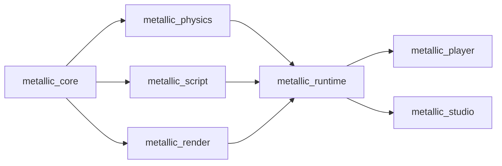

# Architecture

Planned design from the M1 plan; crates appear as their tasks land. When a public interface changes, update this file
and the crate docs in the same PR.

Arrows point from a dependency to its user. Nothing below `runtime` knows about the apps.

## Crates
- **metallic_core** (Task 2): the Roblox-style world. `World` owns a tree of Instances addressed by generational
  `InstanceId`; `Value` (Nil, Bool, Number, String, Vector3, Color3, UDim2, Ref); a class registry (`classes.rs`) with typed
  properties and defaults; `Signal<Args>`; `save_scene`/`load_scene` for the RON text format (one scene per file,
  only non-default properties, stable order). Also `deep_clone()` used by Play. Independent journal readers use
  `change_cursor`/`changes_since`; `ChangeCursor::same_world` distinguishes lost history from a different world.
- **metallic_physics** (Tasks 4-5): `PhysicsWorld` wraps Rapier behind our own interface: `sync_from(&World)`,
  `step(&mut World, dt)` (1/240 s substeps), `velocity`/`angular_velocity`, `raycast`, `drain_touched`. Anchored parts that
  are moved or rotated become kinematic movers (linear + angular velocity). `CharacterController`, `spawn_character`
  and the Humanoid rules (death, respawn, checkpoints) live here. `sync_from` reads the world's change journal,
  reclassifies affected Humanoid/Model subtrees, and reconciles the full Workspace only on first use, overflow, or
  world replacement. Overflow preserves matching bodies; a different world resets simulation state.
  `last_sync_stats() -> PhysicsSyncStats` reports full scans and examined/rebuilt/removed part counts for profiling.
- **metallic_script** (Tasks 6-7): `ScriptVm` is a sandboxed Luau VM (mlua; time budget, memory cap, forbidden globals,
  `task` library). `ScriptHost` runs server and client scripts over a shared `World`, exposes the Roblox-named API
  (documented in `docs/luau-api.md`) and RemoteEvent delivery. Output goes through `OutputSink`.
- **metallic_render** (Task 3): wgpu renderer. `Renderer::sync(&World)`, `render(target, camera, size)`; instanced shapes,
  PBR materials, cascaded shadows, sky, fog. `RenderContext` is built for a window (player) or from eframe (Studio).
- **metallic_runtime** (Task 8): `Game::load/start/frame/stop` ties world, physics, scripts, render, input, third-person
  camera and in-game GUI (ScreenGui/Frame/TextLabel). Shared by player and Studio.
- **metallic_player** (Task 8): `metallic-player <project dir>`; window, input, headless mode for smoke tests.
- **metallic_studio** (Tasks 9-11, 13-14): egui editor: theme, start screen, templates, viewport, Explorer, Properties,
  Output, gizmos, `History` of `Command`s (undo/redo), `PlaySession`, updater, developer mode.
  Updater (Task 13): `updater.rs` (`UpdateChecker::check/check_quietly/download/apply_and_restart`, GitHub Releases feed via
  an injectable `HttpClient`, Velopack for download and apply) and `github_auth.rs` (device sign-in, token in Credential
  Manager behind `SecretStore`). Release pipeline: `tools/release.py`, `.github/workflows/release.yml`, `docs/releasing.md`.

## Frame loop
`Game::frame(input, dt)`: input -> scripts (`ScriptHost::step`: Heartbeat, Touched, queued remotes, resumed threads)
-> physics (`PhysicsWorld::step`, touched events) -> character (`CharacterController::step`, Humanoid rules)
-> render (`Renderer::sync`, `render`) -> GUI over the 3D view.

## Where to add things
- **A new Instance class or property:** `metallic_core/src/classes.rs` (registry entry with defaults), a test in
  `tests/tree.rs`; the Luau API picks up registry properties by name; Studio's Properties panel too. Add to Insert menu if
  creators should create it.
- **A Luau API member:** `metallic_script/src/api/` (`instance.rs`, `datatypes.rs`, `services.rs`, `remote.rs`), a test
  in `tests/api.rs`, and a line in `docs/luau-api.md`.
- **A material:** the material list in `classes.rs`, its row in `metallic_render/src/materials.rs` (roughness, metalness,
  procedural detail), and density/friction in `metallic_physics`. Test `material_table_has_every_registry_material`
  must still pass.
- **A Studio edit action:** a `Command` in `metallic_studio/src/commands.rs` applied through `History`, never by
  mutating the world directly.

## Quality bar
- Every public item has a `///` doc comment; every crate has a `//!` crate doc.
- Tests sit next to behaviour (write the failing test first).
- No `unwrap()` or `expect()` outside tests; return typed errors (`CoreError`, `ScriptError`, `RuntimeError`, `StudioError`).
- Scripts can never freeze or crash the game: budgets and caps are enforced in `metallic_script`.
- Permissive dependency licences only; `cargo deny check licenses` stays green.
- Benchmarks: criterion benches live in `crates/<crate>/benches/` (`cargo bench -p metallic_core --bench world` exists;
  render sync, physics step and script step follow). Budgets, bench names and the perf-CI plan are in
  `docs/research/2026-10-30-performance-and-scale.md`; record numbers in `docs/agents/`.
