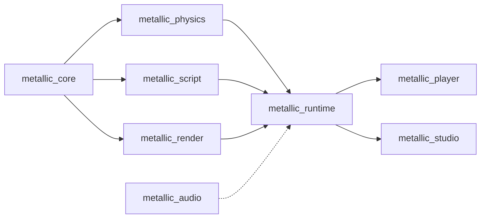

# Architecture

Planned design from the M1 plan; crates appear as their tasks land. When a public interface changes, update this file
and the crate docs in the same PR.

Arrows point from a dependency to its user (dotted: planned, not wired yet). Nothing below `runtime` knows about the
apps.

## Crates
- **metallic_core** (Task 2): the Roblox-style world. `World` owns a tree of Instances addressed by generational
  `InstanceId`; `Value` (Nil, Bool, Number, String, Vector3, Color3, UDim2, Ref); a class registry (`classes.rs`) with typed
  properties and defaults; `Signal<Args>`; `save_scene`/`load_scene` for the RON text format (one scene per file,
  only non-default properties, stable order). Also `deep_clone()` used by Play.
- **metallic_physics** (Tasks 4-5): `PhysicsWorld` wraps Rapier behind our own interface: `sync_from(&World)`,
  `step(&mut World, dt)` (1/240 s substeps), `velocity`/`angular_velocity`, `raycast`, `drain_touched`. Anchored parts that
  are moved or rotated become kinematic movers (linear + angular velocity). `CharacterController`, `spawn_character`
  and the Humanoid rules (death, respawn, checkpoints) live here.
- **metallic_script** (Tasks 6-7): `ScriptVm` is a sandboxed Luau VM (mlua; time budget, memory cap, forbidden globals,
  `task` library). `ScriptHost` runs server and client scripts over a shared `World`, exposes the Roblox-named API
  (documented in `docs/luau-api.md`) and RemoteEvent delivery. Output goes through `OutputSink`.
- **metallic_render** (Task 3): wgpu renderer. `Renderer::sync(&World)`, `render(target, camera, size)`; instanced shapes,
  PBR materials, cascaded shadows, sky, fog. `RenderContext` is built for a window (player) or from eframe (Studio).
- **metallic_audio** (#81): standalone, depends on no other Metallic crate. `AudioEngine` (game thread) sends
  commands to a `MixRenderer` (audio thread) that drives an `AudioBackend`: headless (deterministic offline render,
  tests, servers) or `DeviceBackend` (cpal, feature `device`). Sounds with Roblox-named properties
  (`SoundProperties`), five built-in groups (Master, Music, SFX, UI, Voice) plus nested `SoundGroup`s, group effects
  (`Effect`: Reverb, Equalizer, Compressor, Distortion, Echo, LowPass, HighPass), one `Listener`, roll-off curves,
  equal-power panning, Doppler, occlusion via a per-frame query, a voice limit with priority-ranked virtual voices.
  Decoding/streaming through Symphonia (WAV, OGG Vorbis, FLAC, MP3). Notes: `docs/agents/81-audio.md`.
- **metallic_runtime** (Task 8): `Game::load/start/frame/stop` ties world, physics, scripts, render, input, third-person
  camera and in-game GUI (ScreenGui/Frame/TextLabel). Shared by player and Studio.
- **metallic_player** (Task 8): `metallic-player <project dir>`; window, input, headless mode for smoke tests.
- **metallic_studio** (Tasks 9-11, 13-14): egui editor: theme, start screen, templates, viewport, Explorer, Properties,
  Output, gizmos, `History` of `Command`s (undo/redo), `PlaySession`, updater, developer mode.

## Frame loop
`Game::frame(input, dt)`: input -> scripts (`ScriptHost::step`: Heartbeat, Touched, queued remotes, resumed threads)
-> physics (`PhysicsWorld::step`, touched events) -> character (`CharacterController::step`, Humanoid rules)
-> render (`Renderer::sync`, `render`) -> GUI over the 3D view.

## Audio wiring (planned, after Task 8)
`metallic_audio` is ready; the runtime and Luau sides are not written yet. The plan:
- **Classes in `metallic_core/src/classes.rs`** (Roblox defaults; read-only ones are runtime-maintained):
  - `Sound`: `SoundId` (String), `Volume` (Number 0.5), `PlaybackSpeed` (Number 1), `Looped` (Bool false),
    `Playing` (Bool false), `TimePosition` (Number 0), `TimeLength` (Number 0, read-only), `IsPlaying` (Bool,
    read-only), `IsPaused` (Bool, read-only), `RollOffMode` (enum string "Inverse"; also "Linear", "LinearSquare",
    "InverseTapered"), `RollOffMinDistance` (Number 10), `RollOffMaxDistance` (Number 10000), `SoundGroup` (Ref nil),
    `PlayOnRemove` (Bool false).
  - `SoundGroup`: `Volume` (Number 0.5).
  - `SoundService` (service): `AmbientReverb` (enum string "NoReverb"), `DistanceFactor` (Number 3.33),
    `DopplerScale` (Number 1), `RolloffScale` (Number 1).
  - Effects, each with `Enabled` (Bool true) and `Priority` (Number 0): `ReverbSoundEffect` (`DecayTime` 1.5,
    `Density` 1, `Diffusion` 1, `DryLevel` -6, `WetLevel` 0), `EqualizerSoundEffect` (`LowGain`, `MidGain`,
    `HighGain` in dB, `MidRange` as two numbers; check Roblox's defaults when adding), `CompressorSoundEffect`
    (`Attack` 0.1, `Release` 0.1, `Ratio` 40, `Threshold` -40, `GainMakeup` 0), `DistortionSoundEffect` (`Level`
    0.75), `EchoSoundEffect` (`Delay` 1, `Feedback` 0.5, `DryLevel` 0, `WetLevel` 0).
- **Runtime (`metallic_runtime`, an `audio` system):** owns the `AudioEngine` (`open_device_or_headless` in the
  player and Studio; `headless_clocked` on servers). Mirrors Instances through the world change journal: a `Sound`
  becomes `create_sound`, property changes map to the setters of the same name, `SoundGroup` to `create_group`, an
  effect parented to a `SoundGroup` to `add_effect`. A `Sound` under a BasePart or Attachment gets an `Emitter` (world
  position and velocity, refreshed each frame); anywhere else it is non-positional. `SoundService` maps to
  `set_spatial_settings`.
- **Frame loop:** after physics and camera: `set_listener(camera)`, update emitters of moving parts,
  `update_with_occlusion(dt, &mut |from, to| physics raycast)`, then turn `drain_events()` into `Ended`/`DidLoop`
  signals and write back `TimePosition`, `IsPlaying`, `TimeLength`.
- **Luau (`metallic_script/src/api/`):** `Sound:Play/Pause/Resume/Stop` call the engine; `Played/Paused/Resumed/
  Stopped` fire from the method calls, `Ended`/`DidLoop` from engine events; `SoundService:PlayLocalSound(sound)`.
  Line items go in `docs/luau-api.md` when added.

## Where to add things
- **A new Instance class or property:** `metallic_core/src/classes.rs` (registry entry with defaults), a test in
  `tests/tree.rs`; the Luau API picks up registry properties by name; Studio's Properties panel too. Add to Insert menu if
  creators should create it.
- **A Luau API member:** `metallic_script/src/api/` (`instance.rs`, `datatypes.rs`, `services.rs`, `remote.rs`), a test
  in `tests/api.rs`, and a line in `docs/luau-api.md`.
- **A material:** the material list in `classes.rs`, its row in `metallic_render/src/materials.rs` (roughness, metalness,
  procedural detail), and density/friction in `metallic_physics`. Test `material_table_has_every_registry_material`
  must still pass.
- **A Studio edit action:** a `Command` in `metallic_studio/src/commands.rs` applied through `History`, never by
  mutating the world directly.

## Quality bar
- Every public item has a `///` doc comment; every crate has a `//!` crate doc.
- Tests sit next to behaviour (write the failing test first).
- No `unwrap()` or `expect()` outside tests; return typed errors (`CoreError`, `ScriptError`, `RuntimeError`, `StudioError`).
- Scripts can never freeze or crash the game: budgets and caps are enforced in `metallic_script`.
- Permissive dependency licences only; `cargo deny check licenses` stays green.
- Benchmarks: criterion benches live in `crates/<crate>/benches/` (`cargo bench -p metallic_core --bench world` exists;
  render sync, physics step and script step follow). Budgets, bench names and the perf-CI plan are in
  `docs/research/2026-10-30-performance-and-scale.md`; record numbers in `docs/agents/`.
