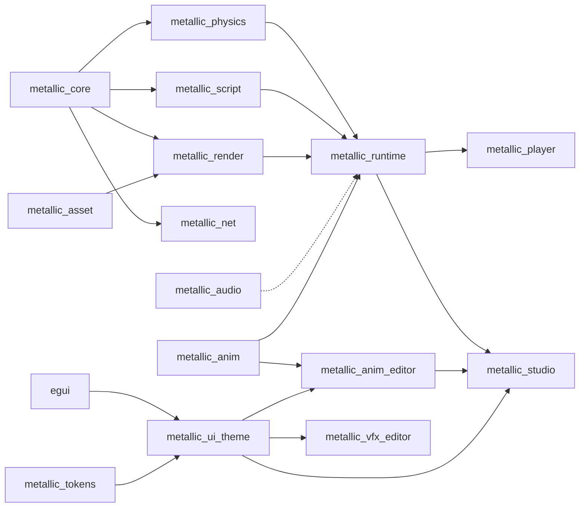

# Architecture

Planned design from the M1 plan; crates appear as their tasks land. When a public interface changes, update this file
and the crate docs in the same PR.


Arrows point from a dependency to its user (dotted: planned, not wired yet). Nothing below `runtime` knows about the
apps.

## Crates
- **metallic_core** (Task 2): the Roblox-style world. `World` owns a tree of Instances addressed by generational
  `InstanceId`; `Value` (Nil, Bool, Number, String, Vector3, Color3, UDim2, Ref, CFrame); a class registry (`classes.rs`) with typed
  properties and defaults; `Signal<Args>` with opaque connection IDs shared across argument types (foreign IDs
  cannot disconnect a handler, identities are never reused, exhaustion panics before registration);
  attributes (`instance/extras.rs`: a boxed side record per node, so instances without any pay one pointer and the
  property paths never look at them; changes go to the change journal and to a bounded attribute log read with
  `attribute_changes_since`) and tags (same record, plus a tag-to-instances index so `tagged` never scans the tree, and a
  tag log for the instance-added/removed signals; reparent and destroy only walk a subtree while some tag exists);
  `save_scene`/`load_scene` for the RON text format (one scene per file,
  only non-default properties, stable order). `World::get_ref` borrows stored properties and immutable registry
  defaults; `classes::default_value_ref` exposes stable defaults, including concrete-class `Name` values. The shared
  default cache initializes once, then successful borrowed reads do not allocate. The owned `get` and
  `classes::default_value` paths remain compatible; references to destroyed instances read as `Ref(None)` through
  either world getter. Name lookup and dotted paths use borrowed reads. Also `deep_clone()` used by Play.
  `CFrame` (`cframe.rs`) is the rigid-transform math with Roblox conventions (row-major rotation, Euler orders,
  look-at, inverse, lerp); `Value::CFrame` (boxed, so `Value` stays 40 bytes) stores `BasePart.PivotOffset` and
  `Model.WorldPivot`. `BasePart.CFrame` in Luau maps onto Position/Orientation. `transform` holds the pivot rules
  (`get_pivot`, `pivot_to`), `resize`, `scale_to` and `bounding_box`, shared by Luau and the building tools.
  `PropDef::hidden` marks engine bookkeeping (`Model.WorldPivotSet`, `Model.ScaleFactor`) that Luau does not show.
  `PropDef::normalize` converts a String write outside `allowed` to its stored form (a display name to an id).
  `look_override` (#222): `BasePart.LookOverride` and `Model.LookOverride` (String, default `inherit`; ids
  `realistic`, `soft`, `toon`, `low-poly`, `voxel`, `pixel-3d`, `retro-32`; display names such as "Retro / PS1" are
  accepted on write). `resolve(world, id)` gives the effective style: own value, else the nearest ancestor Model's
  non-`inherit` value, else `None` (the place Look). `LookOverrides` caches it per part and is kept current with
  `apply(world, &changes)` from the change journal, returning the parts whose style changed (including parts below a
  Model whose own value changed). The renderer's `Scene` holds one; `PartDraw::style` carries the resolved id.
- **metallic_asset** (#76): file formats, with no GPU or world dependency. `SkinnedModel::from_glb(&[u8])` imports a
  skinned glTF 2.0 binary (`.glb`): one skeleton (joints sorted parents-first, inverse binds, rest pose), skinned meshes
  per level of detail (`<name>_LOD<n>`; positions, normals, UVs, up to 4 renormalised joint weights, material slot),
  material slots and animation clips (`Clip`, `Track`: translation/rotation/scale with STEP, LINEAR and CUBICSPLINE).
  Hostile files return `AssetError`, never panic: every accessor is bounds-checked, counts are capped (`MAX_JOINTS`,
  `MAX_VERTICES`, `MAX_KEYFRAMES`, ...), and the gltf crate's own validation runs only after our reference checks.
  Also `Pose` (local transforms, `blend`, `skin_matrices`). A separate crate because render (meshes) and runtime
  (skeleton, clips) both need it, and later player avatars and the animation system (#40) will too.
- **metallic_physics** (Tasks 4-5): `PhysicsWorld` wraps Rapier behind our own interface: `sync_from(&World)`,
  `step(&mut World, dt)` (1/240 s substeps), `velocity`/`angular_velocity`, `raycast`, `drain_touched`. Anchored parts that
  are moved or rotated become kinematic movers (linear + angular velocity). `CharacterController`, `spawn_character`
  and the Humanoid rules (death, respawn, checkpoints) live here. A character is a solid `HumanoidRootPart` plus the 15
  R15 body parts (`BodyPart`: `Head`, `UpperTorso`, ..., `RightFoot`), which have CanCollide off and so are sensors
  that never push. Each body part holds a bone-attached touch capsule, placed by a `BodyPose` the runtime sets every
  tick with `CharacterController::set_body_pose` (else `BodyPose::rest`). The capsules are controller queries: one
  broad-phase lookup per step, at most `MAX_TOUCH_CANDIDATES` parts (existing contacts first, then the nearest; the rest
  are counted in `TouchQueryCost`), nothing allocated once warm. They report `CharacterEvent::Touched`/`TouchEnded
  { part, hit }` per body part, including when a character is destroyed or replaced; the movement capsule reports as
  the root. Nothing is matched by name, so NPC Models keep their own physics. The controller records its support contact
  (`SupportContact`, part of `CharacterState`) in body-local coordinates and carries the capsule's bottom-sphere
  centre through the support's next observed pose change, so riders keep their radius on tilted spinners. Idle
  facing turns by the same pose change's world-up twist; explicit movement keeps world-space facing. Jump momentum
  uses the foot contact's point velocity (cached anchored rates, Rapier world-COM velocity for dynamic bodies).
  The capsule stays upright; the carry sweep ignores the support but other parts can shorten it.
  `PhysicsWorld::scripted_pose` is the pose the next step gives a part; the controller adds the step from an
  anchored support's body pose to it as a final lead, so riders trail a Heartbeat-moved platform by one tick, not
  two (#374). `relative_velocity` is measured against the support's motion at the bottom-sphere centre.
- **metallic_meshgen** (#35, implemented): CPU mesh generation for every Part shape (glam only, no GPU). `generate(&MeshDesc)` turns shape, size in studs, bevel, LOD and shading into an indexed `MeshData` (positions, normals, tangents, two UV sets, optional baked AO) plus a `ColliderHint`; `MeshDesc::key()` is a stable cache key. Meshes are built at real size, so the instance transform carries no scale.
- **metallic_vfx** (#41, implemented): particle effects, trails and beams. Niagara-style module stack data model, a beginner `roblox::ParticleEmitter` front end, a deterministic seeded CPU simulator, a renderer-neutral depth-sorted quad draw list and RON effect files with presets. No GPU, no World knowledge.
- **metallic_ui_theme** (S8): the render-free egui theme shared by Studio, `metallic_anim_editor` and `metallic_vfx_editor`:
  palettes for Graphite, Titanium and Light read from `metallic_tokens`, the bundled fonts and icons (`assets/fonts`), the
  `Visuals`/`Spacing` setup (`apply`), and `apply_saved`, which follows the theme chosen in Studio Settings by reading
  `settings.toml` (read-only). Depends on egui and `metallic_tokens` only; `metallic_studio::theme` re-exports it.
- **metallic_vfx_editor** (#41, implemented): egui widgets for `metallic_vfx`: module stack, node canvas, curve and gradient editors, timeline and a live preview. Not wired into Studio yet.
- **metallic_physics2d** (#126, M3 early slice; standalone, not wired into the runtime yet): `PhysicsWorld2d` wraps
  rapier2d behind our own plain-data types (`Scene2d` of `BodyDesc`/`JointDesc` keyed by caller `BodyId`s, so it does
  not depend on how 2D maps onto Instances): `sync_from(&Scene2d)`, `step(&mut Scene2d, dt)` (fixed 1/60 s ticks with 4
  solver substeps; non-finite `dt` is an error), `raycast`, `drain_touched`, `drain_sensor_events`. Shapes include
  convex polygons, edge chains and merged tilemaps; one-way platforms, sensors, collision groups, revolute/prismatic/
  distance/weld joints. Platformer characters (`add_character`, `CharacterConfig`: coyote time, jump buffer, variable
  jump, wall slide/jump, drop-through, platform carry) run inside the fixed tick. Backend choice and the proposed 2D
  Instance classes: `docs/agents/126-physics2d.md`. Debug view: `--example physics2d_demo`.
- **metallic_script** (Tasks 6-7): `ScriptVm` is a sandboxed Luau VM (mlua; time budget, memory cap, forbidden globals,
  `task` library). `ScriptHost::new` runs server and client scripts over a shared `World`; additive `new_server`
  starts only the server VM and server-eligible Scripts, without creating a local Player/PlayerGui or PlayerAdded.
  The role is fixed at construction, preserves pre-existing world state and filters client script candidates before
  running-script bookkeeping. This adds no transport, player admission, server executable or M2 acceptance.
  The host exposes the Roblox-named API
  (documented in `docs/luau-api.md`) and RemoteEvent delivery. Instance member lookup retains mlua's owning string guard
  for valid UTF-8 keys; invalid UTF-8 keeps an owned lossy fallback. Output goes through `OutputSink`.
  Task queue ownership uses weak thread keys and fresh lease identities; task-created callbacks bind their
  function/arguments at creation. Coroutine admission adapters consume private scheduler markers while ordinary
  result/error tuples remain in Lua. Only finished/error threads lose ownership state; running/active parents
  retain it so later waits remain cancellable. Native `pcall`/`xpcall` are unchanged.
- **metallic_render** (Task 3): wgpu renderer. `Renderer::sync(&World)`, `render(target, camera, size)`; instanced shapes,
  PBR materials, cascaded shadows, sky, fog. `RenderContext` is built for a window (player) or from eframe (Studio). Headless contexts (tests, screenshots) use Vulkan, DX12 or Metal and fall back to OpenGL only without them. Every instance, adapter and device `context.rs` makes is set up under one process-wide lock: wgpu's Windows OpenGL (WGL) setup crashes the process (access violation, heap corruption) when threads do it at once (#276, upstream gfx-rs/wgpu#9760); rendering and teardown stay parallel.
  Frame stages (#62): shadows, then the scene into a linear `Rgba16Float` HDR target (MSAA resolves into it), then the
  post chain (`post.rs`: `PostChain` of `PostPass`es in an `Hdr` and an `Ldr` slot, run in list order; most passes
  wrap a `FullscreenPass`), with the finish pass between the slots (`tonemap.rs`: exposure, grade, `ToneCurve`,
  vignette, sRGB encode, dither). Add a pass with `renderer.post_mut().push(Box::new(pass))`; a pass that returns
  `reads_depth` gets the scene depth (multisampled when MSAA is on).
  Lighting (#149, `lighting.rs`, `shaders/lighting.wgsl`): `sync` also reads the `Lighting` service and its children
  (`LightingInputs::read`) and `evaluate`s them into the sky, the finish settings, a lighting block in the globals
  uniform (ambient, fog, shadow filter, sun / moon discs, stars) and the `bloom` post pass (`bloom.rs`).
  `set_lighting` applies inputs directly. Presets live in `metallic_core::lighting` (`docs/lighting/presets.md`).
  Auto exposure (#151, `exposure.rs`, `shaders/exposure.wgsl`): after the scene pass, before the HDR passes, two
  compute passes meter the HDR scene image (centre-weighted 256-bin log histogram, 30-95% band, EV100 clamp,
  adaptation, night bias) into a GPU state buffer. The next frame copies the multiplier into the finish uniform and
  the globals (`light_toon.y`, for toon's `unfinish`), so nothing is read back. Toon shading writes HDR alpha 0 and is
  not metered, since its light follows the exposure. `Renderer::auto_exposure` holds the settings
  (`Lighting.AutoExposure`, `ExposureMin`, `ExposureMax`, `ExposureCompensation` + `AutoExposureBias`,
  `NightAdaptation`). `capture` meters the still on its own state (the live state is saved and restored), so it is
  deterministic. Also `reset_exposure`, `set_frame_time` and `read_exposure`. Off without compute shaders (WebGL2).
  `LookTone::for_look` maps a Look id to its curve and exposure mode (Auto, Fixed, Display); `Lighting.Look` itself
  comes with #64.
  Skinned meshes (`skinned.rs`): `set_skinned(&[SkinnedInstance])` takes a model, its joint matrices and slot colours;
  the model is uploaded once (cached by `Arc` pointer), the joints go to a per-instance storage buffer (bind group 1),
  and `vs_skinned` (linear-blend skinning in `skin_common.wgsl`) feeds the same fragment shader and shadow passes as
  parts. The level of detail is picked from the projected height in pixels (LOD1 below 220 px, LOD2 below 80 px).
- **metallic_runtime** (Task 8): `Game::load(project_dir)` (reads `metallic.toml`: `name`, `main_scene`) or
  `Game::open(dir, scene, output)` / `Game::from_world(name, world, output)`, then `start`, `frame(&FrameInput, dt)`,
  `render(&mut Renderer, target, size)`, `paint_gui(&egui::Painter)` and `stop`. Ties world, physics, characters,
  scripts, the third-person `CameraController` and the in-game GUI (`gui.rs`: ScreenGui/Frame/TextLabel drawn with an
  egui painter with egui's bundled fonts; their licence texts are in `LICENSES/`).
  Input is actions (`input` module, design in `docs/design/input-actions.md`): see "Input flow" below. Shared by
  player and Studio; no window library in this crate.
  `LocalInput` is pure quantized command data: signed axes (-127..127), held jump/run and a u16 turn angle.
  `from_components` sanitizes non-finite local components, saturates axes and wraps yaw; `is_canonical` rejects
  the reserved -128 axis. `to_move_input` defensively produces finite, unit-bounded horizontal wishes while
  retaining analog magnitude below full tilt. The shared `move_direction` preserves CameraController's existing
  transform. This changes no Game input wiring and supplies no packet encoding, admission or prediction.
  The pure type/helper need only core and physics; later network-role integration supplies FrameInput adapters.
  The local character is drawn as the skinned default avatar (`avatar.rs`, `art/avatar/out/default_avatar.glb` built
  into the binary): feet `ROOT_HEIGHT` below the `HumanoidRootPart`, facing smoothed toward `Orientation.Y`. The
  avatar is animated by a `BodyAnimator` (`body_pose.rs`), which needs only `metallic_asset` and `metallic_anim` (no
  renderer). The tick loop runs one per stepped character (`CharacterBodies`) and hands its pose to
  `CharacterController::set_body_pose`, so a headless server computes the same limb touch volumes; each body part's
  capsule is skinned rigidly by one VRM bone. `locomotion.rs` is a small built-in controller
  (idle / walk_slow / walk / run blended by speed with the clip rate following the distance covered, jump, fall, land,
  0.1-0.2 s crossfades); its only interface is `Locomotion::update(model, LocomotionInput { speed, support }, dt,
  &mut Pose)`, which the animation system (#40) replaces. `examples/avatar_shots.rs` renders review screenshots.
  Private `PhysicsSyncCache` tracks part signatures and direct Humanoid-to-Model dependencies, including deleted
  IDs and inherited character membership. It updates affected entries from the journal, avoids full workspace
  snapshots for ordinary property/pose ticks, and falls back to cache reconciliation on lost history or a new world.
  The physics wrapper retains its own synchronization/reset contract; no physics API is added by this cache.
- **metallic_player** (Task 8): `metallic-player <project dir> [--scene F] [--headless --frames N] [--quality low|high]
  [--fps] [--autopilot] [--capture FRAME:PNG] [--input-script F] [--no-overrides] [--menu PAGE]
  [--emulate phone|tablet|small-phone[-portrait]] [--reduce-motion] [--minimised]`; winit window, wgpu
  surface, egui-wgpu for the GUI pass, gilrs for gamepads, headless mode for smoke tests (no window, no GPU).
  `devices.rs` holds the winit key and mouse mapping and the gilrs `GamepadSource` (the mapping table of spec 4.2); both
  produce `RawEvent`s for the runtime. `menu/` is the Player menu (#254): Resume, Controls, Leave game. The Controls
  page (`menu/controls.rs` state, `menu/paint.rs` drawing in a separate egui pass `menu/layer.rs`, glyph art in
  `menu/glyph_paint.rs`, the in-play hint in `menu/hud.rs`) takes raw events while open, so it works with keyboard,
  mouse or gamepad alone. `controls_store.rs` and `data_dir.rs` load and save the overrides per game in the Player's
  own data folder (`%APPDATA%\MetallicPlayer`, `METALLIC_PLAYER_DATA_DIR` overrides it).
  `touch_overlay.rs` connects the automatic touch controls to winit: real touches, device emulation (the window takes
  the device's shape, the mouse is a finger, a right click pins a second one), the 140 ms fade and `TouchImage` files;
  it logs the overlay's draw time at the end of a windowed emulated run. `pacing.rs` sets the loop's pace (#271):
  every turn while focused (vsync paces it), 30 frames a second while unfocused, and `ControlFlow::Wait` with the
  game paused while minimised or occluded; automated runs (`--fps`, `--frames`, `--capture`, `--autopilot`,
  `--input-script`) always run flat out.
- **metallic_audio** (#81): standalone, depends on no other Metallic crate. `AudioEngine` (game thread) sends
  commands to a `MixRenderer` (audio thread) that drives an `AudioBackend`: headless (deterministic offline render,
  tests, servers) or `DeviceBackend` (cpal, feature `device`). Sounds with Roblox-named properties
  (`SoundProperties`), five built-in groups (Master, Music, SFX, UI, Voice) plus nested `SoundGroup`s, group effects
  (`Effect`: Reverb, Equalizer, Compressor, Distortion, Echo, LowPass, HighPass), one `Listener`, roll-off curves,
  equal-power panning, Doppler, occlusion via a per-frame query, a voice limit with priority-ranked virtual voices.
  Decoding/streaming through Symphonia (WAV, OGG Vorbis, FLAC, MP3). Notes: `docs/agents/81-audio.md`.
- **metallic_studio** (Tasks 9-11, 13-14): egui editor: theme, start screen, templates, viewport, Explorer, Properties,
  Output, gizmos, `History` of `Command`s (undo/redo), `PlaySession`, updater, developer mode.
  Editing (Task 10): `editor.rs` (`EditorState`: world, `Selection`, `History`, tool/snap settings, Output sink,
  `PlayController`; no UI), `editor_ui.rs` (window layout), `commands.rs` (`Command`, `History::apply/record/undo/redo`;
  deletes park instances so undo restores the same ids), `selection.rs`, `viewport.rs` (renders through
  `metallic_render` into an egui texture on eframe's wgpu device, only when world/camera/size change; picking via
  `picking.rs`, camera in `camera.rs`), `gizmo.rs` (own move/rotate/scale handles; pure maths plus egui painting),
  `explorer.rs`, `properties.rs` (live preview while the pointer is held, one undo step on release),
  `script_editor.rs`, `transform.rs`, `expr.rs`. Seams: `actions.rs` (toolbar/menu/key actions as data, with
  accessories), `keymap.rs` (bindings as data), `output.rs` (`OutputSink::push(tag, level, text)` over a bounded
  channel, drops counted; `ScriptOutput` adapts it to Luau output), `play.rs` (`PlayMode`/`PlaySession` with
  start, status and stop hooks; Play #11 and Team Test A12 register here). Editor panels read colours, font sizes
  and metrics only through `tokens.rs` (`ui_tokens()`), so the theme swap (S2) changes one file.
  `play::LocalPlaySession` (#356) owns a fresh real Game over `World::deep_clone`, accepts evaluated FrameInput,
  and lends the play world read-only through an inspection closure. Explicit Stop and the private Game guard's
  Drop shut down VMs and release the play world, including fallible-start cleanup. All script output uses one
  combined `play` tag (`PLAY_TAG`) because Game supplies one sink for both VMs. Snapshot copying is O(world);
  callers through the current borrowed PlayStart/clean_world seam copy twice. Independent #92/#275 still tracks
  recursive clone_subtree behavior reached by Game's StarterGui copying.
  Play and Stop (#11): `EditorState::new` registers `play::LocalPlayMode` (`play.start`, F5; client and server in
  one process like the Player). The session owns an `InputRuntime` and is a `play::PlayView`
  (`PlaySession::view`): the viewport draws it every frame with the game camera, avatar and ScreenGuis,
  `play::input::PlayInput` turns egui keys and mouse into `RawEvent`s, and Explorer shows its world read-only
  (`explorer::PlayTree`, only visible rows drawn). Studio keys go first each frame (keymap context `Play`: Esc,
  plus Shift+F5 globally; `Keymap::pressed_where` leaves a disabled action's key to the game, and
  `EditorUi::raw_input_hook` gives Tab, Space and Enter to the game before egui can move focus or press a widget).
  While playing, `EditorState::apply/record/undo/redo` refuse, every action outside `actions::PLAY_SAFE` (Play,
  Stop, Save, Settings) and its accessory is disabled, gizmos, body drags and the editable drag readout are off,
  Properties and the script editor are read-only, the status bar shows the session's `PlayStatus` ("Playing", theme
  `success`) and the viewport a `success` frame. Esc with the unsaved-changes prompt open answers the prompt. Exposure
  adaptation resets when Play starts and after Stop. Play is asked for with `UiRequest::StartPlay`, so open script
  tabs and gestures commit first. Stop (`EditorState::stop_play`) drops the session; a start error goes to Output
  and Studio stays in edit mode.
  Building core (#213-#215): `preview.rs` (`PreviewOverlay`: gestures write live values through it, write-through
  to the world so renderer and Properties need no change; commit gives one `Command::SetProperties`, cancel restores),
  `gizmo.rs` (handles for Move/Rotate/Scale/Transform, body drags over surfaces, axis locks, R/T turns, typed values,
  pivot drags; `GizmoDrag::finish` returns the one undo step), `snapping.rs` (`SnapSource` candidates with priority
  and glyphs, `Surface` placement in the hit part's grid, virtual surface, soft snap), `pivot.rs` (`Pivot`, `Rigid`,
  27 pivot snap points; pivots are core properties, `PivotOffset` and `WorldPivot`
  plus hidden `WorldPivotSet`, written through the preview overlay as one `SetProperties`, so they are undoable and saved). One-shot commands on `EditorState`: rotate/tilt 90, drop (End), snap to grid.
  Building surfaces (#226): `viewport_header.rs` (tools, increment chips, space, pivot, snap chips, Collisions; a pure
  `fit()` keeps items by priority from measured widths and moves the rest into a "»" menu, never scrolling), `collisions.rs` (oriented-box overlap test and a per-drag `Guard`: a uniform-grid broadphase of the
  parts not moving, ignoring parts the selection overlaps at the start, failing safe past a work cap;
  `GizmoDrag::limit` sweeps each frame's motion and bisects to stop at contact), `context_bar.rs` (the floating bar over the selection: pure `place()` above, below or
  docked, never over the selection or gizmo; it shows building actions only when they are registered, by id), and
  `hints.rs` (eight first-time hints fed by `HintEvent`s from `EditorUi`, at most one per 3 minutes, never during a
  drag, Play or camera flight; shown ids in `hints.ron` in the config folder; Settings "Show tips"/"Reset tips").
  Arrange core (#217, #218, implemented and tested, no UI yet): `tools::arrange` plans `align`, `distribute`, `mirror`,
  `linear`, `radial`, `grid` and `along_path` arrays from `Object`s that `read_objects(&World, ids)` builds from shared
  `tools::geom::PartSnapshot`s, and returns a `Plan` (property changes with old and new values, planned copies, optional
  "Array" Model). Inputs must be finite; arrays create at most 10,000 parts. It never writes the world; #10's
  `History` and #213's preview turn a plan into one undo step. Notes: `docs/agents/217-218-arrange.md`.
  Updater (Task 13): `updater.rs` and `github_auth.rs` re-export the shared `metallic_update` crate; Studio builds its
  checker with `UpdateChecker::new(STUDIO_FEED, channel, tokens)`. Release pipeline: `tools/release.py`,
  `.github/workflows/release.yml`, `docs/releasing.md`.
  Input Actions panel (#253): `input_actions/` is self-contained until the editor shell (#10) exists. It edits
  `InputContext` > `InputAction` > `InputBinding` instances; every change is one `EditStep` (built by `StepBuilder`,
  handed to a `CommandSink`; `History` is the stand-in undo stack). Logic modules: `capture`, `checks`, `presets`,
  `touch` (device presets, automatic touch layout, custom `TouchPosition`), `preview`. View: `InputActionsPanel::show`
  or `show_with_sink`. Demo: `cargo run -p metallic_studio --example input_actions`.
  Colour (#221): `colour/` holds `ColourPopover` (ring + square, Hex/RGB/HSV, eyedropper hook, recent, palettes,
  OKLCh harmonies). It returns `ColourEvent`s (preview, commit with undo name, cancel) and never edits the scene;
  the Properties panel and preview overlay will consume them (#10, #213). Recent colours live in the user config
  (`recent-colours.toml`), saved palettes in the project (`palettes/<name>.palette.ron`). Demo: `--scene colour`.
- **metallic_update** (Launcher L1 Task 1): no UI. `http.rs` (`HttpClient`, `UreqClient`, redacting `Token`; `get_to_writer` streams a download and drops `Authorization` when a redirect leaves the host), `feed.rs`
  (`ReleaseFeed`, `STUDIO_FEED`, `LAUNCHER_FEED`, `UpdateChecker::check/check_quietly/download/apply_and_restart/apply_after_exit`,
  `latest_asset` -> `ReleaseAsset` (name, API address, SHA-256 from GitHub's `digest`, size), GitHub Releases feed, Velopack for download
  and apply), `download.rs` (`download_verified`: `<name>.part`, size cap, SHA-256 check, rename; failure deletes the part file), `github_auth.rs` (device sign-in, `GithubAuth`) and `secret.rs`
  (`SecretStore`, `MemorySecretStore`, `KeyringSecretStore::new(service, account)`). Shared by Studio and the Launcher.
- **metallic_launcher** (Launcher L1 Tasks 2-3; library plus the `Metallic` program): `deep_link.rs` (`DeepLink::parse/to_uri` for
  `metallic://play|studio/open|open|install`, `PlaceId`, `JoinTicket`, `SitePath`), `site.rs` (`SiteOrigin`, `LauncherConfig::from_args`,
  `is_local_page`), `url_policy.rs` (`UrlPolicy::navigation/new_window/origin_of`), `settings.rs` (`LauncherSettings`, `SettingsStore`).
  Site address: `config/launcher_site_origin.txt`. Task 3 adds, in the library, `local_pages.rs` (`LocalPage`, `OfflineReason`,
  `local_url`, `serve`, `LOCAL_CSP`: the bundled pages in `assets/pages/`, exact file names only), `site_check.rs` (`check_site`,
  `SiteStatus`, `start_page`, `user_agent`) and `app_event.rs` (`AppEvent`, `EventSink`: how other parts talk to the window). The
  program is `main.rs` (start-up order, what to show on failure), `shell.rs` (tao window + wry web view + event loop, thin glue)
  and `platform/` (`windows.rs`: system browser, WebView2 message box, failed-load hook, accelerator keys; `other.rs`: stubs).
  Task 4 adds `bridge.rs` (`Bridge::handle/deliver/event_script`, `BridgeCommand`, `allowed`, `BridgeHost`, `BridgeEvent`,
  `BridgeErrorCode`) and `assets/bridge.js` (`window.metallic`, main frame only): the checked path from a page to the Launcher. Only the
  site (and the development origin) and bundled pages may call it; commands are a typed enum with unknown fields refused, 16 KiB
  message limit, 32 calls in flight (Play starts are limited by the shell's `LaunchGate`, see Task 9); an answer goes only to a page of the same origin as the asker. The
  shell implements `BridgeHost` (`ShellHost`); the Metallic sign-in answers `notAvailable` until Task 7. A call counts toward the 32
  only while the host runs it (long work goes to background threads and reports by events), never while its answer waits.
  Task 5 adds `single_instance.rs` (hand-over message `HandoffMessage`, `encode`/`decode`, 4096-byte limit checked before the body is
  read; `Acquired`, `HandoffListener`, `HandoffSender`; the Windows pipe is `\\.\pipe\Metallic.Launcher.<user SID>`, first-instance, no remote
  clients, current user only, and a sender checks that the pipe's server runs as the same user before it sends), `protocol.rs` (`register`,
  `unregister`, `is_registered_to`, `UriRegistry`, `MemoryRegistry`; `metallic://` under HKCU only, an installed copy re-registers itself
  on start, a copy run from `target\` never does), `launch.rs` (`Spawner`, `ProductPaths`, `start_player`, `start_studio`) and `tray.rs`
  (`TrayAction`, `tray_menu`, `CloseAction`, `on_close_requested`). The tray icon, pipe, registry and process start are in
  `platform/windows.rs` (`tray-icon` crate, MIT/Apache-2.0; icon only from `branding/`). Every script the shell runs into a page
  (`AppEvent::RunScript`, `Bridge::guard_script`) carries the same in-page `location.origin` guard as bridge replies.
  Task 6 adds `install.rs` (`Installer::install_studio/start_install_studio`: looks up `MetallicStudio-<channel>-Setup.exe` on
  `STUDIO_FEED`, `download_verified` into `%LOCALAPPDATA%\MetallicLauncher\data\Downloads`, runs it with `--silent` through
  `Spawner::spawn_and_wait` only after the SHA-256 matched, deletes it; one install at a time; `ProductStatus`,
  `LauncherUpdateState`, `InstallStatus`, `read_installed_version`, `github_sign_in`) and `self_update.rs` (`SelfUpdater`: check on
  start and every `CHECK_INTERVAL`, background download, `on_quit` applies silently without restart only when `ProcessTracker`
  counts no running Player, `restart_to_update` answers `Busy` instead, a `required` update makes `allow_play` fail with
  `UpdateRequired`; `StartedPlayers`, `UpdateSource`). `settings.rs` gains `channel` (local-only: the site may not change it).
  The tray shows "Restart to update" once an update is downloaded, and "Open Studio" once Studio is installed (`TrayMenuState`,
  no restart needed). `getInfo.channel` is the channel this run started on (`LauncherInfo::running`); a changed setting
  applies from the next start. `--hidden` (autostart) starts in the tray (`show_on_start`; shown anyway without a tray icon).
  Task 7 adds `platform_auth.rs` (`PlatformAuth`: OAuth device flow against `<site>/v1/oauth/*` with client `metallic-launcher`, scopes
  `profile play`. Only the refresh token is stored (UTF-8 bytes, Credential Manager service `MetallicLauncher`, account `platform`, shown by Windows as `platform.MetallicLauncher`; 2560-byte check); the
  access token stays in memory; tokens over 256 bytes are refused; refreshes are serialised, the new refresh token is stored before use.
  `platform_sign_in` answers `{state:"pending"}` at once and a worker emits `signIn` events `pending` (with `userCode`, `verificationUri`),
  then `signedIn|denied|expired|failed`; a second call returns the running flow's code; a signed-in Launcher skips the browser. The
  verification page is opened only if it is https on the site origin. `signOut` forgets the session at once, revokes on a worker.) After
  sign-in `web_session_code` (`POST /v1/oauth/web-session`, single use, 60 s, 3 tries) becomes `AppEvent::Handoff(HandoffUrl)` =
  `<site>/auth/launcher-handoff?code=..`, which the site redeems itself; the code is a redacting `Token`/`HandoffUrl`, never logged.
  `OneAtATime` makes a second `githubSignIn` answer `busy`.
  **Player contract:** `metallic-player.exe <metallic://play?place=<id>&ticket=<ticket>>`: exactly one argument, the canonical link from
  `DeepLink::to_uri`, started without a shell; the Player sits beside `Metallic.exe`. Studio is started with no arguments (a place in
  `metallic://studio/open?place=..` is ignored for now).
  Task 9 (release and hardening; product name **Metallic Play**, owner choice 2026-10-30, used for the window title, tray, pack title and bundled pages; ids, folders and `Metallic.exe` keep their names): `tools/release.py --app launcher` packs `Metallic.exe` + `metallic-player.exe` as Velopack
  `MetallicLauncher` (`--framework webview2`, channel `launcher-<channel>`, tag `launcher-v<version>-<channel>`; see
  `docs/releasing.md`). `play_limit.rs` (`PlayLimiter`, burst 3 then one per 2 s; `LaunchGate`) is one gate for every program start: Play and
  Studio links (pipe, protocol handler, page clicks, start argument), the bridge `play`/`openStudio` and the tray (the bridge has no limit of its own). The single-instance pipe client sends only
  to a server of the same user whose image is this very executable, full path (`same_program`; a copy in another folder does not hand over). The GitHub sign-in page opens through the
  same https-only browser opener as other links, after `github_auth::is_github_page`. `url_policy::remote_content_allowed`: if
  the WebView2 `FrameNavigationStarting` handler cannot be registered, iframes would be unpoliced, so the Launcher shows the bundled
  offline page and loads no remote page (fail closed). Own data folders (`data_dirs.rs`): `%LOCALAPPDATA%\MetallicLauncher\data` (`Downloads`, `WebView2`) and `%APPDATA%\MetallicLauncher` (settings), never under `Metallic\` (another app may own it); each holds a `.metallic-launcher` marker written when the Launcher creates it, and the uninstall hook deletes only marked folders. Keyring service `MetallicLauncher`, accounts `platform` and `github`
  (Windows shows `platform.MetallicLauncher`, `github.MetallicLauncher`); the uninstall hook deletes both (`forget_saved_sign_ins`). The view starts on `about:blank`; the start page loads only after registration. CI job `launcher-linux-check` compiles the Launcher on Ubuntu.
  Template creation preserves project metadata (`metallic.toml`, including `[[setting]]`) while setting the new name;
  legacy settings migrate from `template.toml`, with conflicting dual definitions rejected and rolled back. Catalog
  metadata, preview files and root `tests/` stay in the template; tutorials and nested game assets are copied.
  The runtime reads `name`/`main_scene` and accepts additional metadata; the Game settings panel remains planned.
  Exact-tag update source (now in `metallic_update`, `feed/tagged.rs`): Velopack downloads the full package of the release the check
  selected (`<tag_prefix>X.Y.Z-<channel>`), through asset ids on the GitHub API; the token never goes to a URL taken from release metadata.
- **metallic_anim** (#40, implemented): animation data and playback, pure Rust (glam, no GPU). Typed keyframe
  `Curve<T>` (f32, Vec2, Vec3, Quat, Color3, bool) with constant, linear, Bezier and Roblox `EasingStyle`/`Direction`
  interpolation; `Clip` of joint and property tracks plus event markers; `Skeleton`/`Pose` for 3D joints and 2D bones
  (tracks are offsets from rest, like Roblox Poses); `Animator` (Roblox-style tracks: priority, weight, speed, fades,
  additive, per-joint masks, marker events); `StateMachine` (bool/float/trigger parameters, 1D blends, exit times);
  `Tween`/`TweenInfo` (Roblox semantics); two-bone IK and look-at; root-motion extraction; RON text format
  (`format::clip_to_text`, versioned, one key per line). No Instance or World knowledge: `metallic_runtime` will bind
  Animator poses to Motor6D-like joints and Tweens to Instance properties.
- **metallic_anim_editor** (#40, implemented): egui widgets that edit one `EditorState` (a `Clip` plus playhead,
  selection and views): `DopeSheet` (timeline), `CurveEditor`, `TransportBar`, `KeyInspector` and painter-only
  previews (2D bone rig, blocky 3D figure). Theme tokens follow the Studio UI design (PR #127). All key edits go
  through `EditorState` methods so Studio can wrap them in `Command`s; these widgets are the seed of the shared
  Timeline and Curve editor in `metallic_studio::widgets`. Demo: `cargo run -p metallic_anim_editor --example
  anim_editor_demo`.
- **metallic_modeling** (#136, epic #19): modeller core, no renderer or Studio dependency. `Mesh` is a BMesh-style
  radial-edge mesh in index arenas (stable, never-reused `VertId`/`EdgeId`/`FaceId`; n-gons, wire edges and
  non-manifold edges allowed); every edit runs in `Mesh::record`, which journals before/after per element
  (`ChangeSet`) so undo/redo restore exact ids. `Selection` (vertex/edge/face, flushed), `ops::*` (extrude, inset,
  bevel, loop cut, bridge, merge, dissolve, delete, fill, mirror, subdivide, Catmull-Clark, normals, marks; booleans
  as an interface only), `Op` + `MeshCommand` + `History`, `triangulate` to a local `MeshData` (switches to
  `metallic_meshgen`'s once merged), `uv` (box/planar, LSCM), `export` (GLB/glTF/OBJ). Demo:
  `cargo run -p metallic_modeling --example modeling_demo`.
- **metallic_net** (M2a, #297 transport, #328 wire; more modules land with tasks A7-A12): depends on `metallic_core`
  only. `transport` has the `Connection` and
  `Listener` traits (non-blocking, polled once per tick), channels `Control`/`World`/`Remote`/`Bulk` plus datagrams,
  `QuicServer`/`QuicClient` (quinn on a background tokio thread, TLS 1.3 with a pinned self-signed certificate, ALPN
  `metallic/1`), `MemoryNet` (manual clock, deterministic) and `LinkConditioner` (latency, jitter, loss; on QUIC it
  wraps the server's UDP socket). The server side enforces spec 7.3's transport limits (`transport::limits`).
  `wire` is the byte format on top: `ClientMsg`/`ServerMsg` in reliable frames (`[kind][source][varint len][postcard
  body]`, `encode_*`/`decode_*`, unknown kinds decode as `Decoded::UnknownKind`), `NetId` (services 1-10, dynamic from
  64), `NetValue` (every `Value` type plus `Vector2` and tables, `from_value`/`to_value`), the join snapshot body
  (`compress_join`/`decompress_join`: postcard `Vec<Create>`, zstd 3, inflation capped at 16 MiB), datagrams
  (3-byte header; bit-packed `SnapshotPacket` and `InputPacket`, postcard `UnreliableRemotePacket`), `BitWriter`/
  `BitReader`, LEB128/zigzag varints and `quant` (1/64-stud cell positions, smallest-three orientations through
  `CFrame`, 1/8 stud/s velocities). Decoders treat bytes as hostile: size caps before reading (64 KiB client frames,
  1,200-byte datagrams), lengths bounded by the bytes present, tables nested at most 32 deep, never a panic. Fuzz
  targets for the three decoders live in `crates/metallic_net/fuzz` (own workspace, `cargo fuzz` on nightly).

## Input flow
Games listen to actions, never to raw keys (design: `docs/design/input-actions.md`; phase 1 is implemented: spec
sections 3, 4.1, 4.2, 4.4 and 6).

```
winit touches, --emulate mouse, finger script lines  ->  TouchControls (layout, finger capture)  --+
winit keys/mouse, gilrs pads, --input-script  ->  RawEvent  ->  InputQueue (1,024 per frame)  <--+
InputRuntime::evaluate(now, dt):  bindings -> actions (values, Pressed/Released/Triggered/StateChanged events)
InputRuntime::frame_input():      CharacterControls actions -> FrameInput   (Move, Jump, Run, Look, Zoom)
Game::frame(&FrameInput, dt)      unchanged; MoveInput and the camera read FrameInput
```

- **Data model.** Classes `InputContext` (`Enabled`, `Priority`, `Sink`, `RebindGroup`), `InputAction` (`Type`,
  `Trigger`, times, `Role`, touch fields) and `InputBinding` (`KeyCode`, composites, modifiers, `Scale`,
  `ResponseCurve`, `Deadzone` ...) are in the class registry. `InputConfig::from_world` reads them from
  `ReplicatedStorage`, `StarterPlayer` and `Players`; when the scene has no `CharacterControls` context the built-in one
  (`default_character_controls`) is used, otherwise the scene wins entirely. `InputRuntime::sync(&World)` reloads
  when the change journal reports an input instance.
- **Evaluation.** Per binding: modifiers, dead zone (radial, rescaled), response curve, scale, delta time, clamp. Per
  action: Bool is the OR of its bindings, vectors take the largest magnitude. Contexts are asked by priority; a `Sink`
  context takes the controls its bindings use (per control, not per context). Bool actions are evaluated at each raw
  event's own time, so Hold, Tap, DoubleTap and Repeat use event time (a 30 fps phone still reads a 200 ms tap) and
  a press that ends inside one frame is not lost. `last_device()` follows the hysteresis rule of spec 4.4.
- **No allocation per frame.** Bindings are compiled once (`load`) into dense arrays with a list of binding indices per
  control; `evaluate`, `push` and `drain_events` use preallocated buffers (test `tests/input_alloc.rs`). Bench
  `input_eval/96_bindings` (`benches/input_eval.rs`).
- **Headless.** `InputRuntime::push(RawEvent)` is the only entry. `ScriptedSource` replays `--input-script` files
  (`frame device control state [values]`). The Parkour route test sends its moves as raw events, records them as a
  script and replays the script.
- **Player overrides (#254, spec 8 and 11).** `InputRuntime` keeps the creator's config (`base_config`) and compiles
  `PlayerOverrides::apply(base)`; `set_overrides` recompiles (menu changes only, never per frame). Overrides are
  stored per game as JSON (`OverrideStore`: `<data>/input/<game>/local.json`, atomic write, unknown keys kept, a
  corrupt file is moved to `.json.corrupt` and the creator's controls apply). `rebind.rs` holds slots, conflicts
  (`RebindGroup`; the built-in `Metallic.System` context with `Menu` on Escape and Start is in group `System`, which
  meets every group) and Swap/Replace. Accessibility: per-action toggle, toggle every hold action, hold to press,
  hold-time scale, per-stick sensitivity, dead zone and invert. `glyph.rs` maps controls to drawn glyphs (keycaps,
  mouse, Letters and Positions face buttons; no brand art); `InputRuntime::glyph(s)` caches them per action and
  device, and `glyph_changes()` counts changes of device, binding or style.
- **Touch** (#252, spec 7, `input/touch/`). `TouchSet` picks the controls on every load: a Direction2D action with
  `ShowOnTouch` gets the stick or the look pad (`TouchSlot`, role, context priority), Bool actions get buttons sorted by
  `TouchOrder` (at most 6, plus the menu button for role `Menu`). The runtime adds implicit bindings: `TouchStick`
  (dead zone 0.15), `TouchLook` (0.01 rad per dp) and `TouchButton1` to `TouchButton7`. `layout(profile, set)` is the
  pure placement rule in dp (48 dp minimum, 8 dp gaps, 16 dp inside the safe area, spare ring slots for narrow
  screens). `TouchControls` captures each finger with the first thing it lands on and pushes `Device::Touch` events;
  sliding off a button sends `RawEvent::cancel` (Released without Triggered). `paint` draws it with egui in the
  visual-language colours. `ContextActionService:GetButton` reads the placed buttons (`Game::set_touch_buttons`).
  The Controls page's Touch tab (#333: stick mode, opacity, size 0.8x to 1.5x, Large controls) drives the overlay;
  touch controls have their own glyphs. A held press whose action changes role is cancelled on reload. While touch
  shows, `Game::set_gui_inset` moves the `ScreenGui` root below a top-placed menu button, eased with the fade.
- **Not yet** (later phases, spec section 15): Studio panel (#253), Luau glyph API, swap sides and Edit layout.

## Frame loop
`Game::frame(input, dt)` applies camera orbit/zoom, then runs fixed 60 Hz ticks (an accumulator carries the remainder;
`dt` is clamped to 0.25 s), so a headless run of N frames of 1/60 s is deterministic. Each tick:

1. **input -> character controller**: `CharacterController::step` with the camera-relative move wish (Shift sets
   `MoveInput::run`: 1.5 x `Humanoid.WalkSpeed`, which scripts still read unchanged); death, respawn, checkpoints and
   character touches happen here. Humanoid tuning is clamped in the class registry (`metallic_core::classes`
   `MAX_*`), and the controller never writes a non-finite pose (leaving the world, `WORLD_LIMIT`, kills). A
   character Model that a script destroyed or took out of the Workspace is replaced after `RESPAWN_DELAY` too.
2. **physics step**: `PhysicsWorld::step(TICK)` (four 1/240 s substeps; anchored parts moved by scripts become movers).
3. **feed events** to the script host: every `drain_touched` pair as `touched(a, b)` and `touched(b, a)`; a character
   touch as `touched(part, hit)` and `touched(hit, part)` and its end as `touch_ended` both ways, with `hit` the
   touching body part (or the `HumanoidRootPart` for the movement capsule), so `hit.Parent` is the character Model
   (`TouchEnded` still fires on the touched part when the character was destroyed first, with the destroyed limb);
   `Died` -> `humanoid_died`;
   `Respawned` -> `physics.sync_from` and `character_added(player, model)`.
4. **script step** (`ScriptHost::step`: new scripts, remotes, the inputs above, `RunService.Heartbeat`, resumed waits).
5. **physics re-sync** when the change journal shows a BasePart under Workspace was created, destroyed, reparented or
   reshaped (Size, Shape, Material, Anchored, CanCollide); plain moves need no sync.

Then the avatar follows the character (pose, smoothed facing, animation from the humanoid state and the speed
relative to what it stands on) and the camera follows too (frozen where it died while dead; a ray pulls it in front of walls). The app then
calls `Game::render` (`Renderer::sync` from the change journal, then `render`) and paints the GUI over the 3D view. The
game never holds a `World` borrow while scripts run. `Game::start` runs the scripts (which creates `Player1`), copies
`StarterGui` into the `PlayerGui` once, spawns the character and fires `CharacterAdded`.

## Audio wiring (planned, after Task 8)
`metallic_audio` is ready; the runtime and Luau sides are not written yet. The plan:
- **Classes in `metallic_core/src/classes.rs`** (Roblox defaults; read-only ones are runtime-maintained):
  - `Sound`: `SoundId` (String), `Volume` (Number 0.5), `PlaybackSpeed` (Number 1), `Looped` (Bool false),
    `Playing` (Bool false), `TimePosition` (Number 0), `TimeLength` (Number 0, read-only), `IsPlaying` (Bool,
    read-only), `IsPaused` (Bool, read-only), `RollOffMode` (enum string "Inverse"; also "Linear", "LinearSquare",
    "InverseTapered"), `RollOffMinDistance` (Number 10), `RollOffMaxDistance` (Number 10000), `SoundGroup` (Ref nil),
    `PlayOnRemove` (Bool false).
  - `SoundGroup`: `Volume` (Number 0.5).
  - `SoundService` (service): `AmbientReverb` (enum string "NoReverb"), `DistanceFactor` (Number 3.33),
    `DopplerScale` (Number 1), `RolloffScale` (Number 1).
  - Effects, each with `Enabled` (Bool true) and `Priority` (Number 0): `ReverbSoundEffect` (`DecayTime` 1.5,
    `Density` 1, `Diffusion` 1, `DryLevel` -6, `WetLevel` 0), `EqualizerSoundEffect` (`LowGain`, `MidGain`,
    `HighGain` in dB, `MidRange` as two numbers; check Roblox's defaults when adding), `CompressorSoundEffect`
    (`Attack` 0.1, `Release` 0.1, `Ratio` 40, `Threshold` -40, `GainMakeup` 0), `DistortionSoundEffect` (`Level`
    0.75), `EchoSoundEffect` (`Delay` 1, `Feedback` 0.5, `DryLevel` 0, `WetLevel` 0).
- **Runtime (`metallic_runtime`, an `audio` system):** owns the `AudioEngine` (`open_device_or_headless` in the
  player and Studio; `headless_clocked` on servers). Mirrors Instances through the world change journal: a `Sound`
  becomes `create_sound`, property changes map to the setters of the same name, `SoundGroup` to `create_group`, an
  effect parented to a `SoundGroup` to `add_effect`. A `Sound` under a BasePart or Attachment gets an `Emitter` (world
  position and velocity, refreshed each frame); anywhere else it is non-positional. `SoundService` maps to
  `set_spatial_settings`.
- **Frame loop:** after physics and camera: `set_listener(camera)`, update emitters of moving parts,
  `update_with_occlusion(dt, &mut |from, to| physics raycast)`, then turn `drain_events()` into `Ended`/`DidLoop`
  signals and write back `TimePosition`, `IsPlaying`, `TimeLength`.
- **Luau (`metallic_script/src/api/`):** `Sound:Play/Pause/Resume/Stop` call the engine; `Played/Paused/Resumed/
  Stopped` fire from the method calls, `Ended`/`DidLoop` from engine events; `SoundService:PlayLocalSound(sound)`.
  Line items go in `docs/luau-api.md` when added.

## Where to add things
- **A new Instance class or property:** `metallic_core/src/classes.rs` (registry entry with defaults), a test in
  `tests/tree.rs`; the Luau API picks up registry properties by name; Studio's Properties panel too. Add to Insert menu if
  creators should create it.
- **A Luau API member:** `metallic_script/src/api/` (`instance.rs`, `datatypes.rs`, `services.rs`, `remote.rs`), a test
  in `tests/api.rs`, and a line in `docs/luau-api.md`.
- **A material:** the material list in `classes.rs`, its row in `metallic_render/src/materials.rs` (roughness, metalness,
  procedural detail), and density/friction in `metallic_physics`. Test `material_table_has_every_registry_material`
  must still pass.
- **An easing style or interpolation:** `metallic_anim/src/easing.rs` or `curve.rs`, a reference row in
  `tests/easing.rs` or `tests/curve.rs`, and its tile in `metallic_anim_editor/src/inspector.rs`.
- **A Studio edit action:** a `Command` in `metallic_studio/src/commands.rs` applied through `History`, never by
  mutating the world directly (a live-preview gesture writes through `EditorState::preview`, the
  `PreviewOverlay`, while dragging and records its `commit` once on release). A toolbar or menu command: register an `Action` in
  `metallic_studio/src/actions.rs` and, for a default key, a row in `keymap.rs` `METALLIC_PRESET`.

## Quality bar
- Local Cargo cache ownership across worktrees: use `tools/cargo_lane.py` for a
  guarded build/test invocation; [build lanes](docs/build-lanes.md) documents the
  metadata-derived package clean, process lock and recovery command.
- Every public item has a `///` doc comment; every crate has a `//!` crate doc.
- `World::set` rejects NaN and infinities in Number, Vector3, Color3, and UDim2 before changing
  state, signals, or the journal. Instance/property/type errors retain precedence; finite ranges
  remain governed by the existing class registry.
- Tests sit next to behaviour (write the failing test first).
- No `unwrap()` or `expect()` outside tests; return typed errors (`CoreError`, `ScriptError`, `RuntimeError`, `StudioError`).
- Scripts can never freeze or crash the game: budgets and caps are enforced in `metallic_script`.
- Permissive dependency licences only; `cargo deny check licenses` stays green.
- Benchmarks: criterion benches live in `crates/<crate>/benches/` (`cargo bench -p metallic_core --bench world` exists;
  render sync, physics step and script step follow). Budgets, bench names and the perf-CI plan are in
  `docs/research/2026-10-30-performance-and-scale.md`; record numbers in `docs/agents/`.
