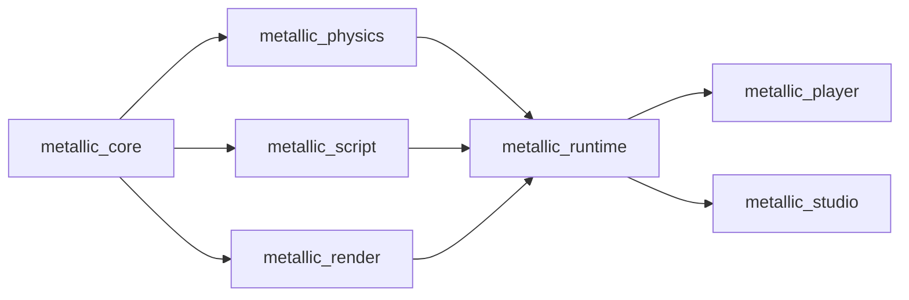

# Architecture

Planned design from the M1 plan; crates appear as their tasks land. When a public interface changes, update this file
and the crate docs in the same PR.

Arrows point from a dependency to its user. Nothing below `runtime` knows about the apps.

## Crates
- **metallic_core** (Task 2): the Roblox-style world. `World` owns a tree of Instances addressed by generational
  `InstanceId`; `Value` (Nil, Bool, Number, String, Vector3, Color3, UDim2, Ref); a class registry (`classes.rs`) with typed
  properties and defaults; `Signal<Args>`; `save_scene`/`load_scene` for the RON text format (one scene per file,
  only non-default properties, stable order). Also `deep_clone()` used by Play.
- **metallic_physics** (Tasks 4-5): `PhysicsWorld` wraps Rapier behind our own interface: `sync_from(&World)`,
  `step(&mut World, dt)` (1/240 s substeps), `velocity`/`angular_velocity`, `raycast`, `drain_touched`. Anchored parts that
  are moved or rotated become kinematic movers (linear + angular velocity). `CharacterController`, `spawn_character`
  and the Humanoid rules (death, respawn, checkpoints) live here.
- **metallic_script** (Tasks 6-7): `ScriptVm` is a sandboxed Luau VM (mlua; time budget, memory cap, forbidden globals,
  `task` library). `ScriptHost` runs server and client scripts over a shared `World`, exposes the Roblox-named API
  (documented in `docs/luau-api.md`) and RemoteEvent delivery. Output goes through `OutputSink`.
- **metallic_render** (Task 3): wgpu renderer. `Renderer::sync(&World)`, `render(target, camera, size)`; instanced shapes,
  PBR materials, cascaded shadows, sky, fog. `RenderContext` is built for a window (player) or from eframe (Studio).
- **metallic_runtime** (Task 8): `Game::load(project_dir)` (reads `metallic.toml`: `name`, `main_scene`) or
  `Game::open(dir, scene, output)` / `Game::from_world(name, world, output)`, then `start`, `frame(&FrameInput, dt)`,
  `render(&mut Renderer, target, size)`, `paint_gui(&egui::Painter)` and `stop`. Ties world, physics, characters,
  scripts, the third-person `CameraController` and the in-game GUI (`gui.rs`: ScreenGui/Frame/TextLabel drawn with an
  egui painter with egui's bundled fonts; their licence texts are in `LICENSES/`).
  `InputState` turns keys, mouse and gamepad into `FrameInput`s without depending on a window library. Shared by
  player and Studio.
- **metallic_player** (Task 8): `metallic-player <project dir> [--scene F] [--headless --frames N] [--quality low|high]
  [--fps] [--capture FRAME:PNG]`; winit window, wgpu surface, egui-wgpu for the GUI pass, gilrs for gamepads, headless
  mode for smoke tests (no window, no GPU).
- **metallic_studio** (Tasks 9-11, 13-14): egui editor: theme, start screen, templates, viewport, Explorer, Properties,
  Output, gizmos, `History` of `Command`s (undo/redo), `PlaySession`, updater, developer mode.
  Updater (Task 13): `updater.rs` and `github_auth.rs` re-export the shared `metallic_update` crate; Studio builds its
  checker with `UpdateChecker::new(STUDIO_FEED, channel, tokens)`. Release pipeline: `tools/release.py`,
  `.github/workflows/release.yml`, `docs/releasing.md`.
- **metallic_update** (Launcher L1 Task 1): no UI. `http.rs` (`HttpClient`, `UreqClient`, redacting `Token`; `get_to_writer` streams a download and drops `Authorization` when a redirect leaves the host), `feed.rs`
  (`ReleaseFeed`, `STUDIO_FEED`, `LAUNCHER_FEED`, `UpdateChecker::check/check_quietly/download/apply_and_restart/apply_after_exit`,
  `latest_asset` -> `ReleaseAsset` (name, API address, SHA-256 from GitHub's `digest`, size), GitHub Releases feed, Velopack for download
  and apply), `download.rs` (`download_verified`: `<name>.part`, size cap, SHA-256 check, rename; failure deletes the part file), `github_auth.rs` (device sign-in, `GithubAuth`) and `secret.rs`
  (`SecretStore`, `MemorySecretStore`, `KeyringSecretStore::new(service, account)`). Shared by Studio and the Launcher.
- **metallic_launcher** (Launcher L1 Tasks 2-3; library plus the `Metallic` program): `deep_link.rs` (`DeepLink::parse/to_uri` for
  `metallic://play|studio/open|open|install`, `PlaceId`, `JoinTicket`, `SitePath`), `site.rs` (`SiteOrigin`, `LauncherConfig::from_args`,
  `is_local_page`), `url_policy.rs` (`UrlPolicy::navigation/new_window/origin_of`), `settings.rs` (`LauncherSettings`, `SettingsStore`).
  Site address: `config/launcher_site_origin.txt`. Task 3 adds, in the library, `local_pages.rs` (`LocalPage`, `OfflineReason`,
  `local_url`, `serve`, `LOCAL_CSP`: the bundled pages in `assets/pages/`, exact file names only), `site_check.rs` (`check_site`,
  `SiteStatus`, `start_page`, `user_agent`) and `app_event.rs` (`AppEvent`, `EventSink`: how other parts talk to the window). The
  program is `main.rs` (start-up order, what to show on failure), `shell.rs` (tao window + wry web view + event loop, thin glue)
  and `platform/` (`windows.rs`: system browser, WebView2 message box, failed-load hook, accelerator keys; `other.rs`: stubs).
  Task 4 adds `bridge.rs` (`Bridge::handle/deliver/event_script`, `BridgeCommand`, `allowed`, `BridgeHost`, `BridgeEvent`,
  `BridgeErrorCode`) and `assets/bridge.js` (`window.metallic`, main frame only): the checked path from a page to the Launcher. Only the
  site (and the development origin) and bundled pages may call it; commands are a typed enum with unknown fields refused, 16 KiB
  message limit, 32 calls in flight, one Player start per 2 s; an answer goes only to a page of the same origin as the asker. The
  shell implements `BridgeHost` (`ShellHost`); the Metallic sign-in answers `notAvailable` until Task 7. A call counts toward the 32
  only while the host runs it (long work goes to background threads and reports by events), never while its answer waits.
  Task 5 adds `single_instance.rs` (hand-over message `HandoffMessage`, `encode`/`decode`, 4096-byte limit checked before the body is
  read; `Acquired`, `HandoffListener`, `HandoffSender`; the Windows pipe is `\\.\pipe\Metallic.Launcher.<user SID>`, first-instance, no remote
  clients, current user only, and a sender checks that the pipe's server runs as the same user before it sends), `protocol.rs` (`register`,
  `unregister`, `is_registered_to`, `UriRegistry`, `MemoryRegistry`; `metallic://` under HKCU only, an installed copy re-registers itself
  on start, a copy run from `target\` never does), `launch.rs` (`Spawner`, `ProductPaths`, `start_player`, `start_studio`) and `tray.rs`
  (`TrayAction`, `tray_menu`, `CloseAction`, `on_close_requested`). The tray icon, pipe, registry and process start are in
  `platform/windows.rs` (`tray-icon` crate, MIT/Apache-2.0; icon only from `branding/`). Every script the shell runs into a page
  (`AppEvent::RunScript`, `Bridge::guard_script`) carries the same in-page `location.origin` guard as bridge replies.
  Task 6 adds `install.rs` (`Installer::install_studio/start_install_studio`: looks up `MetallicStudio-<channel>-Setup.exe` on
  `STUDIO_FEED`, `download_verified` into `%LOCALAPPDATA%\MetallicLauncher\data\Downloads`, runs it with `--silent` through
  `Spawner::spawn_and_wait` only after the SHA-256 matched, deletes it; one install at a time; `ProductStatus`,
  `LauncherUpdateState`, `InstallStatus`, `read_installed_version`, `github_sign_in`) and `self_update.rs` (`SelfUpdater`: check on
  start and every `CHECK_INTERVAL`, background download, `on_quit` applies silently without restart only when `ProcessTracker`
  counts no running Player, `restart_to_update` answers `Busy` instead, a `required` update makes `allow_play` fail with
  `UpdateRequired`; `StartedPlayers`, `UpdateSource`). `settings.rs` gains `channel` (local-only: the site may not change it).
  The tray shows "Restart to update" once an update is downloaded.
  Task 7 adds `platform_auth.rs` (`PlatformAuth`: OAuth device flow against `<site>/v1/oauth/*` with client `metallic-launcher`, scopes
  `profile play`. Only the refresh token is stored (UTF-8 bytes, Credential Manager entry `Metallic`/`platform`, 2560-byte check); the
  access token stays in memory; tokens over 256 bytes are refused; refreshes are serialised, the new refresh token is stored before use.
  `platform_sign_in` answers `{state:"pending"}` at once and a worker emits `signIn` events `pending` (with `userCode`, `verificationUri`),
  then `signedIn|denied|expired|failed`; a second call returns the running flow's code; a signed-in Launcher skips the browser. The
  verification page is opened only if it is https on the site origin. `signOut` forgets the session at once, revokes on a worker.) After
  sign-in `web_session_code` (`POST /v1/oauth/web-session`, single use, 60 s, 3 tries) becomes `AppEvent::Handoff(HandoffUrl)` =
  `<site>/auth/launcher-handoff?code=..`, which the site redeems itself; the code is a redacting `Token`/`HandoffUrl`, never logged.
  `OneAtATime` makes a second `githubSignIn` answer `busy`.
  **Player contract:** `metallic-player.exe <metallic://play?place=<id>&ticket=<ticket>>`: exactly one argument, the canonical link from
  `DeepLink::to_uri`, started without a shell; the Player sits beside `Metallic.exe`. Studio is started with no arguments (a place in
  `metallic://studio/open?place=..` is ignored for now).
  Task 9 (release and hardening): `tools/release.py --app launcher` packs `Metallic.exe` + `metallic-player.exe` as Velopack
  `MetallicLauncher` (`--framework webview2`, channel `launcher-<channel>`, tag `launcher-v<version>-<channel>`; see
  `docs/releasing.md`). `play_limit.rs` (`PlayLimiter`, burst 3 then one per 2 s; `LaunchGate`) is one gate for every program start: Play and
  Studio links (pipe, protocol handler, page clicks, start argument), the bridge `play`/`openStudio` and the tray (the bridge also keeps its own one-per-2-s Play limit). `url_policy::remote_content_allowed`: if
  the WebView2 `FrameNavigationStarting` handler cannot be registered, iframes would be unpoliced, so the Launcher shows the bundled
  offline page and loads no remote page (fail closed). Own data folders (`data_dirs.rs`): `%LOCALAPPDATA%\MetallicLauncher\data` (`Downloads`, `WebView2`) and `%APPDATA%\MetallicLauncher` (settings), never under `Metallic\` (another app may own it); each holds a `.metallic-launcher` marker written when the Launcher creates it, and the uninstall hook deletes only marked folders. Keyring service `MetallicLauncher`. The view starts on `about:blank`; the start page loads only after registration. CI job `launcher-linux-check` compiles the Launcher on Ubuntu.

## Frame loop
`Game::frame(input, dt)` applies camera orbit/zoom, then runs fixed 60 Hz ticks (an accumulator carries the remainder;
`dt` is clamped to 0.25 s), so a headless run of N frames of 1/60 s is deterministic. Each tick:

1. **input -> character controller**: `CharacterController::step` with the camera-relative move wish (Shift sets
   `MoveInput::run`: 1.5 x `Humanoid.WalkSpeed`, which scripts still read unchanged); death, respawn, checkpoints and
   character touches happen here.
2. **physics step**: `PhysicsWorld::step(TICK)` (four 1/240 s substeps; anchored parts moved by scripts become movers).
3. **feed events** to the script host: every `drain_touched` pair as `touched(a, b)` and `touched(b, a)`; a character
   touch as `touched(part, HumanoidRootPart)` so `hit.Parent` is the character Model; `Died` -> `humanoid_died`;
   `Respawned` -> `physics.sync_from` and `character_added(player, model)`.
4. **script step** (`ScriptHost::step`: new scripts, remotes, the inputs above, `RunService.Heartbeat`, resumed waits).
5. **physics re-sync** when the change journal shows a BasePart under Workspace was created, destroyed, reparented or
   reshaped (Size, Shape, Material, Anchored, CanCollide); plain moves need no sync.

Then the camera follows the character (frozen where it died while dead; a ray pulls it in front of walls). The app then
calls `Game::render` (`Renderer::sync` from the change journal, then `render`) and paints the GUI over the 3D view. The
game never holds a `World` borrow while scripts run. `Game::start` runs the scripts (which creates `Player1`), copies
`StarterGui` into the `PlayerGui` once, spawns the character and fires `CharacterAdded`.

## Where to add things
- **A new Instance class or property:** `metallic_core/src/classes.rs` (registry entry with defaults), a test in
  `tests/tree.rs`; the Luau API picks up registry properties by name; Studio's Properties panel too. Add to Insert menu if
  creators should create it.
- **A Luau API member:** `metallic_script/src/api/` (`instance.rs`, `datatypes.rs`, `services.rs`, `remote.rs`), a test
  in `tests/api.rs`, and a line in `docs/luau-api.md`.
- **A material:** the material list in `classes.rs`, its row in `metallic_render/src/materials.rs` (roughness, metalness,
  procedural detail), and density/friction in `metallic_physics`. Test `material_table_has_every_registry_material`
  must still pass.
- **A Studio edit action:** a `Command` in `metallic_studio/src/commands.rs` applied through `History`, never by
  mutating the world directly.

## Quality bar
- Every public item has a `///` doc comment; every crate has a `//!` crate doc.
- Tests sit next to behaviour (write the failing test first).
- No `unwrap()` or `expect()` outside tests; return typed errors (`CoreError`, `ScriptError`, `RuntimeError`, `StudioError`).
- Scripts can never freeze or crash the game: budgets and caps are enforced in `metallic_script`.
- Permissive dependency licences only; `cargo deny check licenses` stays green.
- Benchmarks: criterion benches live in `crates/<crate>/benches/` (`cargo bench -p metallic_core --bench world` exists;
  render sync, physics step and script step follow). Budgets, bench names and the perf-CI plan are in
  `docs/research/2026-10-30-performance-and-scale.md`; record numbers in `docs/agents/`.
