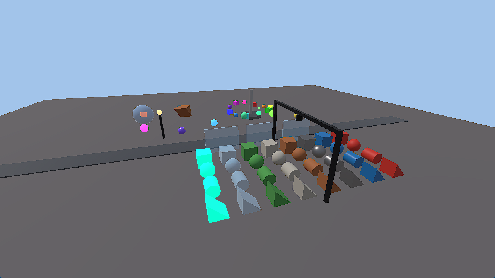

# Metallic

A game engine and platform written in Rust. One engine powers three programs:

- **Studio** — the editor (Windows, Linux, macOS)
- **Player** — runs games, standalone or on the Metallic platform
- **Launcher** — shows the website and runs Player (and Studio on PC) inside itself

Games are built from a class-based API (`Object → Instance → WorldObject → Light → SpotLight`) and scripted in
Luau, with room for more languages. Targets: Windows, Linux, macOS, Android, iOS, PlayStation and Xbox. 3D comes
first; 2D comes later.

> **Status:** the first renderer milestone (M3): a built-in demo game runs in the Player. Projects, Studio and
> physics come later. See the pinned roadmap issue #1.

## Build

You need Rust; `rust-toolchain.toml` picks the exact version.

```bash
cargo build --workspace
cargo test --workspace
```

## Play the demo

The Player runs a built-in demo game in a window: every part shape and material, see-through glass, the three
kinds of light, and a Luau script that moves parts on `Heartbeat` and flies the camera with `UserInputService`.

```bash
cargo run -p metallic_player --release
```



| Control | Does |
|---|---|
| W A S D | move the camera (leaves the automatic orbit) |
| Q / E | down / up |
| Shift | move faster |
| hold the right mouse button | look around |
| arrow keys | look around without a mouse |
| C | back to the automatic orbit |
| Space | pause or resume the moving parts |

Flags (`cargo run -p metallic_player --release -- --help`):

| Flag | Does |
|---|---|
| `--scene <name>` | the built-in game to run: `demo`, or a stress scene (`parts_10k`, `parts_50k`, `parts_100k`, `many_lights`, `overdraw`, `mobile`, `see_through_10k`; see [docs/perf.md](docs/perf.md#stress-scenes)) |
| `--preset <name>` | `low`, `medium`, `high`, `ultra` or `auto`; kept until graphics settings land (#84) |
| `--bench <frames>` | runs that many frames after a 30-frame warm-up, with no frame cap (vsync still paces it), then prints frame times (p50, p99, 1% low), script, physics and render CPU time, GPU time per pass and the draws per pass as JSON on stdout and exits |
| `--overlay` | starts with the performance overlay shown; F3 shows or hides it |

`METALLIC_LOG=info` (or `debug`, ...) shows the engine's logs on stderr.

Light instances are in the scene already; the renderer draws them once the sun and sky (#81) and point and spot
lights (#83) land. Until then one temporary directional light shades everything.

## Layout

```
crates/   the engine: core · classes · script · luau · render · physics · project · platform · engine
apps/     player · studio · launcher
docs/     architecture.md and the decision records (adr/)
xtask/    repository automation (`cargo xtask`)
```

- **New here?** Start with [`docs/architecture.md`](docs/architecture.md).
- **An AI agent or a contributor?** Read [`AGENTS.md`](AGENTS.md) and [`CONTRIBUTING.md`](CONTRIBUTING.md).

## License

See [`LICENSE`](LICENSE). The license is being decided in #27.
