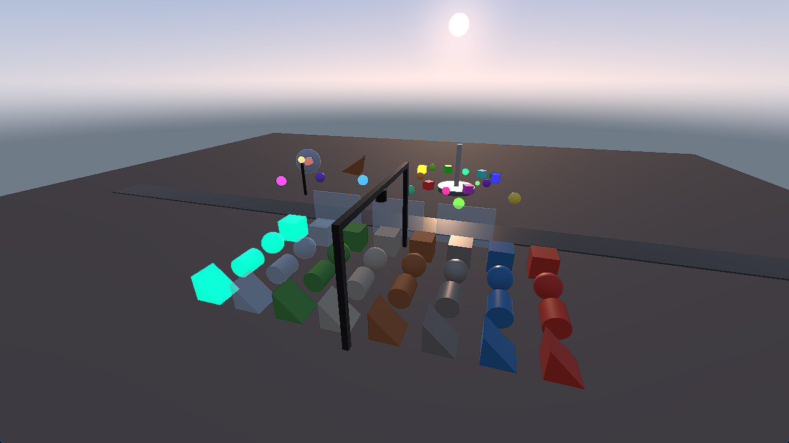
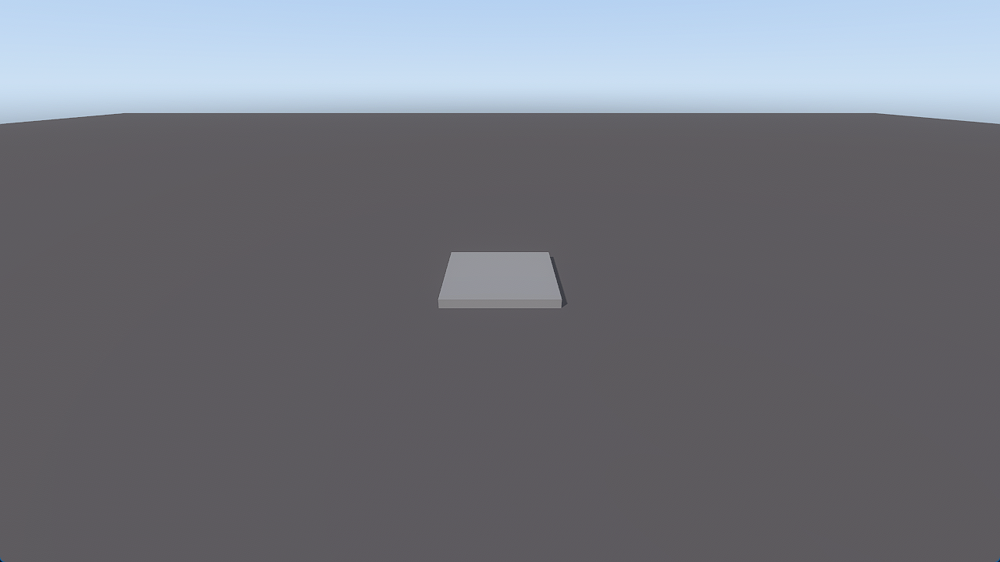

# Metallic

A game engine and platform written in Rust. One engine powers three programs:

- **Studio** — the editor (Windows, Linux, macOS)
- **Player** — runs games, standalone or on the Metallic platform
- **Launcher** — shows the website and runs Player (and Studio on PC) inside itself

Games are built from a class-based API (`Object → Instance → WorldObject → Light → SpotLight`) and scripted in
Luau, with room for more languages. Targets: Windows, Linux, macOS, Android, iOS, PlayStation and Xbox. 3D comes
first; 2D comes later.

> **Status:** the first renderer milestone (M3): a built-in demo game runs in the Player. Projects, Studio and
> physics come later. See the pinned roadmap issue #1.

## Build

You need Rust; `rust-toolchain.toml` picks the exact version.

```bash
cargo build --workspace
cargo test --workspace
```

## Play the demo

The Player runs a built-in demo game in a window: every part shape and material, see-through glass, the three
kinds of light, and a Luau script that moves parts on `Heartbeat` and flies the camera with `UserInputService`.

```bash
cargo run -p metallic_player --release
```



| Control | Does |
|---|---|
| W A S D | move the camera (leaves the automatic orbit) |
| Q / E | down / up |
| Shift | move faster |
| hold the right mouse button | look around |
| arrow keys | look around without a mouse |
| C | back to the automatic orbit |
| Space | pause or resume the moving parts |
| T | time-lapse: a whole day in a minute and a half (again to slow the clock back down) |

Flags (`cargo run -p metallic_player --release -- --help`):

| Flag | Does |
|---|---|
| `--scene <name>` | the built-in game to run: `demo`, or a stress scene (`parts_10k`, `parts_50k`, `parts_100k`, `many_lights`, `overdraw`, `mobile`, `see_through_10k`; see [docs/perf.md](docs/perf.md#stress-scenes)) |
| `--project <file.mtproj>` | runs a project in place of a built-in game: its start scene, with its scripts (below) |
| `--connect <host:port>` | joins a game server as a player (Studio's Multiple Clients and Team Create Play, ADR 0011): WASD walk, Space and Shift up and down, Q and E turn |
| `--name <name>` | the player's name with `--connect` (default `Player`) |
| `--preset <name>` | `low`, `medium`, `high`, `ultra` or `auto` for this run, in place of the settings file's preset (below) |
| `--bench <frames>` | runs that many frames after a 30-frame warm-up, with no frame cap (vsync still paces it), then prints frame times (p50, p99, 1% low), script, physics and render CPU time, GPU time per pass and the draws per pass as JSON on stdout and exits |
| `--overlay` | starts with the performance overlay shown; F3 shows or hides it |

`METALLIC_LOG=info` (or `debug`, ...) shows the engine's logs on stderr.

A project is one `.mtproj` file, a zip archive ([ADR 0006](docs/adr/0006-project-format.md)). Until Studio makes them,
make one from the 3D Baseplate template and play it:

```bash
cargo run -p metallic_project --example new_project -- templates/baseplate-3d MyGame.mtproj
cargo run -p metallic_player --release -- --project MyGame.mtproj
```



Graphics settings live in `graphics.toml` in the user's config folder (`%APPDATA%\metallic\Player\config` on Windows,
`~/Library/Application Support/dev.metallic.Player` on macOS, `~/.config/metallic/player` on Linux), made with the
Auto preset on the first run: the preset and any overrides, one `key = value` a line (every key is listed, commented
out, with the preset's value). A damaged file is ignored with a warning, and Auto is used. See
[docs/perf.md](docs/perf.md#graphics-settings-84).

Light instances are in the scene already; the renderer draws them once the sun and sky (#81) and point and spot
lights (#83) land. Until then one temporary directional light shades everything.

## Open projects in Studio

```bash
cargo run -p metallic_studio -- "My Games/MyGame.mtproj"   # straight to the editor, skipping sign-in and the projects page
```

A project given on the command line (relative or absolute, spaces and all) opens once the splash is done and is added
to Recent. A path with no file, or a file that is not a project, lands on the projects page with the error.

**Double-click to open.** Studio never registers itself for `.mtproj` files on its own. Ask it to, for the current
user only, and it prints each change it made:

```bash
metallic_studio --register-file-types     # .mtproj files open with this metallic_studio executable
metallic_studio --unregister-file-types   # removes what that added
```

| OS | What `--register-file-types` writes |
|---|---|
| Windows | `HKEY_CURRENT_USER\Software\Classes\.mtproj` (default `Metallic.Project`, `Content Type` `application/x-metallic-project`), and `...\Classes\Metallic.Project` (default `Metallic project`) with `DefaultIcon` `"<exe>",0` and `shell\open\command` `"<exe>" "%1"`; then tells Explorer associations changed. Studio's executable has no icon resource yet, so the files show the generic program icon until packaging (M8) adds one. |
| Linux | `~/.local/share/mime/packages/dev.metallic.Studio.xml` (the `application/x-metallic-project` type for `*.mtproj`) and `~/.local/share/applications/dev.metallic.Studio.desktop` (`Exec="<exe>" %f`, `MimeType=application/x-metallic-project;`), under `$XDG_DATA_HOME` if set; then runs `update-mime-database` and `update-desktop-database` if they are installed. |
| macOS | nothing: the app bundle declares the type at packaging (M8), below. |

The executable registered is the one that ran the command, so register an installed or release build, not a `target/`
folder you will clean. To check it by hand: run `metallic_studio --register-file-types`, double-click a `.mtproj` in
Explorer or your file manager, see Studio open it straight in the editor (and in Recent next time), then run
`metallic_studio --unregister-file-types` and see the double-click no longer offers Studio.

For the macOS bundle's `Info.plist` (M8):

```xml
<key>CFBundleDocumentTypes</key>
<array>
  <dict>
    <key>CFBundleTypeName</key>        <string>Metallic project</string>
    <key>CFBundleTypeRole</key>        <string>Editor</string>
    <key>LSHandlerRank</key>           <string>Owner</string>
    <key>LSItemContentTypes</key>      <array><string>dev.metallic.project</string></array>
  </dict>
</array>
<key>UTExportedTypeDeclarations</key>
<array>
  <dict>
    <key>UTTypeIdentifier</key>        <string>dev.metallic.project</string>
    <key>UTTypeDescription</key>       <string>Metallic project</string>
    <key>UTTypeConformsTo</key>        <array><string>public.data</string><string>public.zip-archive</string></array>
    <key>UTTypeTagSpecification</key>
    <dict>
      <key>public.filename-extension</key> <array><string>mtproj</string></array>
      <key>public.mime-type</key>          <string>application/x-metallic-project</string>
    </dict>
  </dict>
</array>
```

A double-clicked file reaches a bundled app as an "open documents" event, not as an argument; handling that event is
part of the packaging work.

## Layout

```
crates/   the engine: core · classes · script · luau · render · physics · project · platform · engine
apps/     player · studio · launcher
docs/     architecture.md and the decision records (adr/)
xtask/    repository automation (`cargo xtask`)
```

- **New here?** Start with [`docs/architecture.md`](docs/architecture.md).
- **An AI agent or a contributor?** Read [`AGENTS.md`](AGENTS.md) and [`CONTRIBUTING.md`](CONTRIBUTING.md).

## License

See [`LICENSE`](LICENSE). The license is being decided in #27.
