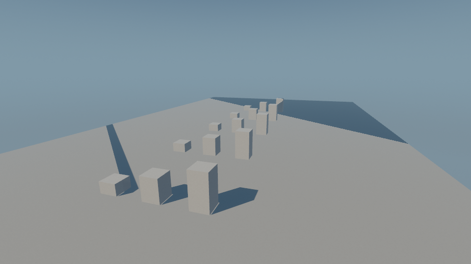
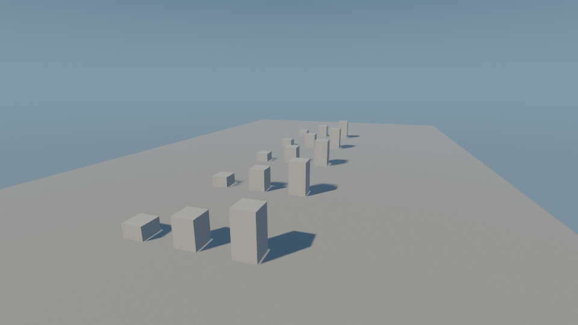

# 426: portable shadow cascade depth

Branch `studio/426-portable-shadow-depth`, pinned main
`8699192791825af0c8c44edb9d833339440cc508`. No dependency change, public API addition,
renderer input/uniform layout change, or upstream implementation copy.

## Problem and fix

WGSL defines fragment `position.w` as interpolated reciprocal vertex clip-w.
Pinned Naga/wgpu 30.0.1 passes native HLSL `SV_Position.w` through without the
normalization needed on DX12. The old `1.0 / in.clip.w` consequently selects the
first shadow cascade at distant surfaces on that backend. This is a translator
compatibility defect, rather than permitted WGSL backend variation.

Both `vs_main` and `vs_skinned` now pass vertex clip-w through a perspective
interpolated `VOut.view_depth` at location 8. Shared `fragment_view_depth` reads that
field in both `fs_main` and `fs_toon`; shared `shadow_cascade` retains strict `<`
split comparisons and the fully lit behavior beyond all cascades. This follows
the existing geometry-prepass approach. Prepass and outline vertex math stay intact.
Nine interstage locations fit the default limit of 16 (downlevel 15).

Primary evidence:

- [WGSL position builtin](https://www.w3.org/TR/2026/CRD-WGSL-20261026/#built-in-values-position)
- [Vulkan FragCoord](https://docs.vulkan.org/refpages/latest/refpages/source/FragCoord.html)
- [D3D functional spec, section 16.3](https://microsoft.github.io/DirectX-Specs/d3d/archive/D3D11_3_FunctionalSpec.htm)
- [Pinned Naga HLSL argument initialization](https://github.com/gfx-rs/wgpu/blob/40f4a34ebaf56f9a046231f54125ad046239d3f3/naga/src/back/hlsl/writer.rs#L906-L954)
- [Upstream report](https://github.com/gfx-rs/wgpu/issues/4963) and [proposed upstream fix](https://github.com/gfx-rs/wgpu/pull/10733)

## Executed regression evidence

All GPU observations used a Windows host with an NVIDIA GeForce RTX 3060 Ti;
the requested DX12 and Vulkan backends were reported by the actual adapters.
`METALLIC_REQUIRE_SHADOW_PROBE=1` made unavailable adapters fail these focused runs.

1. Initial baseline `b3505a5`: production `vs_main` at expected depth 52.96419 /
   cascade 1 produced 0.01888068 / cascade 0 on DX12. Coverage passed; the depth
   assertion failed. Exit 101, one failed test after a successful build.
2. Expanded baseline `e2accef`: both production vertex routes, including actual
   `GpuSkinnedModel` upload and a nonidentity joint through `SkinSlot::write`, ran
   44 numeric observations per backend. All 44 DX12 depth checks failed; all 44
   Vulkan observations passed. The original DX12 test failed and CPU WGSL validation
   passed: two tests passed, two failed. All observations were collected before
   the matrix assertion. The exact split-equality checks themselves passed.
3. Fixed `1894260`: only the shared depth helper return/comment changed from that
   expanded baseline. The entire probe blob remained
   `03cb0b2f24fbcf3057de7bf848924a32ffca51fd`. All four tests passed, including
   both 44-observation matrices, the original DX12 case and CPU shader validation.

The matrices cover both sides of every actual split, the beyond-last count sentinel,
exact uniform equality independently of raster rounding, and tilted triangles with
unequal vertex depths. Their independently calculated perspective oracle differs
substantially from both flat and screen-linear interpolation at each sampled point.
The probe calls the actual production depth/index helpers, rather than copying the
selection algorithm. This is numerical correctness evidence, not a timing result.

The `shadow_depth_capture` example renders the same ground/caster scene with an
explicit backend. All four captures succeeded and were inspected. DX12's false
shadow bands disappear and distant caster shadows return. Vulkan's before/after
PNG files are byte-identical on this fixture. This does not establish cross-backend
pixel identity or cross-vendor coverage.

| DX12 baseline | DX12 fixed |
| --- | --- |
|  |  |

| Vulkan baseline | Vulkan fixed |
| --- | --- |
|  |  |

## Commands and handoff

Use `tools/cargo_lane.py` with owned lane124, `--locked` and four jobs. Focused:

```text
cargo test --locked -p metallic_render --lib renderer::shadow_depth_tests:: -j 4 -- --test-threads=1 --nocapture
cargo run --locked -p metallic_render --example shadow_depth_capture -j 4 -- dx12 OUTPUT.png
cargo run --locked -p metallic_render --example shadow_depth_capture -j 4 -- vulkan OUTPUT.png
```

`METALLIC_SHADOW_PROBE_DIR` optionally writes raw little-endian RGBA32F images and
metadata externally. Pins, hashes, logs and raw images are separately retained under
`integration-evidence/426-portable-shadow-depth`; primary research is under
`integration-evidence/426-shadow-coordinate-audit`.

Root delegated the test module to platform_backend and the capture example to root;
studio_core owns shaders/docs, commits and execution. A pre-execution review caught
the helper's u32 index needing an i32 cast for `shadow_filter`; that correction
preceded GPU execution and is not counted as a runtime reproduction.

PR359 touches no WGSL. PR428 adds a debug-cascade reciprocal consumer and was
[notified after the executed proof](https://github.com/Metallic-Club/studio/pull/428#issuecomment-6546413405)
to use the shared depth helper during integration. No owner branch was edited.

Next: granted full workspace prebuild, serial tests, strict all-target Clippy,
licenses and formatting, then PR and CI review. No milestone or multiplayer
acceptance is implied, and studio_core must not merge its own PR.
