# Lighting presets

Twelve built-in lighting presets (#149). Each is an original look made for Metallic: a set of property values on the
`Lighting` service and its effect children (`Atmosphere`, `Sky`, `Clouds`, `BloomEffect`, `ColorCorrectionEffect`,
`ColorGradingEffect`). Values are in `crates/metallic_core/src/lighting.rs` (`PRESETS`).

- Applying a preset (`metallic_core::lighting::apply_preset`) resets every lighting property to its default, then sets
  the preset's values. Missing children are created; other children of `Lighting` are kept.
- `matching_preset(world)` names the preset a place matches, or none after any edit.
- A new place is Clear Day. A place without an `Atmosphere` child reads the Atmosphere defaults.
- The renderer reads the same properties every `Renderer::sync`, so edits show on the next frame.

Presets set lighting only. Point lights, the Look (art style) and vignette live elsewhere (look-presets design: one home
per parameter).

## Previews

`cargo run -p metallic_render --example lighting_presets -- docs/lighting/presets` renders each preset on the
look-presets reference scene (section 6.1) at 320 x 180 and prints luma mean / p1 / p99 and mean chroma. The PNGs
below are its output and can serve as Studio picker thumbnails (#83).

| Preset | Luma mean | p1 | p99 | Chroma |
|---|---|---|---|---|
| clear-day | 0.555 | 0.181 | 0.694 | 0.111 |
| golden-hour | 0.531 | 0.169 | 0.674 | 0.187 |
| overcast | 0.545 | 0.167 | 0.806 | 0.034 |
| night-city | 0.188 | 0.043 | 0.322 | 0.099 |
| moonlit | 0.288 | 0.057 | 0.466 | 0.081 |
| horror-fog | 0.366 | 0.233 | 0.444 | 0.074 |
| sci-fi-interior | 0.484 | 0.120 | 0.654 | 0.191 |
| cartoon-bright | 0.514 | 0.169 | 0.754 | 0.182 |
| pixel-dusk | 0.464 | 0.087 | 0.683 | 0.243 |
| underwater | 0.487 | 0.316 | 0.643 | 0.247 |
| desert-noon | 0.580 | 0.235 | 0.756 | 0.108 |
| alien-dusk | 0.526 | 0.171 | 0.679 | 0.303 |

`tests/lighting_presets.rs` checks these bounds on every preset: mean luma 0.3 to 0.7 (0.1 to 0.45 for the two night
presets), p99 under 0.95, p99 - p1 over 0.15, p1 under 0.35, mean chroma 0.01 to 0.45, and every pair of presets
differs.

## How properties map to the image

Every Number and Color3 below has a sane range in the class registry; writes outside it (scripts, scene files) are
clamped, and `ClockTime` wraps around 24.

- `ClockTime`, `GeographicLatitude`: sun position (equinox; +X east, +Z south). The sky, sun colour, sun strength
  and metered exposure come from the per-elevation table in `docs/agents/37-lighting/m1_sky_table.md`. Below -1
  degrees the moon lights the scene (`MoonBrightness`), with stars (`Sky.StarCount`).
- `Brightness` scales the sun; `ExposureCompensation` is in stops. `NightAdaptation` keeps night darker and bluer.
- `Ambient` (flat, everywhere) and `OutdoorAmbient` (from the sky) add fill light relative to exposure: 255 adds
  half of a metered mid-tone, so the same value reads the same by day and by night. `ColorShift_Top` adds to the
  sun's colour, `ColorShift_Bottom` to the light bounced up from the ground. `EnvironmentDiffuseScale` and
  `EnvironmentSpecularScale` scale sky fill and reflections.
- `GlobalShadows` turns sun shadows on or off; `ShadowSoftness` widens the shadow filter.
- `LightingStyle` `Soft` wraps diffuse light around shapes, softens shadows (at least 0.35) and picks the Neutral
  curve.
- `FogColor`, `FogStart`, `FogEnd`: linear distance fog (off at `FogEnd` 100000).
- `Atmosphere`: height fog. `Density` and `Haze` set thickness, `HeightFalloff` and `FogHeight` its shape, `Color`
  the lit fog toward the sun, `Decay` away from it, `Glare` the glow around the sun, `Absorption` light lost per
  colour, `AirColor` the clear-sky tint, `Offset` how much fog covers the sky.
- `Clouds.Cover` dims the sun, turns the sky an even grey of `Clouds.Color` and softens shadows.
- `BloomEffect` drives the bloom post pass (absent: 0.04 / 24 / 0; disabled: off).
- `ColorCorrectionEffect`: brightness, contrast, saturation, tint in the finish pass.
- `ColorGradingEffect.TonemapperPreset`: `Default` (AgX Punchy; Neutral when `LightingStyle` is Soft), `AgX`,
  `Neutral`, `ACES`, `Filmic`, `Retro` (clamp).

## The presets

### Clear Day (`clear-day`)

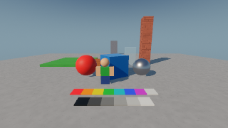

Crisp mid-afternoon sun, blue sky, light haze. The default for new places.

All defaults.

### Golden Hour (`golden-hour`)

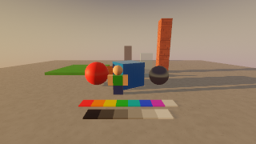

Low warm sun an hour before sunset, long soft shadows with a violet fill.

| Object | Property | Value |
|---|---|---|
| Lighting | ClockTime | 17.25 |
| Lighting | Brightness | 1.15 |
| Lighting | ExposureCompensation | 0.2 |
| Lighting | OutdoorAmbient | (18, 14, 34) |
| Lighting | ShadowSoftness | 0.3 |
| Atmosphere | Density | 0.3 |
| Atmosphere | Color | (235, 200, 160) |
| Atmosphere | Decay | (110, 100, 130) |
| Atmosphere | Glare | 4 |
| Atmosphere | Haze | 1.5 |
| BloomEffect | Intensity | 0.06 |
| ColorCorrectionEffect | Saturation | 0.05 |

### Overcast (`overcast`)

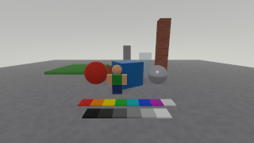

Even grey daylight under full cloud: no hard shadows, quiet colour.

| Object | Property | Value |
|---|---|---|
| Lighting | ClockTime | 13 |
| Lighting | ExposureCompensation | 0.2 |
| Lighting | ShadowSoftness | 1 |
| Atmosphere | Density | 0.32 |
| Atmosphere | Color | (205, 208, 214) |
| Atmosphere | Decay | (150, 156, 166) |
| Atmosphere | Glare | 0 |
| Atmosphere | Haze | 2 |
| Atmosphere | HeightFalloff | 0.012 |
| Clouds | Cover | 0.9 |
| ColorGradingEffect | TonemapperPreset | Neutral |
| BloomEffect | Intensity | 0.02 |
| ColorCorrectionEffect | Contrast | 0.1 |
| ColorCorrectionEffect | Saturation | 0.1 |

### Night City (`night-city`)

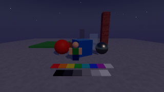

Late evening under a violet city glow; fog lit from below, few stars.

| Object | Property | Value |
|---|---|---|
| Lighting | ClockTime | 22.5 |
| Lighting | Ambient | (62, 52, 82) |
| Lighting | OutdoorAmbient | (12, 12, 22) |
| Lighting | NightAdaptation | 0.5 |
| Lighting | MoonBrightness | 0.5 |
| Atmosphere | Density | 0.4 |
| Atmosphere | Color | (118, 108, 132) |
| Atmosphere | Decay | (58, 54, 78) |
| Atmosphere | Glare | 1 |
| Atmosphere | Haze | 3 |
| Atmosphere | HeightFalloff | 0.01 |
| Sky | StarCount | 300 |
| BloomEffect | Intensity | 0.08 |
| ColorCorrectionEffect | Saturation | -0.1 |

### Moonlit (`moonlit`)

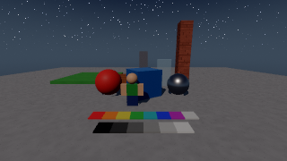

Full moon on a clear night: cool silver light, crisp shadows, many stars.

| Object | Property | Value |
|---|---|---|
| Lighting | ClockTime | 1 |
| Lighting | ExposureCompensation | 0.6 |
| Lighting | ShadowSoftness | 0.15 |
| Lighting | MoonBrightness | 1.5 |
| Atmosphere | Density | 0.15 |
| Atmosphere | Glare | 1 |
| Atmosphere | Haze | 0.5 |
| Sky | StarCount | 5000 |
| BloomEffect | Intensity | 0.05 |

### Horror Fog (`horror-fog`)

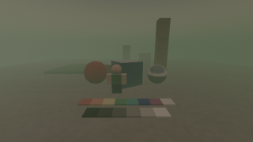

Dusk swallowed by thick green-grey fog; drained colour, nothing far is safe.

| Object | Property | Value |
|---|---|---|
| Lighting | ClockTime | 18.15 |
| Lighting | Brightness | 0.4 |
| Lighting | ExposureCompensation | -0.3 |
| Lighting | ShadowSoftness | 0.8 |
| Atmosphere | Density | 0.9 |
| Atmosphere | Offset | 0 |
| Atmosphere | Color | (140, 172, 146) |
| Atmosphere | Decay | (58, 84, 70) |
| Atmosphere | Glare | 0 |
| Atmosphere | Haze | 5 |
| Atmosphere | HeightFalloff | 0.05 |
| Sky | StarCount | 0 |
| ColorGradingEffect | TonemapperPreset | AgX |
| BloomEffect | Intensity | 0.03 |
| ColorCorrectionEffect | Contrast | 0.15 |
| ColorCorrectionEffect | Saturation | -0.45 |

### Sci-fi Interior (`sci-fi-interior`)

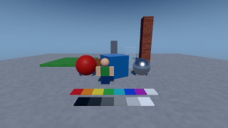

Clean, cool halls: soft overhead light, steel-blue fill, no haze.

| Object | Property | Value |
|---|---|---|
| Lighting | ClockTime | 12 |
| Lighting | Brightness | 0.55 |
| Lighting | ExposureCompensation | 0.2 |
| Lighting | Ambient | (64, 78, 104) |
| Lighting | EnvironmentDiffuseScale | 0.5 |
| Lighting | ShadowSoftness | 0.35 |
| Atmosphere | Density | 0 |
| ColorGradingEffect | TonemapperPreset | Neutral |
| BloomEffect | Intensity | 0.07 |
| ColorCorrectionEffect | Contrast | 0.08 |
| ColorCorrectionEffect | Saturation | -0.12 |

### Cartoon Bright (`cartoon-bright`)

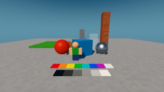

Toy-box noon: saturated colour, soft wrap light, lifted shadows, no grime.

| Object | Property | Value |
|---|---|---|
| Lighting | ClockTime | 13 |
| Lighting | Brightness | 1.2 |
| Lighting | ExposureCompensation | -0.3 |
| Lighting | OutdoorAmbient | (40, 44, 64) |
| Lighting | ColorShift_Top | (20, 12, 0) |
| Lighting | EnvironmentDiffuseScale | 0.7 |
| Lighting | ShadowSoftness | 0.05 |
| Lighting | LightingStyle | Soft |
| Atmosphere | Density | 0.12 |
| Atmosphere | Offset | 0.5 |
| Atmosphere | Glare | 1 |
| Atmosphere | Haze | 0 |
| Atmosphere | AirColor | (90, 170, 255) |
| ColorGradingEffect | TonemapperPreset | Neutral |
| BloomEffect | Intensity | 0.02 |
| ColorCorrectionEffect | Saturation | 0.2 |

### Pixel Dusk (`pixel-dusk`)

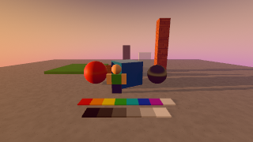

Peach light, violet shadows, hard edges and a big sun, for pixel styles.

| Object | Property | Value |
|---|---|---|
| Lighting | ClockTime | 17.55 |
| Lighting | OutdoorAmbient | (40, 22, 72) |
| Lighting | ShadowSoftness | 0 |
| Atmosphere | Color | (255, 176, 130) |
| Atmosphere | Decay | (110, 80, 160) |
| Atmosphere | Glare | 3 |
| Atmosphere | Haze | 1.5 |
| Sky | SunAngularSize | 4 |
| ColorGradingEffect | TonemapperPreset | Neutral |
| BloomEffect | Intensity | 0 |
| ColorCorrectionEffect | Saturation | 0.1 |

### Underwater (`underwater`)

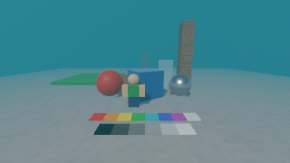

Teal water that eats red light and swallows distance; soft sun from above.

| Object | Property | Value |
|---|---|---|
| Lighting | ClockTime | 13 |
| Lighting | Brightness | 0.6 |
| Lighting | ExposureCompensation | 0.3 |
| Lighting | ShadowSoftness | 0.6 |
| Atmosphere | Density | 0.9 |
| Atmosphere | Offset | 0 |
| Atmosphere | Color | (50, 180, 175) |
| Atmosphere | Decay | (12, 78, 92) |
| Atmosphere | Glare | 0 |
| Atmosphere | Haze | 0 |
| Atmosphere | HeightFalloff | 0 |
| Atmosphere | Absorption | (230, 90, 40) |
| Sky | StarCount | 0 |
| ColorGradingEffect | TonemapperPreset | AgX |
| BloomEffect | Intensity | 0.06 |
| ColorCorrectionEffect | Saturation | 0.05 |

### Desert Noon (`desert-noon`)

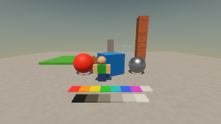

Hard high sun at low latitude: short black shadows, bleached warm haze.

| Object | Property | Value |
|---|---|---|
| Lighting | ClockTime | 12.3 |
| Lighting | GeographicLatitude | 25 |
| Lighting | Brightness | 1.5 |
| Lighting | ExposureCompensation | -0.4 |
| Lighting | ShadowSoftness | 0.1 |
| Atmosphere | Color | (240, 214, 176) |
| Atmosphere | Decay | (170, 152, 132) |
| Atmosphere | Glare | 3 |
| Atmosphere | Haze | 2.5 |
| ColorCorrectionEffect | Contrast | 0.08 |
| ColorCorrectionEffect | Saturation | 0.05 |

### Alien Dusk (`alien-dusk`)

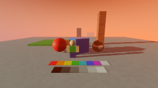

Sunset on another world: amber sky, teal shade, a cold blue glow toward the sun.

| Object | Property | Value |
|---|---|---|
| Lighting | ClockTime | 17 |
| Lighting | OutdoorAmbient | (40, 120, 130) |
| Lighting | EnvironmentDiffuseScale | 0.35 |
| Lighting | ColorShift_Top | (0, 120, 255) |
| Atmosphere | Density | 0.22 |
| Atmosphere | Color | (120, 190, 255) |
| Atmosphere | Decay | (190, 120, 80) |
| Atmosphere | Glare | 6 |
| Atmosphere | Haze | 3 |
| Atmosphere | AirColor | (255, 170, 110) |
| BloomEffect | Intensity | 0.06 |

