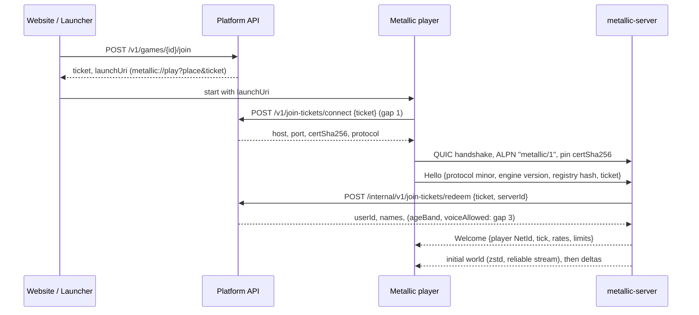

# Metallic M2 networking: research and design

Date: 2026-10-30. Status: proposal for the owner (issue #156, epic #15). Docs only; no code changed.

Scope: everything milestone 2 needs on the wire. Transport and handshake, the `metallic_net` protocol, replication,
the character over the network, RemoteEvents between real processes, the headless `metallic-server`, Studio's
multi-process test, Team Create, voice, network testing, and a phased plan with issue-sized items.

How to read the labels:
- **Sourced**: I fetched the page, or a search result states it. The URL is in the text and again in section 15.
- **Judgment**: my reasoning from sourced facts or general engineering knowledge I could not confirm with a page today.
- **Assistant's call**: a decision I made while the owner was away. Section 14 lists them all so the owner can
  overturn any of them.

It builds on: the design spec (section 6, milestone 2), the platform architecture
document `docs/research/2026-10-30-platform-architecture.md` (Game Server, matchmaker, join tickets, editor protocol,
Team Create as an edit-mode session), the performance document `docs/research/2026-10-30-performance-and-scale.md`
(section 3.5 network budgets), the platform API `api/openapi.yaml` on `Metallic-Club/plateform` branch
`platform/p1-backend` (version 0.1.1), and the current crates on `main` plus `studio/7-luau-api`.

---

## 0. Decisions in short

| # | Topic | Decision | Label |
|---|-------|----------|-------|
| 1 | Transport | QUIC through `quinn` 0.11 (MIT OR Apache-2.0) with `rustls` and the `ring` provider. Reliable data on QUIC streams, unreliable data on QUIC datagrams (RFC 9221) | Assistant's call |
| 2 | Encryption and identity | TLS 1.3 inside QUIC. Each server process makes a fresh ECDSA P-256 certificate (`rcgen`), valid for 13 days (WebTransport requires under 14); the client pins its SHA-256 hash, which it gets from the platform with the join ticket. Same rule as WebTransport `serverCertificateHashes`, so web clients can join later | Assistant's call |
| 3 | Join | Platform join ticket (single use, 60 s) goes in the first message; the server redeems it at `/internal/v1/join-tickets/redeem` before it admits the player | Sourced API + Assistant's call |
| 4 | Wire format | `postcard` (stable, documented format) for reliable messages; a hand-written bit-packed format for snapshots and inputs; `zstd` for large reliable payloads | Assistant's call |
| 5 | Replication model | Server authority for everything. Reliable ordered event stream for the Instance tree (create, destroy, reparent, property changes, remotes); unreliable delta snapshots for moving transforms at 30 Hz, delta-coded against the last acknowledged snapshot (Quake 3) and filled by a priority accumulator (Fiedler) | Assistant's call |
| 6 | Tick rates | Server simulation 60 Hz fixed; snapshots 30 Hz; client inputs every tick, sent 30 times a second with redundancy | Assistant's call |
| 7 | Character | Client predicts its own character with the same `CharacterController` code and reconciles against the server (Gambetta, Overwatch); other characters are interpolated about 100 ms behind; lag-compensated raycasts for the FPS template | Assistant's call |
| 8 | Network ownership | No client ownership of physics in M2. Server owns every body. Opt-in client ownership for vehicles comes later with server checks | Assistant's call |
| 9 | Interest management | Grid cells on the XZ plane from M2a for snapshots; full StreamingEnabled (min 64, target 1,024 studs, Roblox's defaults) in M2e | Assistant's call |
| 10 | Remotes | Roblox semantics: RemoteEvent reliable and ordered, UnreliableRemoteEvent dropped above 1,000 bytes, RemoteFunction yields. Limits and the over-limit rule (queue 1 s, then drop) are defined once, in section 6.3 | Sourced + Assistant's call |
| 11 | Server process | One sandboxed `metallic-server` process per match; registers, heartbeats and stops through the platform's internal API; crash means the match ends and players get a Rejoin button | Assistant's call |
| 12 | Studio | In-process Play stays. "Server and Clients" spawns one server and N players on localhost with local tickets; a localhost editor link carries commands | Assistant's call |
| 13 | Team Create | Server-ordered operation log with last-writer-wins per property (Figma's model), not a CRDT for the tree. Script text: edit locks in M2d, live co-editing with `yrs` (MIT) text CRDT later | Assistant's call |
| 14 | Voice | Opus, 48 kHz mono, 20 ms frames, about 24 kbit/s, carried as QUIC datagrams through the game server, which forwards without decoding (an SFU, no mixing). The server picks the nearest few speakers per listener for proximity voice; clients decode and place them in 3D. Off for under-13 accounts and until age assurance exists | Assistant's call |
| 15 | Testing | An in-memory transport with a seeded link conditioner (latency, jitter, loss, reorder, duplication, bandwidth cap) runs in `cargo test`; bots, fuzzers and a nightly soak run on top | Assistant's call |

---

## 1. What we start from

### 1.1 Engine code today (read on `main` at `d004bc5` and on `studio/7-luau-api`)

- `metallic_core::World` has a change journal: `change_cursor()` and `changes_since(cursor)` return the ids changed
  since a cursor, or `Changes::Overflow` when the journal (16,384 entries, halved on overflow) no longer reaches back.
  The journal stores **ids only**: it does not say which property changed or whether the change was a create, destroy
  or reparent. Replication needs that detail (section 4.2).
- `InstanceId` is a generational slot. It is meaningful only inside one process, so the wire needs its own id.
- The class registry has Players, ReplicatedStorage, ServerScriptService, StarterPlayer, StarterPlayerScripts,
  StarterGui, Lighting, RunService, Folder, Model, Part, SpawnLocation, Script, LocalScript and RemoteEvent. No
  ServerStorage, ReplicatedFirst, ModuleScript, RemoteFunction or UnreliableRemoteEvent yet.
- `metallic_script` (branch `studio/7-luau-api`, `api/remote.rs`): `FireServer`, `FireClient`, `FireAllClients`.
  Arguments become a VM-independent `Wire` value (nil, bool, number, string, Vector3, Color3, UDim2, Instance, table)
  with limits: 32 arguments, 10,000 values, 1 MiB of string bytes, table depth 16, 1,000 queued messages and 16 MiB
  queued per VM. Functions, cycles and unknown userdata are refused. `Wire` is the right seed for the network
  encoding.
- `ScriptHost` runs both VMs over **one shared** `Rc<RefCell<World>>` and creates one local player, `Player1`. In M2
  the server VM and the client VM live in different processes with different worlds. Any M1 game logic that relies on
  the client seeing server-only state, or on client writes reaching the server, breaks. Parkour must be audited.
- `metallic_physics::CharacterController::step(world, physics, character, MoveInput, dt)` moves a kinematic capsule.
  Its per-character `Motion` (state, vertical speed, inherited velocity, ground part, yaw, death timer, velocity) is
  private. Prediction needs to save and restore it (section 5.1).
- Avatar parts are Anchored and placed by the controller each step. Replicating them as ordinary parts would send
  seven transforms per character per tick; section 4.3 sends the root only.
- The performance document plans one Rapier step per frame with four solver substeps and an accumulator. M2 needs a
  fixed 60 Hz tick on the server and in client prediction.

### 1.2 Budgets already set (performance document, section 3.5)

Server tick 60 Hz; snapshots 20-30 Hz with interpolation two snapshots behind; client download 50 KB/s typical,
100 KB/s peak; upload 10 KB/s; at most 0.2 KB/s per moving part at 20 Hz; RemoteEvent 500 per second per client;
streaming radii 64 and 1,024 studs; server replication budget 3.0 ms of each 16.7 ms tick; join in 5 s warm,
10 s cold. This document keeps those numbers and adds voice on top (section 3.6).

### 1.3 Platform API today (`openapi.yaml` 0.1.1, Sourced by reading the file)

- `POST /v1/games/{gameId}/join` returns `{ticket, launchUri, placeId, expiresAt}`. The ticket is single use, lives
  60 seconds and is bound to the user, the place and, once chosen, the server. `launchUri` is
  `metallic://play?place=...&ticket=...`. The API never exposes server addresses.
- `POST /internal/v1/servers` (register: gameId, placeId, region, maxPlayers up to 200) returns `serverId` and
  `heartbeatIntervalSecs`. `POST .../heartbeat` sends the authoritative player list, `joinable`, and
  `status: running | draining`; a server silent for 30 s is stopped and gets 410. `POST .../stop` ends it.
- `POST /internal/v1/join-tickets/redeem {ticket, serverId}` returns `userId, username, displayName, gameId, placeId`;
  409 for a ticket meant for another server, 410 for expired or used.
- Internal calls use one shared header secret, `X-Metallic-Server-Secret` (`METALLIC_SERVER_SECRET`).
- `AgeBand` is `under_13 | 13_15 | 16_17 | adult | unknown`; under-13 accounts stay `limited` until a parent confirms.

**Gaps the platform team needs to close for M2** (I do not touch `plateform` from here; the lead should raise these):

1. **No way for the Player to learn where to connect.** The ticket carries no address and the API has no endpoint
   that turns a ticket into one. Proposal: `POST /v1/join-tickets/connect` (bearer token, body `{ticket}`) returns
   `{serverId, host, port, certSha256, protocol, expiresAt}`. Addresses stay out of URIs, browser history and logs.
2. **Register lacks connection facts.** Add `host`, `port`, `certSha256`, `protocolMajor`, `engineVersion` and
   `kind: play | edit | test` to `registerGameServer`, and let a re-register rotate `certSha256`.
3. **Redeem should return what the server must enforce:** `ageBand`, `voiceAllowed`, `chatAllowed`,
   `isPlaceEditor`, and `accountStatus`. The server cannot call public endpoints for these.
4. **Team Create routing:** an endpoint that finds or starts the edit server for a place and issues an edit ticket
   (`kind: edit`), with Owner/Edit/Play permissions like Roblox's (Sourced, Roblox collaboration page).
5. **In-game reports:** an internal endpoint to file a report with a short voice or chat excerpt (section 10).
6. **Per-server credentials** instead of one shared secret, so one leaked host cannot impersonate the fleet.
   Judgment; a short-lived token per server from the host agent is enough.

---

## 2. Transport, crates, handshake, encryption

### 2.1 What the research says

- **Quake 3** sends nearly everything unreliably: the server keeps the last 32 snapshots per client, deltas each new
  one against the last snapshot the client acknowledged, and falls back to a full update when no baseline exists. A
  separate guaranteed path carries rare critical messages. Messages are split into 1,400-byte chunks to avoid IP
  fragmentation (Sourced: [Fabien Sanglard on Quake 3](https://fabiensanglard.net/quake3/network.php)).
- **Glenn Fiedler** builds reliability per message, not per packet: every packet carries `sequence`, `ack` and a
  32-bit `ack_bits`, so each ack is repeated 32 times; unacked messages ride along in later packets and are resent at
  most every 0.1 s (Sourced: [Reliable ordered messages](https://gafferongames.com/post/reliable_ordered_messages/)).
- **netcode.io** defines a connect token issued by the web backend over HTTPS: a private part encrypted with
  XChaCha20-Poly1305 under a key shared by backend and servers (client id, timeout, up to 32 server addresses, two
  32-byte session keys, 256 bytes of user data) and a public part. Its handshake is request, challenge, response, so a
  spoofed address never completes it, and every server reply is smaller than the request, which blocks amplification.
  Tokens are single use; packets use per-direction keys with the sequence number as nonce and a 256-entry replay
  window (Sourced: [netcode STANDARD.md](https://github.com/networkprotocol/netcode/blob/main/STANDARD.md)).
- **QUIC datagrams (RFC 9221)** are encrypted, congestion controlled, never retransmitted and never fragmented; their
  size is bounded by the path MTU. The RFC names gaming as a use case (Sourced:
  [RFC 9221](https://www.rfc-editor.org/rfc/rfc9221.html)).
- **quinn** exposes `send_datagram` ("unreliable, unordered"), which may discard older queued datagrams to make room;
  `max_datagram_size`; cheap `open_uni`/`open_bi` streams; `rtt()`; and client address migration when the server
  enables it (Sourced: [quinn Connection docs](https://docs.rs/quinn/latest/quinn/struct.Connection.html)). QUIC removes
  head-of-line blocking between streams but not within one (Sourced, search result citing a patent filing; the
  property follows from RFC 9000's stream model, Judgment).
- **s2n-quic** (Apache-2.0) also supports datagrams but drops oversize ones and alternates between stream and
  datagram queues, so a busy stream can delay datagrams (Sourced: search result from the s2n-quic docs).
- **Hytale** (early access January 2026) is reported to run QUIC over UDP only, port 5520 (Sourced, hosting-provider
  guides only; no official spec found). It shows a shipped voxel sandbox chose QUIC; treat the detail as unconfirmed.
- **WebTransport** shipped in Safari 26.4 (March 2026) and is in Chrome and Firefox, so it is Baseline Newly Available
  (Sourced: [web-features explorer](https://web-platform-dx.github.io/web-features-explorer/features/webtransport)).
  A pinned certificate must be X.509v3, ECDSA P-256, valid under two weeks, hashed with SHA-256 (Sourced:
  [MDN WebTransport constructor](https://developer.mozilla.org/en-US/docs/Web/API/WebTransport/WebTransport)). An open
  bug reports Safari failing with `serverCertificateHashes` against one server stack (Sourced:
  [hyperium/h3 #347](https://github.com/hyperium/h3/issues/347)).

### 2.2 Crates compared (licences and versions from the crates.io API today)

| Crate | Version, licence | What it gives | Fit |
|-------|------------------|---------------|-----|
| `quinn` | 0.11.12, MIT OR Apache-2.0; 386 M downloads | QUIC: TLS 1.3, congestion control, streams, datagrams, migration. Needs an async runtime (tokio) | **Chosen** |
| `quinn-proto` | 0.11.19, same | quinn without I/O (we drive it from our own loop) | Fallback if the tokio thread hop shows up in profiles |
| `s2n-quic` | 1.91.0, Apache-2.0 | AWS QUIC, GSO, PMTU discovery | Good, but heavier and datagram scheduling shares a queue with streams |
| `renet` + `renetcode` | 2.0.0, MIT OR Apache-2.0 | Game channels (ReliableOrdered, ReliableUnordered, Unreliable), netcode.io tokens, fragmentation; Bevy optional (Sourced: [renet README](https://github.com/lucaspoffo/renet)) | Strong runner-up; no WebTransport in renet itself (`renet2` 1.0.0 adds it) |
| `naia` | 0.25.0, MIT OR Apache-2.0 | Entity replication, rooms and per-user scope, delegated client authority, tick-buffered input channel; ECS-agnostic; UDP and browser WebRTC; native mobile "not yet supported" (Sourced: [naia README](https://github.com/naia-lib/naia)) | Ideas only; its entity model is not our Instance tree |
| `lightyear` | 0.31.0, MIT OR Apache-2.0 | Prediction, rollback, interpolation, lag compensation, priority with bandwidth caps, input redundancy | Built for Bevy (Sourced: [lightyear README](https://github.com/cBournhonesque/lightyear)); the spec bans engine crates. Ideas only |
| `laminar` | 0.5.0, MIT/Apache-2.0, last release 2021 | Reliable UDP | Unmaintained; rejected |
| `wtransport` / `web-transport-quinn` | 0.7.2 / 0.13.5, MIT OR Apache-2.0 | WebTransport servers on quinn | For a future web client; same QUIC stack |
| `rustls`, `ring`, `rcgen` | 0.23.46 (Apache-2.0 OR ISC OR MIT), 0.17.14 (Apache-2.0 AND ISC), 0.14.10 (MIT OR Apache-2.0) | TLS, crypto, certificate generation | Pass our `deny.toml`. `aws-lc-rs` also passes but builds C and adds a long licence list; use `ring` |
| `postcard` | 1.1.3, MIT OR Apache-2.0 | serde format with a written wire spec (1.0 stable) | Reliable messages |
| `bitcode` | 0.6.9, MIT OR Apache-2.0 | Compact serde format | Format may change between versions; not for a versioned protocol |
| `zstd` / `lz4_flex` | 0.14.3 BSD-3-Clause / 0.14.0 MIT | Compression | `zstd` for join and stream-in payloads |

### 2.3 Why QUIC and quinn (Assistant's call)

1. We need encryption, congestion control, a handshake that resists spoofing, reliable streams without head-of-line
   blocking between them, and unreliable datagrams. QUIC gives all five in one audited stack. Writing them on raw
   UDP (the renet route) is possible and lighter, but the team is four people and the crypto would be ours to get
   right.
2. The same stack serves a future browser client through WebTransport (`wtransport` sits on quinn) and the Team
   Create and editor links.
3. QUIC's connection IDs survive a client address change (Wi-Fi to cellular, NAT rebinding) when the server enables
   migration. Mobile clients follow M2.
4. quinn is the most used Rust QUIC (386 M downloads), pure Rust, permissive.

Costs we accept: QUIC's congestion controller can hold back datagrams on a bad link. That is correct behaviour (the
link is full), and our priority accumulator adapts by sending less. About 50 bytes of header and tag per packet
(Judgment: IP 20 + UDP 8 + QUIC short header about 6-12 + AEAD tag 16). tokio as a dependency.

Shape in code: one network thread per process runs a tokio current-thread runtime and quinn. It hands decoded
messages to the 60 Hz simulation thread through bounded channels and takes outgoing packets back the same way. The
simulation never awaits. A `Transport` trait hides quinn, so the in-memory test transport (section 11) and a later
`quinn-proto` driver can replace it.

UDP blocked? Some school and office networks block UDP. QUIC then fails. A fallback through TCP/TLS (WebTransport
over HTTP/2 is reliable-only and allowed by the spec, Sourced W3C draft) is a later item; M2 shows a clear "Your
network blocks game traffic (UDP)" message instead of a generic failure.

### 2.4 Join and handshake



Rules:
- The ticket is a bearer secret for 60 s. Never log it; redact it in crash reports.
- QUIC's own address validation (Retry tokens) protects the server from spoofed floods before TLS. quinn supports
  Retry; enable it when a server is under load (Judgment).
- The server admits a connection only after redeem returns 200; until then it accepts no other message and closes the
  connection after 5 s.
- **Version checks:** the protocol major is in the ALPN (`metallic/1`), so a mismatch fails during the TLS handshake.
  `Hello` also carries the protocol minor, the engine version and a hash of the class registry (classes, property
  names, types, order). A different registry hash means the Player must update; the server answers `UpdateRequired`.
  The fleet runs the current release; on a new release old servers report `status: draining` and close when empty.
- **Certificates:** each server process generates its key pair at start (`rcgen`, ECDSA P-256), validity 13 days,
  and registers the SHA-256 hash. The client accepts exactly that certificate (a custom rustls verifier that checks
  the hash and the validity window), no CA. Processes live hours, not weeks, so rotation is "start a new process".
  A web client later uses the same hash through `serverCertificateHashes`.
- **Local and Studio:** `metallic-server --local` accepts tickets signed with HMAC-SHA256 under a random 32-byte
  secret that Studio passes through an environment variable. No platform call.

---

## 3. The `metallic_net` protocol

A new crate `metallic_net` holds message types, encoders, the channel layer, the link conditioner and the replication
logic shared by client and server. It depends on `metallic_core`; `metallic_script` gains a small conversion between
its `Wire` value and the network value type.

### 3.1 Channels

| Channel | QUIC mapping | Direction | Carries |
|---------|--------------|-----------|---------|
| `Control` | bidirectional stream 0, reliable ordered | both | Hello, Welcome, Kick, UpdateRequired, time sync, settings changes, Studio test commands |
| `World` | one long-lived uni stream, reliable ordered | server to client | Instance create, destroy, reparent, property changes, RemoteEvent `FireClient`/`FireAllClients`, RemoteFunction results, chat |
| `Remote` | one long-lived uni stream, reliable ordered | client to server | `FireServer`, `InvokeServer`, `InvokeClient` replies, chat |
| `Bulk` | one short uni stream per payload, reliable, unordered between payloads | server to client | Join snapshot chunks, stream-in regions (M2e), script sources when large |
| `Snapshot` | datagrams, sequenced (older dropped) | server to client | Transform deltas, own-character state, input acks, server tick |
| `Input` | datagrams, sequenced | client to server | Inputs with redundancy, snapshot acks |
| `UnreliableRemote` | datagrams, sequenced per remote | both | UnreliableRemoteEvent |
| `Voice` | datagrams | both | Opus frames (section 10) |

Remotes from server to client share the `World` stream with tree changes on purpose: a `FireClient` that passes a
Part created a moment earlier always arrives after that Part. Roblox documents that RemoteEvents keep firing order
even across different RemoteEvent instances, and that RemoteFunction order relative to RemoteEvents is not guaranteed
(Sourced: [Roblox remote events](https://create.roblox.com/docs/scripting/events/remote)). We match the first and
give the stronger guarantee for free.

Stream priorities (quinn supports per-stream priority): `Control` highest, then `World`/`Remote`, then `Bulk`.

"Sequenced" means each datagram carries a 16-bit sequence and the receiver drops anything older than the newest one
it has applied. Roblox's UnreliableRemoteEvent makes no ordering promise (Sourced, same page); sequencing per remote
costs two bytes and saves creators from writing their own check.

### 3.2 Message encoding

- Reliable messages: a `u8` message kind, a varint length, then a `postcard` body. Postcard's wire format is
  specified and stable since 1.0, which matters for versioning (Judgment from its docs; Sourced crate data above).
- Datagrams: a hand-written bit writer. Header: protocol minor (4 bits), kind (4 bits), sequence (16), server tick
  (32, snapshots only). Then a packed body (section 4.4). Maximum datagram payload 1,200 bytes, the safe QUIC size
  (Judgment: QUIC requires paths to carry 1,200-byte packets; quinn's `max_datagram_size` reports the real limit).
- Values: a `NetValue` enum mirrors `metallic_core::Value` and the script `Wire` (nil, bool, number as f64, string,
  Vector3, Color3, UDim2, instance reference as NetId, table, and later CFrame and Enum). Strings are length-prefixed
  UTF-8 or bytes.
- **NetId:** the server assigns a `u32` NetId to each replicated Instance (varint on the wire, so most cost 2-3
  bytes). The client keeps a NetId to `InstanceId` map. Freed NetIds are not reused for 10 s, so a late message
  cannot hit a new instance.
- **Property ids:** the registry hash pins the class and property tables, so a property travels as a `u16` index,
  not a name.
- Compression: `zstd` level 3 on `Bulk` payloads over 1 KiB (the join snapshot is the big one). None on datagrams;
  quantization and deltas do that job better.

### 3.3 Versioning

- Protocol major in ALPN, minor in `Hello`. A minor bump may add message kinds and optional fields at the end of a
  postcard struct; receivers ignore unknown message kinds on reliable channels after logging once.
- Registry hash must match exactly (section 2.4). Engine and Player release together, as the platform document plans.
- Studio's test mode ignores minor differences between its own server and clients, since they are one build.

### 3.4 Time sync

Every snapshot carries the server tick. The client keeps `server_tick_estimate = last_tick + elapsed / dt` and
corrects it by a filtered offset. quinn's `rtt()` gives round-trip time. The client simulates ahead of the server by
`RTT / 2 + input buffer` (section 5.1), the scheme Overwatch uses: its client clock leads the server by half the RTT
plus one buffered command frame, 96 ms at 160 ms RTT (Sourced, secondary summary:
[Edgegap on Overwatch](https://edgegap.com/blog/game-backend-deep-dive-overwatch-2016-netcode-architecture-rollback)).

### 3.5 Limits on what a peer may send

| Limit | Value | Action |
|-------|-------|--------|
| Messages before `Welcome` | `Hello` only, within 5 s | close |
| Reliable message size, client to server | 64 KiB | close (protocol violation) |
| Reliable message size, server to client | 4 MiB (split larger payloads over `Bulk`) | n/a |
| Open streams from a client | 4 | QUIC flow control (`set_max_concurrent_uni_streams`) |
| Datagrams from a client | 120 per second | drop excess, count it |
| Unknown NetId or property index | n/a | drop the message, count it; close after 100 in 10 s |
| Malformed message | n/a | close with "protocol error", log the peer |

### 3.6 Bandwidth budget per client

| Flow | Typical | Peak | Notes |
|------|---------|------|-------|
| Down: snapshots | 28 KB/s | 60 KB/s | 30 Hz, priority-filled to the budget |
| Down: world stream and remotes | 12 KB/s | 30 KB/s | Bursty; join snapshot excluded |
| Down: packet overhead | 3 KB/s | 5 KB/s | About 50 B per packet |
| Down: voice | 0-12 KB/s | 12 KB/s | Up to 4 voices at about 24 kbit/s each (section 10) |
| **Down total** | **50 KB/s without voice, 62 KB/s with** | **100 KB/s** | Perf doc budget plus voice |
| Up: inputs and acks | 3 KB/s | 4 KB/s | 30 packets/s with 2 new inputs and up to 6 repeats |
| Up: remotes | 0-4 KB/s | 8 KB/s | Token bucket per client |
| Up: voice | 0-3 KB/s | 3 KB/s | While talking |
| **Up total** | **under 10 KB/s** | **15 KB/s** | Perf doc budget |

Cost of one moving part, worked out: NetId 2 B, a change mask, a position delta averaging about 26 bits (Fiedler's
measured average for delta-coded position), an orientation of 32 bits (smallest three), and an optional velocity of
36 bits: about 13 bytes per update. At 30 Hz that is 0.39 KB/s for a part that moves every tick; the priority
accumulator sends distant or slow parts less often, which brings the average under the perf document's 0.2 KB/s
(Judgment from Sourced numbers: [snapshot compression](https://gafferongames.com/post/snapshot_compression/), quoted
in the perf document). At a 28 KB/s budget that is about 2,150 part updates per second: 70 parts at the full rate,
several hundred at mixed rates.

---

## 4. Replication

### 4.1 Model: server authority, two paths

Roblox has enforced FilteringEnabled for years: client changes stay on that client unless a server script makes them
(Judgment from general knowledge; the security pages above assume it). Its newest mode goes further: with `Workspace.AuthorityMode = Server`, "the server is the single source of
truth", clients send only inputs, predict a few frames ahead and roll back on mismatch; it requires fixed-step
simulation, deferred signals and streaming (Sourced: [Roblox server authority](https://create.roblox.com/docs/projects/server-authority);
full release July 2026 per [Roblox newsroom](https://about.roblox.com/newsroom/2026/07/creating-responsive-cheat-resistant-games-roblox-server-authority)).
The older distributed model hands unanchored parts near a player to that player's client, and Roblox warns it
"cannot verify physics calculations on client-owned parts", so clients can teleport parts and fire Touched on parts
they own (Sourced: [network ownership](https://create.roblox.com/docs/physics/network-ownership)).

Metallic starts where Roblox ended up: **server authority only** (Assistant's call). It is simpler, it fits a
kinematic character controller, and a UGC platform for young players attracts cheaters early.

Two paths carry the world:
1. **Event path (reliable, ordered, `World` channel):** create, destroy, reparent, and changes to every property
   except transforms of moving parts. These must arrive and must arrive in order.
2. **Snapshot path (unreliable, `Snapshot` channel):** `Position`, `Orientation` and velocities of parts that move,
   and each character's root and state. Only the newest value matters, so loss is fine.

Gaffer's comparison of the three classic models: deterministic lockstep sends only inputs but waits for the slowest
peer; snapshot interpolation sends state for everything; state synchronization sends inputs plus state for the most
important objects (Sourced: [state synchronization](https://gafferongames.com/post/state_synchronization/)). We use
snapshots with priority filling (state-sync style budgeting) for remote objects and input-plus-correction for the
local character. Lockstep is out: Luau scripts, Rapier and floating point across machines are not deterministic, and
one slow player would stall everyone.

### 4.2 Feeding replication from the change journal

The journal needs to say what changed. Proposed change in `metallic_core` (issue M2a-1):

```rust
pub enum ChangeKind { Created, Destroyed, Reparented, Property(u16) }
// journal entry: (revision, InstanceId, ChangeKind)
```

`changes_since` keeps its id-only form for the renderer and physics; a new `changes_since_detailed` returns the
kinds. Each tick the server:
1. Reads the detailed changes since its cursor. On `Overflow` (more than 16,384 changes in one tick, rare), it marks
   every client for a resync of the affected subtree, falling back to a full state comparison.
2. Drops instances that never replicate: descendants of ServerScriptService and ServerStorage, and `Script` (server)
   sources. Clients never see server code.
3. Routes transform properties of non-character BaseParts to the snapshot path and everything else to the event
   path, per client, after the interest filter (4.5).
4. Coalesces: several changes to one property in one tick send the last value only.

The client applies events to its replica `World` through the same `World::create/set/destroy` calls, so its renderer,
physics and scripts see ordinary changes. Client-side writes to replicated instances change only the client copy
(FilteringEnabled behaviour). If the server later changes the same property, the server value wins.

### 4.3 Characters

A character is a Model of eight Anchored parts placed by the controller. Replication sends **only** the root
(`HumanoidRootPart` position and yaw), the Humanoid state and a few Humanoid properties (Health, WalkSpeed,
JumpPower). The client places the limbs with the same avatar layout code (`metallic_physics::avatar`). That cuts eight
transforms to one. Rule: any part whose transform is derived from another (welded to an assembly root) is not
snapshotted; its assembly root is. Welds come later; for M2 the rule covers characters.

### 4.4 Snapshot packets

- One snapshot per two server ticks (30 Hz). Each is one datagram of at most 1,200 bytes; if the budget for this
  tick allows more, a second datagram follows with the next entities by priority.
- **Baseline delta (Quake 3):** for each client and entity the server remembers the last state the client
  acknowledged. Each entry is coded against it: a "changed" bit per field, positions as small deltas when close, full
  values otherwise. Acks travel back in the client's `Input` datagrams as `ack` plus a 32-bit `ack_bits`
  (Fiedler's scheme), so a lost ack rarely matters.
- **Quantization:** positions in cell-relative fixed point at 1/64 stud, orientation as smallest-three quaternion
  (2 bits index + 3 x 10 bits), linear velocity 3 x 12 bits when the part moves. At-rest parts send a single "at
  rest" bit once and then nothing. Fiedler's state-sync example needed 4,096 values per metre and 15 bits per
  quaternion component because the receiver simulates from them (Sourced, state synchronization). Our clients only
  draw remote objects, so coarser values suffice (Judgment); the local character uses full precision (section 5).
- **Priority accumulator (Fiedler):** each tick every candidate entity adds its priority to an accumulator; the
  server sorts, fills the packet to the per-tick byte budget, and resets the accumulators of what it sent; the rest
  go first next time (Sourced, state synchronization). Priority = class weight (character 10, moving part 3, other 1)
  x distance falloff from the client's focus x 4 if the entity touched the client's character recently.
- **Jitter:** clients hold snapshots in an interpolation buffer, not a separate jitter buffer (section 5.2).

### 4.5 Interest management

Unreal built its Replication Graph because per-actor, per-connection relevancy checks did not scale to Fortnite's
100 players and about 50,000 replicated actors; it buckets actors into grid cells or rooms, keeps "always relevant"
lists, and lets dormant actors go quiet (Sourced:
[Replication Graph](https://dev.epicgames.com/documentation/en-us/unreal-engine/replication-graph-in-unreal-engine)).
Unreal's newer Iris is push-based: the game must notify it of changes rather than being polled (Sourced, search
results from [Iris docs](https://dev.epicgames.com/documentation/en-us/unreal-engine/iris-replication-system-in-unreal-engine)).
Godot's MultiplayerSynchronizer offers per-peer visibility filters and "on change" or "always" sync intervals
(Sourced: [Godot docs](https://docs.godotengine.org/en/stable/classes/class_multiplayersynchronizer.html)). Photon
Fusion 2 checks each player's area-of-interest regions on the server and caps shared-mode radii at 300 units
(Sourced, search results from [Fusion docs](https://doc.photonengine.com/fusion/v2/addons/interest-management/overview)).

Our journal is already push-based, like Iris. Design:
- **M2a:** a 2D grid on XZ, 64-stud cells. Each moving entity sits in one cell. A client's focus is its character root
  (or `Player.ReplicationFocus` when set). The snapshot path considers cells within the target radius, nearest first.
  Event-path changes still go to every client in M2a, because without streaming every client holds the whole tree.
- **M2e: StreamingEnabled.** Roblox's semantics, which creators know: `StreamingMinRadius` 64 (always present, never
  streamed out), `StreamingTargetRadius` 1,024, `StreamOutBehavior` LowMemory or Opportunistic; `ModelStreamingMode`
  Nonatomic (default), Atomic, Persistent, PersistentPerPlayer; streamed-out instances are parented to nil on the
  client; Workspace non-part instances and everything outside Workspace replicate at join (Sourced:
  [Roblox streaming](https://create.roblox.com/docs/workspace/streaming)). A stream-in region travels on its own
  `Bulk` stream, so one slow region does not block others.
- Always-relevant sets (per Unreal): Players, each player's own character, teammates if the game says so.

### 4.6 Ticks

| Loop | Rate | Why |
|------|------|-----|
| Server simulation (scripts Heartbeat, physics, characters) | 60 Hz fixed, accumulator, at most 5 catch-up ticks then skip | Perf doc budget; Overwatch runs 16 ms command frames (Sourced, Edgegap summary); Fiedler's fixed timestep (Sourced: [Fix your timestep](https://gafferongames.com/post/fix_your_timestep/)) |
| Snapshots to clients | 30 Hz | Fiedler: 30 Hz needs about 150 ms buffering, 60 Hz about 85 ms, 10 Hz 350 ms (Sourced: [snapshot interpolation](https://gafferongames.com/post/snapshot_interpolation/)); Half-Life sent 20 per second (Sourced: copy of Valve's paper, section 5.2) |
| Client input sampling | every server tick (60 Hz) | Rocket League: "client sends input for every physics frame" (Sourced, slides) |
| Input packets | 30 Hz, two new inputs each plus repeats | Halves upstream packets |
| World stream flush | every tick | Events are rare and small |
| Heartbeat to platform | `heartbeatIntervalSecs` from register | API |

Physics: the server steps Rapier once per tick with four solver substeps (perf doc). Clients run physics only for the
local prediction they need (section 5); other parts are drawn from snapshots.

### 4.7 Network ownership

M2: none. Every body is server-owned. `BasePart:SetNetworkOwner` exists in the API but only accepts nil (server) and
logs a warning otherwise. Later (after M2e), opt-in ownership for vehicles: the owning client sends the assembly
state; the server checks speed, acceleration and bounds against limits the creator sets, and takes ownership back on
violation. This copies Roblox's use case (assign the driver when they sit, Sourced network ownership page) without
its default of handing parts to clients automatically.

---

## 5. Character: prediction, interpolation, lag compensation, validation

### 5.1 Local player: prediction and reconciliation

Sources: Gambetta tags each input with a sequence number; the server reports the last input it processed; the client
resets to the server state and replays the inputs not yet acknowledged (Sourced:
[Gambetta, prediction and reconciliation](https://www.gabrielgambetta.com/client-side-prediction-server-reconciliation.html)).
Valve's Half-Life did the same with shared movement code and played effects only the first time a command ran
(Sourced: copy of [Bernier, Latency Compensating Methods](https://www.cnblogs.com/samen168/p/5162401.html), original on
the Valve wiki, which returned 403). Rocket League's server buffers client inputs instead of waiting for them, runs
physics with the previous input when the buffer is empty, and steers the buffer by asking the client to run slightly
faster or slower; on a correction the client reverts physics to the corrected frame and replays to the present
(Sourced: [Cone, GDC 2018 slides](https://media.gdcvault.com/gdc2018/presentations/Cone_Jared_It_Is_Rocket.pdf)).
Overwatch sends every input since the last acknowledged one in each packet and dilates the client's tick (16 ms to
about 15.2 ms) when the server starves (Sourced, secondary: Edgegap summary).

Design:
1. **Input command** per tick: `{tick, move: (x, z) quantized to 8 bits each, jump: bool, yaw: u16, actions: u16
   bitfield}`, about 7 bytes. Actions are reserved for the Input Action layer (Roblox's server-authority mode also
   requires input actions for simulation-affecting input, Sourced server authority page).
2. Each input packet carries the newest 2 inputs plus up to 6 older unacknowledged ones.
3. **Server input buffer:** target 2 ticks. Empty: reuse the last input and count a starve. Over 6: drop the oldest.
   The server sends a `buffer` hint in each snapshot; the client stretches or shrinks its tick by up to 5 %.
4. **Client:** samples input, runs `CharacterController::step` at the fixed tick for its own character, stores
   `(tick, input, CharacterState)` in a ring of 128 ticks (2 s).
5. **Server snapshot for the owner** carries `last_input_tick` and the full `CharacterState` at that tick (position
   at full precision, vertical and inherited velocity, state, ground NetId, yaw).
6. **Reconcile:** compare with the stored state for that tick. Within 0.01 stud and the same state: drop older
   history. Otherwise restore the server state and replay every later input. Hide the visual jump: keep a render
   offset that decays by 0.85-0.95 per frame (Fiedler's smoothing factors, Sourced state synchronization).

Engine work this needs: `CharacterController::save_state(character) -> CharacterState` and `restore_state`; a fixed
`dt` in network mode; the controller must read only the world the client also has (it raycasts against parts; the
client has them all in M2a). Moving platforms: kinematic movers are moved by server scripts, and the client sees them
100 ms in the past. When the predicted character stands on a mover, the client extrapolates that mover to the
predicted tick from its replicated linear and angular velocity. Mispredictions on platforms are the top risk for
Parkour (section 13).

### 5.2 Other players and moving parts: interpolation

- Render remote entities at `server_time - interp_delay`. Default delay: two snapshot intervals plus the measured
  95th-percentile jitter, clamped to 50-200 ms; about 100 ms on a normal link, Valve's long-standing default (Sourced:
  Half-Life "interpolates players ... over a period of 100 milliseconds", copy of Bernier's paper above).
- Hermite interpolation with the replicated velocity; slerp for orientation (Sourced: Fiedler, snapshot
  interpolation: Hermite removed the artefacts of linear interpolation at 10 Hz).
- Missing snapshots: extrapolate at most one interval (33 ms), then hold. Fiedler found extrapolation poor for rigid
  bodies (Sourced, same page).

### 5.3 Lag compensation for hits (FPS template)

- The server keeps 1 s of history (60 ticks) of each character's hit volumes (head, torso, limbs as boxes).
- A `Fire` input carries the client's render time (tick and interpolation fraction). The server rewinds targets to that
  time, raycasts against the stored boxes, then restores. Half-Life rewound other players by latency plus the
  interpolation amount and did not compensate projectiles (Sourced, Bernier). Overwatch first tests the ray against
  a bounding volume of each entity's last 0.5 s of motion and fully rewinds only hits; above about 220 ms RTT it stops
  favouring the shooter (Sourced, Edgegap summary). Gambetta notes victims can be hit "after they've already taken
  cover" and calls it the most agreeable trade (Sourced: [Gambetta, lag compensation](https://www.gabrielgambetta.com/lag-compensation.html)).
- Our caps: rewind at most 200 ms; beyond that, judge at 200 ms. Projectiles are simulated on the server in present
  time and drawn ahead on the shooter's client.
- Luau API (Metallic addition, server only): `workspace:RaycastRewound(player, origin, direction, params)`. It uses
  the player's last reported view time and refuses origins more than 8 studs from that player's head. The FPS
  template uses it; everything else keeps plain `workspace:Raycast`.

### 5.4 What the server validates

Because the server runs the movement, speed hacks and fly hacks have nothing to change. Roblox's own security page
makes the same point and warns that simple speed checks raise false positives on bad connections (Sourced:
[Roblox movement validation](https://create.roblox.com/docs/scripting/security/network-ownership)). The server still
checks:
- Input values: finite, move length at most 1, tick within the window `[last + 1, last + 8]`, at most one input per
  tick (Rocket League notes the input buffer "eliminates some cheats (speed, jitter)", Sourced slides).
- Fire inputs: rate per weapon from server data, origin near the head, rewind cap.
- Remotes: section 6.4.
- Teleports only by server scripts; the client applies them as corrections.
- Packet-level limits from section 3.5.

---

## 6. Scripts over the wire

### 6.1 Where scripts run

| Script | Runs | Source sent to clients? |
|--------|------|-------------------------|
| `Script` in Workspace or ServerScriptService | server only (`metallic-server`) | never |
| `LocalScript` in StarterPlayerScripts, PlayerGui, the character | each client | yes (it is in a replicated container) |
| `ModuleScript` (to add) | wherever it is required; replicated only if its container is | only from replicated containers |

The Roblox security page lists what clients can do: fire or invoke remotes "at any frequency" with any arguments, so
"all critical logic must be validated server-side or run exclusively on the server", and logic and data belong in
ServerScriptService "from day one" (Sourced: [Roblox security tactics](https://create.roblox.com/docs/scripting/security/security-tactics)).
Studio warns when a `Script` under ReplicatedStorage would have been sent to clients.

Sending source rather than bytecode: Luau compiles fast (the perf document quotes about 950K lines per second), and
source keeps the protocol independent of the Luau version. Assistant's call; revisit if load time suffers.

### 6.2 `ScriptHost` split

`ScriptHost` gains a role: `Server` (server VM only, one `Player` per connection created by the network layer, real
UserIds from redeem) or `Client` (client VM only, `Players.LocalPlayer` is the NetId from `Welcome`). In-process Play
in Studio keeps today's combined mode. Remote queues stay as they are; the network layer drains outgoing remotes
after each `step` and injects incoming ones before the next.

### 6.3 Remote semantics (Roblox names, Roblox behaviour)

From Roblox (Sourced: remote events page and [RemoteEvent reference](https://create.roblox.com/docs/en-us/reference/engine/classes/RemoteEvent.md)):
RemoteEvent is one way and reliable; messages keep firing order; a yielding handler does not block the next one;
excess client messages over the throttle are delayed, not dropped; with no handler connected they queue until a
limit, then are discarded with an error. RemoteFunction yields the caller; only the last assigned callback runs;
`InvokeClient` errors if the client errors or disconnects and "yields forever" if the client returns nothing.
UnreliableRemoteEvent drops payloads over 1,000 bytes and messages over the throttle, and discards messages that
arrive with no handler. Both remote event types are throttled at about 500 client-to-server requests per second per
client, shared by remotes of the same type. Arguments: tables are copied, metatables lost, functions arrive as nil,
mixed or holey tables are unsafe, and an Instance the receiver cannot see arrives as nil.

Metallic rules (Assistant's calls where they differ):

| Rule | Value |
|------|-------|
| `FireServer` rate | 500 per second per client per remote type (Roblox), plus a byte budget of 50 KB/s with a 200 KB burst |
| Over the limit | queue up to 1 s of excess, then drop with one warning per second in the client Output |
| Payload, client to server | 64 KiB encoded per call; larger fails on the client with "remote payload too large" |
| Payload, server to client | 1 MiB encoded per call (today's VM limit) |
| UnreliableRemoteEvent | 1,000 bytes encoded, sequenced per remote, never queued |
| No handler yet | queue up to 256 messages or 1 MiB per remote for 30 s, then drop with an error (Roblox queues too; the numbers are ours) |
| `InvokeServer` | one in flight per calling thread; 30 s timeout raises an error (Roblox has no timeout; a stuck server should not hang a client forever) |
| `InvokeClient` | allowed, 10 s timeout, raises on timeout or disconnect; Studio lints it as risky |
| Instances in arguments | sent as NetId; arrive as nil if the receiver does not have them |
| Ordering | server-to-client remotes are ordered with tree changes (section 3.1) |
| Errors in handlers | go to the Output of the side that ran them; server errors never reach players, only the game's editors (Developer Console, later) |

### 6.4 Security guidance for creators (goes into `docs/luau-api.md` and the templates)

1. Treat every argument of `OnServerEvent` and `OnServerInvoke` as hostile. Check types, NaN and infinity, string
   length, table size, and that referenced Instances exist and belong to the sender.
2. Send intent, not results: "I want to buy item 12", never "give me 100 coins". The server knows prices, balances and
   distances (Roblox's purchase example, Sourced security tactics).
3. Rate-limit per player in your handler for anything costly, below the engine limit.
4. Keep secrets and server logic in ServerScriptService; anything in ReplicatedStorage or Workspace is readable by
   cheaters.
5. Do not trust `Touched` on the client for rewards; check on the server.
6. Prefer RemoteEvent over RemoteFunction for server-to-client; avoid `InvokeClient`.
7. Use UnreliableRemoteEvent only for data that is stale a moment later (cursor positions, cosmetic effects).

Templates show this pattern, and Litha (the in-studio teacher) can lint for unchecked remote arguments later.

---

## 7. `metallic-server`: the headless game server

### 7.1 Process and lifecycle

A new binary crate `metallic_server` builds `metallic-server`. It links `metallic_runtime` without `metallic_render`
or a window (the platform document's "no render" configuration), plus `metallic_net`.

```
metallic-server --place <dir|hash> [--local] [--listen 0.0.0.0:0] [--max-players 24]
                [--edit] [--editor-link 127.0.0.1:PORT] [--log-json]
env: METALLIC_SERVER_SECRET (platform mode), METALLIC_LOCAL_SECRET (local mode)
```

1. **Start:** generate the certificate, bind UDP, load the place (from the asset service by hash in platform mode;
   from a directory in local mode), start the server `ScriptHost` and physics.
2. **Register** with `/internal/v1/servers` (plus the gap-2 fields), then heartbeat every
   `heartbeatIntervalSecs` with the player list, `joinable` (false when full or closing) and `status`.
3. **Run** the 60 Hz loop: receive, scripts, physics, characters, replication, send.
4. **Drain** on a release, on host maintenance, or when empty for 5 minutes (public servers): `status: draining`,
   `joinable: false`, fire `game:BindToClose` handlers with 30 s to finish (Roblox's limit, Judgment), kick remaining
   players with a reason, `POST .../stop`, exit 0.
5. **410 on heartbeat** (the platform stopped us): drain at once.

### 7.2 One sandboxed process per match

- One process per match, one core each (perf document: a Zen 4 core per match, Hetzner AX42 class hosts).
- Linux hosts: run as an unprivileged user per process, cgroup v2 limits (`cpu.max` one core, `memory.max` 2 GiB),
  no write access outside a temp directory, outbound network only to the platform API and asset CDN (Judgment;
  standard practice). Windows dev and Studio: a Job Object with a memory limit and kill-on-close, so Studio closing
  ends its test servers (Sourced: [Microsoft Job Objects](https://learn.microsoft.com/en-us/windows/win32/procthread/job-objects)).
- Inside: the existing script budgets (time per resume, memory cap per VM, no file, network or OS access).
- Creator code never gets sockets. DataStores and HTTP for games come later as platform services the server calls on
  the game's behalf.

### 7.3 Crashes and hangs

- A watchdog thread checks that the tick counter advances. Stuck for 5 s: dump the Luau stacks and the last log lines,
  then abort.
- A crash ends the match: the platform marks the server stopped after 30 s without heartbeat (API). Players see
  "The server stopped. Rejoin?" and the Rejoin button asks for a new ticket.
- The host agent keeps the exit code, a minidump and the last 1,000 log lines, uploads them to crash reporting
  (platform analytics), and strips tickets and IPs.
- No mid-match migration in M2. Roblox does not migrate live servers either (Judgment).

### 7.4 Metrics

Exposed on localhost only, scraped by the host agent (Prometheus text format; Judgment):
tick time (p50, p99, max), ticks over budget, players, per-client RTT, loss, bytes up and down per channel, snapshot
fill ratio, input buffer starves, reconciliations sent, remotes received, dropped and throttled per type, script time
and memory per VM, physics bodies, Instance count, journal overflows. Logs are `tracing` JSON lines with match id and
server id, never tickets.

---

## 8. Studio

- **Play in Studio (in-process)** stays as built in M1B: one process, combined `ScriptHost`, fastest loop.
- **Server and Clients test (M2b):** Studio saves the current place to a temporary directory, starts
  `metallic-server --local --place <tmp> --listen 127.0.0.1:0 --editor-link 127.0.0.1:P` and N `metallic-player
  --connect 127.0.0.1:<port> --local-ticket <t> --editor-link 127.0.0.1:P` (N from 1 to 8; Roblox allows up to eight,
  Sourced in the platform document). Studio mints one HMAC ticket per client with a random secret passed through the
  environment. All processes sit in one Job Object, so closing Studio closes them.
- Studio's Output shows server and client logs side by side, tagged by process. Stop ends every process and discards
  their state ("Play runs in a separate world").
- **Editor link:** TCP on 127.0.0.1 only, length-prefixed `postcard` frames, a random session token in the first
  frame. Commands from the platform document section 1.7: list, read and set properties by NetId; insert and delete;
  replace script source; pause, step, resume; screenshot (clients); stream logs; later the debugger. The game
  marshals each command onto its main thread between ticks. TCP rather than QUIC: localhost, no certificates, easy to
  inspect (Assistant's call).
- **Network simulation in Studio:** a toolbar menu sets the link conditioner on the test server (latency, jitter,
  loss), so creators feel 150 ms before players do. Roblox Studio has a similar incoming-replication-lag setting
  (Judgment; not re-checked today).

---

## 9. Team Create

### 9.1 What Roblox does

Edits to the place save to the cloud automatically (every four minutes); Live Scripting lets collaborators type in the
same script with coloured cursors; optional Drafts mode keeps script edits local until a Commit, with Merge From
Server choosing Draft, Server or Other per change; collaborators have colours, presence and "Join" to jump to someone;
pinned comments; Owner, Edit, Play and No Access permissions; script history and an activity log; only the owner can
revert others' changes; Team Create with others needs an age check (Sourced:
[Roblox collaboration](https://create.roblox.com/docs/projects/collaboration)).

### 9.2 CRDT or server-ordered log

| Option | For | Against |
|--------|-----|---------|
| CRDT for the whole tree (`automerge` 0.12.0 MIT, `yrs` 0.28.0 MIT, `loro` 1.17.1 MIT) | Works offline and peer to peer; merges without a server | A tree with moves needs a move-operation CRDT (Kleppmann et al. 2021, Sourced: [move op](https://kleppmann.com/2021/10/07/crdt-tree-move-operation.html); Loro skips moves that would create cycles, Sourced: [Loro movable tree](https://www.loro.dev/blog/movable-tree)). History metadata grows. Validation (class rules, limits, permissions) still needs an authority |
| OT | Proven for text | "Unnecessarily complex" for a structured document (Figma, below) |
| **Server-ordered operation log, last-writer-wins per property** | Simple; the server validates everything; matches Figma, which runs one server process per document, stores the latest value per property, orders events on the server, generates object ids with a per-client prefix, stores the parent link as a property and rejects cycles, and lets clients ignore server values for properties with pending local edits (Sourced: [Figma multiplayer](https://www.figma.com/blog/how-figmas-multiplayer-technology-works/)) | Needs a connection; one text edit wins whole |

**Decision (Assistant's call): server-ordered operation log for the Instance tree; text CRDT (`yrs`) only for script
source, later.** Team Create already needs a server (permissions, saving, versions), and the tree's rules are easier
to enforce in one place.

### 9.3 Edit session

- An edit session is `metallic-server --edit` (scripts and physics off), started by the platform for a place on the
  first editor's request (gap 4) and closed 10 minutes after the last editor leaves. Studio connects with the same
  `metallic_net` QUIC connection using ALPN `metallic-edit/1` and an edit ticket.
- On join the server sends the current tree (same `Bulk` path as play) and the current log sequence number.

### 9.4 Operations

```
Create   { id: (client_id, counter), class, parent, after: Option<id>, props }
Destroy  { id }
Set      { id, props: [(property index, value)] }
Move     { id, parent, after: Option<id> }
ScriptText { id, ... }      // M2d: whole-text replace under a lock; later yrs updates
Batch    { ops }            // one Studio Command = one undo step, applied atomically
```

1. Studio applies a `Command` locally (optimistic) and sends its ops with a client sequence.
2. The server validates: the instance exists, the class may parent there, no cycle, property types and limits, the
   user has Edit permission, the script lock (if any) is theirs. It assigns a global sequence number, appends to the
   log, applies, and broadcasts to every editor (including the sender, as an ack).
3. Rejected: the server answers with a reason; Studio reverts that `Command` and shows a short note.
4. Pending rule (Figma): while a client has unacknowledged edits to a property, it ignores incoming values for it.

Conflict rules:
- Same property, two editors: server order wins (last writer).
- Different properties of one instance: both apply.
- Edit or move of a deleted instance: rejected. Create under a deleted parent: rejected.
- Move that would make a cycle: rejected.
- Sibling order: `after` anchors; a missing anchor appends at the end.
- Ids are `(client_id, counter)` while pending; the server keeps them (Figma's approach), so no id remapping.

Undo: each editor's `History` stays local. Undo sends the inverse ops as a new `Batch`. If someone else changed a
property since, undo skips that property and says so, rather than overwriting their work (Assistant's call).

### 9.5 Scripts

- **M2d: script locks.** Opening a script for editing takes a lease (renewed every 20 s, dropped on disconnect).
  Others can read it and see changes every second. Simple, and nobody's text gets merged badly.
- **Later (M2 follow-up): live co-editing.** The server keeps a `yrs` Y.Text per open script and relays updates;
  cursors come with it. Roblox ships both live scripting and drafts; drafts (local edits, commit, three-way merge)
  can follow on the scene text format, which was made text precisely so it can diff and merge.

### 9.6 Presence

Ephemeral, unreliable, not logged: each editor's colour, camera position, selection, open script and cursor line,
idle after 5 minutes (Roblox's threshold, Sourced). "Jump to" moves your camera to theirs.

### 9.7 Persistence and versions

- The server appends ops to a durable log (platform storage) in batches every second, and writes a full snapshot in
  the scene text format every 5 minutes or 2,000 ops. A crash loses at most a second of edits; recovery loads the
  last snapshot and replays the log.
- Each snapshot becomes a place version with author list and time. Publishing picks a version. Restoring creates a
  new version on top (nothing is rewritten). The activity view reads the log: who changed what, when.
- Each snapshot carries a hash of the tree; a reconnecting Studio compares it to detect divergence and reloads.

### 9.8 Permissions and age

Owner, Edit, Play (test only), None, as Roblox. Team Create text chat and voice follow the platform's age rules
(section 10.5). Roblox requires an age check to collaborate with others (Sourced); our platform needs to decide its
rule (section 14).

---

## 10. Voice

### 10.1 Architecture

Discord forwards audio through its own SFU instead of peer to peer, because peer to peer gets expensive as groups grow
and a relay hides client IPs and lets moderators cut a participant; native clients skip SDP and ICE and exchange about
1,000 bytes of setup, and they suppress silence (Sourced:
[Discord voice at 2.6 M users](https://discord.com/blog/how-discord-handles-two-and-half-million-concurrent-voice-users-using-webrtc)).

Metallic in M2 (Assistant's call): **the game server is the voice relay for its own match.**
- Clients send Opus frames as `Voice` datagrams on the existing connection: no second handshake, no extra port, the
  same encryption, and the server already knows who is where.
- The server forwards frames without decoding (SFU, no mixing). Mixing on the server would cost decode and encode per
  listener on the one core the match has.
- Clients decode, then mix and place each voice in 3D through the audio engine (#81).
- Voice outside a match (parties, friends) needs a platform voice relay later; `str0m` (MIT OR Apache-2.0, sans-I/O
  WebRTC) is the candidate if browser voice is ever needed.

### 10.2 Proximity and standard voice

- **Proximity:** for each listener the server picks up to 4 speakers within `VoiceRadius` (default 80 studs), ranked
  by distance and loudness (each frame carries a 6-bit level). Clients attenuate by distance.
- **Standard (non-spatial):** a voice channel the game defines (team, party, whole server); same forwarding, no
  attenuation, still capped at 4 simultaneous speakers per listener, louder first.
- Luau surface (Roblox-like names, details at implementation): `VoiceChatService` settings on the place
  (`Proximity`, `Radius`), and `Player:SetVoiceChannel(name)` from server scripts.

### 10.3 Codec and audio path

- Opus, the open, royalty-free codec spanning 6-510 kbit/s, 2.5-60 ms frames and 8-48 kHz, with packet loss
  concealment (Sourced: [opus-codec.org](https://opus-codec.org/); libopus 1.6.1, January 2026).
- Settings: 48 kHz mono, 20 ms frames, VBR around 24 kbit/s, in-band FEC on, DTX (silence suppression) on.
- Crate: `opus` 0.4.0 (MIT/Apache-2.0 bindings, builds libopus, BSD-3-Clause; Judgment for the libopus licence, from
  its COPYING file as I know it). `opus-rs` 0.1.40 (BSD-3-Clause, pure Rust) is a young alternative behind the same
  trait. Noise suppression: `nnnoiseless` 0.5.2 (BSD-3-Clause). Echo cancellation: needed for speakers; pick a crate
  in M2e and check its licence then.
- Client jitter buffer 40-80 ms adaptive; packet loss concealment from Opus.

### 10.4 Moderation

- No end-to-end encryption for game voice: the server must be able to act on abuse. Say so in the privacy policy.
- Mute and block are client-side and immediate; block also stops forwarding on the server.
- Report: the server keeps the last 30 s of each speaker's Opus frames in memory only. A report sends the reported
  speaker's buffer to the platform's report endpoint (gap 5), never other people's audio. Otherwise nothing is
  stored.
- Automated classification later: Roblox open-sourced a voice safety classifier (16 kHz input, 15 s segments, six
  categories in v2) and reports that U.S. abuse report rates dropped over 50 % per hour of speech after launching
  notifications (Sourced: [model card](https://huggingface.co/Roblox/voice-safety-classifier-v2), [ROOST
  release](https://about.roblox.com/newsroom/2026/08/roblox-open-source-safety-models-roost)). The v2 model is
  CC-BY-SA-3.0 (Sourced, model card): fine to run as a service, but not code we ship in the engine. It would run in
  the platform, not in game servers.
- Server-side kill switch: a moderator action or a voice ban removes the user's voice instantly at the server.

### 10.5 Privacy and age

Roblox requires users to be 13 or older and to pass ID verification or facial age estimation before voice turns on;
phone verification does not count, and voice is off by default (Sourced:
[Roblox help: turn on voice chat](https://en.help.roblox.com/hc/en-us/articles/34506487825428-How-do-I-turn-on-Voice-Chat)).

Metallic default (Assistant's call, owner to confirm): voice off for `under_13` and `unknown`, and off for everyone
until the platform has age assurance (the API says it arrives in P2). Opt-in per user; push-to-talk default for
13-15. The server enforces it from the redeem response (gap 3), not the client. Microphone use shows an indicator
whenever audio is sent.

---

## 11. Testing

1. **In-memory transport and link conditioner** in `metallic_net`: latency, jitter (normal distribution), loss
   (with burst correlation), duplication, reorder, bandwidth cap; seeded so a failing test replays exactly. Linux
   `netem` offers the same knobs for real sockets, for example `delay 100ms 10ms`, `loss 0.1%`, `reorder 25% 50%`
   (Sourced: [tc-netem man page](https://man7.org/linux/man-pages/man8/tc-netem.8.html)).
2. **Protocol unit tests:** encoders round-trip (property tests with `proptest`), ack bitfields, sequence wrap,
   reliable delivery under 30 % loss, sequenced drop of stale datagrams, limits from section 3.5.
3. **Replication tests:** a server world and N client worlds in one test, connected through the conditioner. After
   random edits and a quiet period, every client tree equals the server tree minus server-only containers. Run with
   0, 100 and 250 ms latency and 0, 2 and 10 % loss.
4. **Prediction tests:** scripted inputs on Parkour; at 100 ms and 2 % loss the corrections per minute stay under a
   threshold, and the final position matches the server within 0.01 stud.
5. **Bandwidth tests:** 24 bots on Parkour stay under the section 3.6 budgets; the test fails if a change raises them.
6. **Fuzzing:** `cargo fuzz` targets for every decoder (postcard messages, snapshot bit reader, remote payloads), run
   nightly.
7. **Bots:** `metallic-player --headless --bot <behaviour>` (random walk, follow path, spam remotes, malformed
   packets). Bots join through local tickets.
8. **Soak:** nightly, one server, 24 bots, 2 hours. Track tick p99, memory growth, bytes per client, errors.
   Load test: add bots until tick p99 passes 16.7 ms to find players per core.
9. **Loopback with real quinn** once per CI run; a nightly Linux job with `netem` on loopback.
10. **Manual acceptance:** two PCs on different networks, Parkour, a friend joining through the website (M2c).

---

## 12. Phased plan and issues

Proposed issues (title, then two lines). Not created; the lead decides. Numbering is local to this document.

### M2a: two players on a LAN (no platform)

1. **Core: detailed change journal.** Record `Created/Destroyed/Reparented/Property(index)` per journal entry and add
   `changes_since_detailed`. Bench it next to `changes_since`.
2. **Core: fixed tick and registry hash.** A fixed 60 Hz simulation step with accumulator in `metallic_runtime`; a
   stable hash of the class registry for version checks.
3. **New crate `metallic_net`: transport.** `Transport` trait, quinn implementation (rustls, ring, rcgen, cert-hash
   pinning), in-memory transport, link conditioner; channels from section 3.1.
4. **`metallic_net`: messages and encoding.** Control, World and Remote messages in postcard; `NetValue`; NetId table;
   datagram bit writer and reader; limits from section 3.5; fuzz targets.
5. **`metallic_net`: replication server and client.** Join snapshot over `Bulk` with zstd, event path from the
   journal, server-only containers filtered, client replica world applied through `World` calls.
6. **`metallic_net`: snapshots.** Quantized transforms, per-client baselines with ack bitfields, priority
   accumulator, grid cells; character root only.
7. **Physics: character state save/restore.** Expose `CharacterState` from `CharacterController` and make `step`
   deterministic for a fixed `dt`; tests for replay equality.
8. **Client prediction and reconciliation.** Input commands with redundancy, server input buffer with time dilation
   hints, client history ring, replay, visual smoothing; mover extrapolation for platforms.
9. **Interpolation of remote entities.** Adaptive delay, Hermite position, slerp orientation, capped extrapolation.
10. **Script host roles and remotes over the wire.** `ScriptHost` Server and Client roles; RemoteEvent over
    `World`/`Remote`; rate and size limits; add RemoteFunction and UnreliableRemoteEvent classes.
11. **Headless `metallic-server` (local mode).** No render, `--local` tickets, 60 Hz loop, watchdog, JSON logs;
    `metallic-player --connect` for direct LAN joins.
12. **Parkour audit for split worlds.** Find logic that relied on the shared M1 world; move it to remotes. Acceptance:
    two PCs on a LAN finish Parkour together.

### M2b: Studio multi-process test and hardening

13. **Editor link.** TCP localhost protocol with session token; commands from section 8; game-side marshalling to the
    main thread.
14. **Studio "Server and Clients" test.** Spawn one server and 1-8 players in a Job Object; merged, tagged Output;
    Stop closes all; network simulation menu.
15. **Network test suite in CI.** Replication, prediction and bandwidth tests from section 11 at three latency and
    loss settings, seeded.
16. **Bots, soak and load tests.** Headless bot behaviours, nightly 2-hour soak, players-per-core load test, results
    in `docs/agents/`.
17. **Lag compensation and `RaycastRewound`.** Hitbox history, rewind with caps, the FPS template using it; tests for
    hits at 0, 100 and 200 ms.
18. **Remote security docs and lint.** Section 6.4 in `docs/luau-api.md`; Studio warnings for Scripts in replicated
    containers and for `InvokeClient`.

### M2c: play with a friend over the internet

19. **Platform asks (for the platform team).** Connect-info endpoint, register fields, redeem fields, per-server
    credentials (gaps 1, 2, 3, 6); agree on the JSON and update `openapi.yaml` there.
20. **Server platform mode.** Register, heartbeat, redeem, stop, drain and 410 handling; asset download by hash;
    certificate hash reporting.
21. **Player join flow.** `metallic://play` handling, connect-info call, cert pinning, clear errors for full, update
    required, UDP blocked, server stopped; Rejoin.
22. **Host sandbox.** Linux user, cgroup limits and filesystem rules per server process; Windows Job Object for dev.
23. **Crash reports and metrics.** Watchdog dumps, host agent upload with redaction, localhost metrics endpoint.
24. **Internet acceptance.** Two people on different networks join Parkour through the website and play 30 minutes;
    record RTT, loss, corrections, bandwidth.

### M2d: Team Create

25. **Edit-mode server.** `metallic-server --edit`, ALPN `metallic-edit/1`, edit tickets, join snapshot with log
    sequence.
26. **Operation log.** Ops and batches, server validation, ordering, broadcast, rejects; Studio `Command`s become ops.
27. **Studio Team Create client.** Optimistic apply with the pending rule, revert on reject, reconnect and resync,
    undo that skips others' changes.
28. **Presence.** Colours, cameras, selections, open scripts; jump-to; idle state.
29. **Script locks.** Leases, read-only live view for others, lock indicators in the Explorer.
30. **Persistence and versions.** Durable log batches, periodic scene snapshots, versions, restore, activity view;
    crash recovery test.
31. **Team Test.** Start a test server from the current edit state for the session's editors.

### M2e: voice and scale

32. **Voice capture and playback.** Microphone capture (`cpal`), Opus encode and decode, noise suppression, jitter
    buffer, 3D placement through the audio engine.
33. **Voice forwarding.** `Voice` datagrams, server selection of 4 speakers per listener, proximity and channels,
    mute and block, server kill switch.
34. **Voice safety.** Age and opt-in enforcement from redeem, 30 s report buffer, report endpoint, privacy text.
35. **StreamingEnabled.** Radii, stream-out behaviours, model streaming modes, `Bulk` regions, `RequestStreamAroundAsync`.
36. **Live script co-editing.** `yrs` Y.Text per open script, cursors; replaces locks where both editors opt in.
37. **WebTransport spike.** Prove a browser can join a test server through `wtransport` with a pinned certificate; no
    web client yet.

Order and dependencies: 1-4 first (in parallel after 1), then 5-11, then 12. M2b follows M2a. M2c's server and player
items need item 19 from the platform team; start that conversation now. M2d needs M2a's protocol and M2c's ticket
routing for remote sessions (local Team Create works earlier). M2e's voice needs the audio engine (#81).

---

## 13. Risks

| Risk | Impact | Mitigation |
|------|--------|------------|
| Mispredictions on moving platforms (Parkour's core) | Jitter exactly where the game is | Extrapolate movers to the predicted tick from replicated velocity; drive movers from server time where scripts allow; measure corrections per minute in CI |
| M1 scripts assume one shared world | Parkour breaks when split | Audit in M2a (item 12); Studio in-process Play keeps working meanwhile |
| Journal records ids only | Replication would diff whole instances | Item 1 before anything else |
| QUIC congestion control throttles snapshots | Stutter on weak links | Priority accumulator sends less; watch quinn stats; BBR or a custom controller only if measured |
| UDP blocked on school or office networks | Some players cannot join at all | Clear message in M2; TCP/TLS fallback relay later |
| Ticket address gap in the platform API | M2c cannot start | Raise item 19 now |
| tokio and quinn add build time and binary size | Slower CI | One feature set; `quinn-proto` without tokio as fallback |
| Team Create log loss or divergence | Lost work | Snapshot plus log, tree hash check on reconnect, crash recovery test |
| Voice abuse and child safety law (COPPA, UK Online Safety Act, EU DSA) | Legal and trust | Voice off until age assurance; report buffer; owner and counsel review before launch (Judgment: laws named, not researched today) |
| Remote abuse (spam, giant payloads) | Server CPU and memory | Engine limits in 3.5 and 6.3; fuzzing; metrics on drops |
| Sources thin on Overwatch and Valve details | Some numbers are second hand | Marked; the design does not depend on exact values |

---

## 14. Assistant's calls and owner questions

Assistant's calls (owner may override): QUIC with quinn; self-signed per-process certificates pinned by hash; postcard
plus a hand-written snapshot format; 60 Hz tick, 30 Hz snapshots; server authority only, no client network ownership
in M2; character prediction with the shared controller; the remote limits in 6.3 (64 KiB up, timeouts on
RemoteFunction); scripts shipped as source; one process per match with a 5-minute empty timeout; TCP editor link;
server-ordered op log for Team Create with script locks first; voice relayed by the game server with 4 voices per
listener; voice off for under-13, unknown age, and everyone until age assurance.

Questions only the owner can answer:
1. **Voice age policy:** 13+ only with age assurance (Roblox's rule), or also friends-only voice for younger players
   with parental consent? This also sets Team Create chat rules.
2. **Team Create offline:** must Studio edit a shared place while offline and merge later? If yes, the CRDT option
   comes back for the tree.
3. **Where game servers run first:** one region (which?) on rented hosts, or the team's own machines for early tests?
4. **Max players per server for M2:** 24 (this document's budgets) or more?

---

## 15. Sources

Fetched (Sourced):
- Roblox: [remote events](https://create.roblox.com/docs/scripting/events/remote),
  [RemoteEvent reference](https://create.roblox.com/docs/en-us/reference/engine/classes/RemoteEvent.md),
  [UnreliableRemoteEvent reference](https://create.roblox.com/docs/reference/engine/classes/UnreliableRemoteEvent)
  (API only), [network ownership](https://create.roblox.com/docs/physics/network-ownership),
  [streaming](https://create.roblox.com/docs/workspace/streaming),
  [server authority](https://create.roblox.com/docs/projects/server-authority),
  [collaboration](https://create.roblox.com/docs/projects/collaboration),
  [security tactics](https://create.roblox.com/docs/scripting/security/security-tactics).
- Quake 3: [Fabien Sanglard](https://fabiensanglard.net/quake3/network.php).
- Glenn Fiedler: [state synchronization](https://gafferongames.com/post/state_synchronization/),
  [snapshot interpolation](https://gafferongames.com/post/snapshot_interpolation/),
  [reliable ordered messages](https://gafferongames.com/post/reliable_ordered_messages/),
  [fix your timestep](https://gafferongames.com/post/fix_your_timestep/),
  [netcode STANDARD.md](https://github.com/networkprotocol/netcode/blob/main/STANDARD.md).
- Gabriel Gambetta: [prediction and reconciliation](https://www.gabrielgambetta.com/client-side-prediction-server-reconciliation.html),
  [lag compensation](https://www.gabrielgambetta.com/lag-compensation.html).
- Valve: Bernier, "Latency Compensating Methods" (2001), read through a [copy](https://www.cnblogs.com/samen168/p/5162401.html)
  because the [Valve wiki](https://developer.valvesoftware.com/wiki/Latency_Compensating_Methods_in_Client/Server_In-game_Protocol_Design_and_Optimization)
  and [Source Multiplayer Networking](https://developer.valvesoftware.com/wiki/Source_Multiplayer_Networking) return 403.
- Rocket League: [Cone, GDC 2018 slides](https://media.gdcvault.com/gdc2018/presentations/Cone_Jared_It_Is_Rocket.pdf)
  (text extracted from the PDF).
- Overwatch: [Edgegap summary of Ford's GDC 2017 talk](https://edgegap.com/blog/game-backend-deep-dive-overwatch-2016-netcode-architecture-rollback)
  (secondary; the [GDC Vault talk](https://www.gdcvault.com/play/1024001/-Overwatch-Gameplay-Architecture-and) is video).
- Unreal: [Replication Graph](https://dev.epicgames.com/documentation/en-us/unreal-engine/replication-graph-in-unreal-engine).
  Godot: [MultiplayerSynchronizer](https://docs.godotengine.org/en/stable/classes/class_multiplayersynchronizer.html).
- Figma: [multiplayer technology](https://www.figma.com/blog/how-figmas-multiplayer-technology-works/).
- Discord: [voice with WebRTC](https://discord.com/blog/how-discord-handles-two-and-half-million-concurrent-voice-users-using-webrtc).
- QUIC and web: [RFC 9221](https://www.rfc-editor.org/rfc/rfc9221.html),
  [quinn Connection](https://docs.rs/quinn/latest/quinn/struct.Connection.html),
  [W3C WebTransport](https://www.w3.org/TR/webtransport/),
  [MDN WebTransport constructor](https://developer.mozilla.org/en-US/docs/Web/API/WebTransport/WebTransport).
- Crates: [renet](https://github.com/lucaspoffo/renet), [naia](https://github.com/naia-lib/naia),
  [lightyear](https://github.com/cBournhonesque/lightyear); versions and licences from the crates.io API
  (`https://crates.io/api/v1/crates/<name>`) on 2026-10-30.
- Voice: [opus-codec.org](https://opus-codec.org/),
  [Roblox voice safety classifier v2](https://huggingface.co/Roblox/voice-safety-classifier-v2).
- Windows: [Job Objects](https://learn.microsoft.com/en-us/windows/win32/procthread/job-objects).
- Platform: `api/openapi.yaml` on `Metallic-Club/plateform` branch `platform/p1-backend`, read with `gh api`.

Search results only (not fetched; treat as weaker):
- Roblox: [server authority newsroom](https://about.roblox.com/newsroom/2026/07/creating-responsive-cheat-resistant-games-roblox-server-authority),
  [movement validation](https://create.roblox.com/docs/scripting/security/network-ownership),
  [voice chat help](https://en.help.roblox.com/hc/en-us/articles/34506487825428-How-do-I-turn-on-Voice-Chat),
  [ROOST safety models](https://about.roblox.com/newsroom/2026/08/roblox-open-source-safety-models-roost).
- Unreal [Iris](https://dev.epicgames.com/documentation/en-us/unreal-engine/iris-replication-system-in-unreal-engine);
  Photon [Fusion interest management](https://doc.photonengine.com/fusion/v2/addons/interest-management/overview).
- WebTransport [web-features entry](https://web-platform-dx.github.io/web-features-explorer/features/webtransport),
  [hyperium/h3 #347](https://github.com/hyperium/h3/issues/347).
- CRDT trees: [Kleppmann move op](https://kleppmann.com/2021/10/07/crdt-tree-move-operation.html),
  [Loro movable tree](https://www.loro.dev/blog/movable-tree).
- [tc-netem man page](https://man7.org/linux/man-pages/man8/tc-netem.8.html); s2n-quic datagram notes (lib.rs); Hytale
  QUIC (hosting guides at low.ms).

Not found or not usable today: Valve wiki pages (403), the Overwatch talk itself, Unity Netcode limits (no
authoritative page found for message size), quinn versus s2n-quic game benchmarks, an echo-cancellation crate check.
