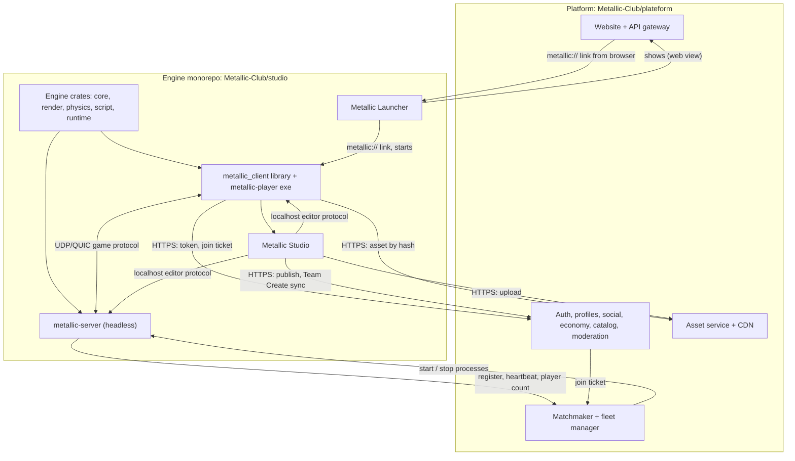

# Metallic platform architecture: decision document

Date: 2026-10-30. Status: proposal for the owner. Author: Claude (research session).
Scope: how to split Metallic into products, what is shared, which repo holds what, and in what order to build it.

How to read the evidence: "Sourced" means a public page I fetched or a search result says it (URL given). "Judgment"
means my own reasoning or general industry knowledge that I could not confirm with a public page in this session.
Public detail on Roblox internals, console SDKs and UEFN internals is thin; where that is so, it says so.

---

## 1. Recommendation

**Keep the owner's five parts, add three, and follow one rule: there is exactly one client library, and everything
that shows a running game (Player, Studio) embeds it. The Launcher starts the Player instead of embedding it.**

The owner's split is right in spirit. It is the same shape Roblox, Unity and Unreal ended up with. Testing it against
them turned up three gaps (no server program, no asset service, no matchmaker) and two changes (the Launcher should show
the real website, not a recreation of it; Studio should run multiplayer tests in separate processes).

### 1.1 The parts

| # | Part | What it is | Owner's idea? |
|---|------|------------|---------------|
| 1 | **Platform** | Website and backend services (accounts, friends, economy, catalog/marketplace, wardrobe, moderation, server browser) | yes |
| 2 | **Engine** | Rust crates: core, render, physics, script, runtime. No app code, no network service | yes |
| 3 | **Client library** (`metallic_client`) | Engine plus platform glue: sign-in token, asset download and cache, connect to a game server, render, input, in-game UI. Built as a library AND as the `metallic-player` exe | owner's "Player", made a library |
| 4 | **Studio** | egui editor. Embeds the client library for Run, spawns player processes for multi-client tests, edits live | yes |
| 5 | **Launcher** | Small native app: install and update, deep links, shows the website, starts the Player | yes (changed: shows the real site) |
| 6 | **Game Server** (`metallic-server`) | Same engine with no window or GPU. Runs server scripts and physics for one match, also hosts Team Create sessions | NEW |
| 7 | **Asset service + CDN** | Stores uploaded assets by content hash, serves them fast, validates and scans uploads | NEW (inside the platform backend) |
| 8 | **Matchmaker / fleet manager** | Decides which server a player joins, starts and stops Game Server processes on hosts, reports live player counts | NEW (inside the platform backend) |

Parts 7 and 8 are services in the platform, not products shipped to users. They are named here because that is where a
Roblox-sized platform gets hard, and because the Player and Game Server talk to them directly.

### 1.2 How they connect

### 1.3 What each part owns

| Part | Owns | Does NOT own |
|------|------|--------------|
| Engine | World/Instance tree, scene format, render, physics, Luau and later Wasm VMs, the network protocol definition (message types, replication rules) | Any window, UI chrome, or HTTP to the platform |
| Client library | Window/surface handoff, input, audio, asset cache, platform HTTP client, game-server connection, in-game GUI, crash reporter | Editing, website pages |
| Studio | Editing commands and undo, panels, project files, publish, Team Create client, launching test sessions | A second copy of rendering or scripting (it calls the client library) |
| Launcher | Install and update of itself, Player and Studio, deep-link registration, tray, recently played, embedded website | Rendering games, game logic |
| Game Server | Authoritative simulation of one place, server scripts, replication to clients, reporting to the matchmaker | Rendering, user-account logic |
| Platform | Identity, money, content metadata, moderation, discovery, fleet decisions | Simulation code |

### 1.4 Shared code (where the most work is saved)

| Shared piece | Used by | Where |
|--------------|---------|-------|
| `metallic_core` (world, values, scene format) | everything | monorepo |
| `metallic_net` (protocol types, replication; NEW crate) | client, server, Studio | monorepo |
| `metallic_client` (asset cache, API client, join flow, sign-in and token storage) | Player, Studio | monorepo |
| `metallic_api_types` (request/response structs for platform REST) | client, Studio, backend if Rust | small crate, versioned, or generated from the OpenAPI file |
| `metallic_update` (Velopack wrapper) | Studio, Launcher, Player | monorepo |

### 1.5 Which repo

| Repo | Contents |
|------|----------|
| `Metallic-Club/studio` | Cargo workspace: engine crates, `metallic_net`, `metallic_client`, `metallic-player`, `metallic-server`, `metallic_studio`, **`metallic_launcher`**, `metallic_update` |
| `Metallic-Club/plateform` | Website, backend services, database migrations, the REST/OpenAPI spec, fleet manager |

**Yes, the Launcher belongs in the studio monorepo.** It must be released in lock-step with the Player it starts (the
deep-link and command-line format), it reuses sign-in, cache and updater code, and one CI pipeline then builds and signs
every desktop executable. The pages it shows are the website, which stays in `plateform`. (Judgment.)

### 1.6 Protocols between the parts

| Link | Protocol | Notes |
|------|----------|-------|
| Browser to Launcher | `metallic://play?place=ID&ticket=...`, `metallic://install`, `metallic://studio/open?place=ID` | Registered per user (HKCU on Windows, no admin). Ticket is short-lived and single-use. Roblox registers `roblox-player` and `roblox` the same way (sourced, 3.1) |
| Launcher to Player | Command-line argument carrying the same URI | Roblox's player exe now takes the URI directly (sourced) |
| Client to platform | HTTPS + JSON (OpenAPI), bearer token from browser/device sign-in | No passwords inside Studio, Player or Launcher (design spec section 8) |
| Client to Game Server | UDP-based, encrypted (QUIC or a small reliable-UDP layer), join ticket in the handshake | Decide in M2. Types live in `metallic_net` |
| Client to asset CDN | HTTPS GET by content hash, immutable, cacheable | Roblox CDN files are hash-named (sourced) |
| Game Server to Matchmaker | Outbound-only gRPC or HTTPS: register, heartbeat, player count, drain | Servers never accept control connections from the internet |
| Studio to running game | Localhost editor protocol (1.7) | Same code for client and server targets |
| Studio to platform | HTTPS: publish, upload; WebSocket for Team Create | Team Create is a Game Server session in edit mode (3.4) |

### 1.7 Studio and the running game

Two modes, both built on the same client library:

1. **Run in Studio (in-process, M1B, already planned):** Studio hosts `metallic_runtime::Game` against a cloned world. Fast, one click, good for solo work.
2. **Server and clients test (separate processes, M2):** Studio spawns `metallic-server` and N `metallic-player` processes on localhost, each started with an `--editor-link 127.0.0.1:PORT` argument. Studio connects as an editor over the localhost editor protocol.

Why both: Roblox offers both (Test runs a client and a server simulation inside one session; "Server & Clients" starts
separate sessions, sourced 3.1). In-process is simplest and is what M1 needs. A real server process catches the bugs
players will hit (replication, security, script isolation), and a crash or hang in the game cannot take the editor down
(judgment, standard process-isolation argument).

The editor protocol is a small command set: list/read/set properties by InstanceId, insert/delete, replace script
source, pause/step, capture screenshot, stream the log. Edits flow Studio to game only and Stop discards them, matching
the "Play runs in a separate world" rule. Live edits that persist (like UEFN live edit) are a later option, not M2.

### 1.8 Build order mapped to milestones

| Milestone | Engine side | Platform side | Structure decision |
|-----------|-------------|---------------|--------------------|
| **M1A** engine runs a game | Crates as planned; keep `metallic_runtime::Game` free of windows and of hard-coded file paths so it can run headless | none | Split `metallic_player` into library `metallic_client` + thin exe now (cheap) |
| **M1B** Studio edits and plays | In-process Run | none | Studio calls `metallic_client`, not runtime directly |
| **M1C** install/update | Velopack updater, `dev` channel | none | Updater goes in `metallic_update` so the Launcher can reuse it. Installer registers `metallic://` (no handler logic yet) |
| **M1D** languages | Wasm host (wasmtime) in `metallic_script` | none | Script host stays an interface the server also uses |
| **Platform P1** (parallel to M1, platform team) | none | Accounts + device sign-in, profiles, OpenAPI spec, asset service v1 (upload, hash, serve), publish endpoint | Pick backend language and hosting (question 2) |
| **M2a** headless server | `metallic-server` (no render/GPU), `metallic_net` v1, join-ticket handshake | Matchmaker v0: server list, start a server for place X | One sandboxed OS process per match |
| **M2b** Studio multi-client test | Editor protocol; Studio spawns server + clients | none | |
| **M2c** Team Create | Edit-mode session on a Game Server, operation log merge | Session routing | Reuses editor protocol and the scene text format |
| **M2d** Launcher v1 | `metallic_launcher` (web-view shell, 3.5), deep links, start Player | Website is what it shows | Windows only first |
| **M3-M5** | 2D, workflows, renderer | Marketplace, wardrobe, economy services | |
| **M7** | Toolbox | Marketplace at scale | |
| After M2 | macOS, Linux, Android, iOS clients | Mobile-friendly web | 3.3 |
| Later, owner decision | Web (WebGPU) and consoles | | 3.3, question 4 |

Rule for the first year: nothing in the platform is on M1's critical path. Studio works fully offline (already the
design spec's rule). The platform team builds P1 in parallel; the first join point is M2.

### 1.9 What I would not do

- Do not recreate the website with native widgets in the Launcher (3.5). Two UIs for the same pages means every feature ships twice.
- Do not run anything that matters (money, inventory, damage) in client scripts. Server scripts run only in `metallic-server`.
- Do not start with an orchestrator such as Kubernetes. Start with a fixed pool of hosts and a simple allocator (3.6).
- Do not start console work until the PC and mobile client is stable (3.3).

---

## 2. Testing the lead's view

Lead's view: keep the five, add a headless Game Server, Studio and Launcher embed one shared Player/client library.

| Claim | Verdict |
|-------|---------|
| Add a headless Game Server | **Confirmed.** Every comparable product has one (3.1, 3.2). Without it: no multiplayer, no authoritative scripts, no Team Create host |
| Studio embeds one shared client library | **Confirmed**, with a change: embed it for in-process Run, but spawn separate processes for server+clients tests |
| Launcher embeds the client library | **Changed.** The Launcher should start the Player as a separate process. Roblox's bootstrapper does not render games (3.1). Embedding the renderer buys little and ties the Launcher's stability to the game's. "Quick play" becomes fast Player start. Embedding can come back on console/mobile where one app is the norm |
| (Missing) Asset service and Matchmaker | **Added.** They are where platform and servers meet |
| (Missing) Launcher as website recreation | **Rejected** in favour of a native shell around the real website on PC and mobile (3.5) |

---

## 3. Evidence by research question

### 3.1 How Roblox splits it

| Topic | What is known | Source |
|-------|---------------|--------|
| Studio testing modes | Test (F5) inserts the avatar; Test Here puts it at the camera; Run (F8) has no avatar. In Test, Studio runs two simulations, a client and a server, and you toggle views. "Server & Clients" launches separate Studio sessions, one server and the rest clients, up to eight. Stop resets everything to its pre-test state | [Studio testing modes](https://create.roblox.com/docs/studio/testing-modes) (fetched) |
| Studio-to-client live link | The page does not describe one. Roblox's internal protocol is not public; I found no documentation | same page (absence) |
| Team Create / Team Test | Team Test publishes the current state and opens sessions for collaborators; one team test at a time | same page; search summary |
| Bootstrapper | On launch it asks a client-settings endpoint for the current version GUID; if different from the installed one it downloads zip "packages" listed in a manifest (sizes, MD5), from an S3 origin mirrored by several CDNs, into a per-version folder. It self-updates first | [Bloxstrap wiki](https://github.com/pizzaboxer/bloxstrap/wiki/A-deep-dive-on-how-the-Roblox-bootstrapper-works) (fetched; third-party reverse engineering, not official) |
| Deep links | `roblox-player` and `roblox` protocols, e.g. `roblox://experiences/start?placeId=...`. Since March 2024 the player exe itself handles the URI and calls its installer when an update is needed | same wiki |
| Channels | A community library says a blank channel means the public "LIVE" client and other values select test branches | [LaunchRoblox](https://pypi.org/project/LaunchRoblox/) (search result; thin) |
| Asset delivery | Asset Delivery API returns signed, time-limited CDN URLs; CDN files are hash-named without extension | [Archive Team notes](https://wiki.archiveteam.org/index.php/User:Dango360/Roblox) (search result; community wiki) |
| Game servers | Moved from Windows to Linux containers, scheduled with HashiCorp Nomad; a case study talks of thousands of nodes | [Roblox talk slides](https://conferences.oreilly.com/software-architecture/sa-ny/cdn.oreillystatic.com/en/assets/1/event/307/Keeping%20kids%20happy_%20How%20Roblox%20uses%20containers%20to%20deliver%20smiles%20to%20over%2090%20million%20gamers%20Presentation%201.pdf), [Portworx case study](https://portworx.com/?p=4740) (search results). A third article's "million instances / 2 s spin-up" figures could not be confirmed; I do not use them |
| Place/universe model | Not re-checked; general knowledge is that a universe holds places and a server runs one place | Judgment |

Takeaway: copy the shape (thin bootstrapper, version id, hash-addressed packages, signed asset URLs, process-per-match
servers, a deep-link scheme). Skip Roblox history: its launcher and player were separate for years and the 2024 change
moved update logic into the player.

### 3.2 Comparable splits

| Product | Split | Lesson | Source |
|---------|-------|--------|--------|
| Unity | Hub, Editor, built Player, Dedicated Server build target. Multiplayer Play Mode runs up to four simulated players on one machine; Multiplayer Roles let one project be client, server or both | One project, several roles; test several clients from the editor | [Multiplayer Play Mode docs](https://mp-docs.dl.it.unity3d.com/mppm/1.4.3/dedicated-server/play-mode-dedicated-server/) (search result) |
| Unreal | Editor, Play In Editor, dedicated server target, Epic launcher | Same idea | Judgment: Epic's docs were not retrievable here |
| Fortnite / UEFN | Editor reaches a dedicated server that connects Fortnite clients for editing and playtesting; live edit lets you playtest while editing, with changes pushed through a content service taking about 30 s to minutes | Even Epic's live edit is not instant; do not promise instant | [Epic docs](https://dev.epicgames.com/documentation/fortnite/server), [Wikipedia: UEFN](https://en.wikipedia.org/wiki/Unreal_Editor_for_Fortnite) (search results; internals not public) |
| Community UEFN tooling | Editor-side HTTP listener that queues commands onto the editor main thread | Our localhost editor protocol should also marshal onto the main thread | search summary (unofficial) |
| Rec Room | Built in Unity; Rec Room Studio lets creators edit rooms in the Unity Editor; runs on PC, consoles, mobile, VR. One source claims the service ended June 2026, others do not: verify before citing | Content made in a desktop editor, played everywhere | [Rec Room mirror](https://wiki.privacytools.io/wiki/Rec_Room_(video_game)) (search result; conflicting) |
| Core | Not researched: no usable result | n/a | |
| Bevy | `MinimalPlugins` is documented as the group for minimal, headless programs (no window or rendering) with a schedule runner for the loop | Give `metallic_runtime` a "no render" configuration | [Bevy docs](https://docs.rs/bevy/latest/bevy/struct.MinimalPlugins.html) |
| Fyrox | Not retrieved | n/a | |

### 3.3 Cross-platform Rust/wgpu client

| Platform | Status | Source |
|----------|--------|--------|
| Windows | Vulkan and DX12 first class | [wgpu README](https://github.com/gfx-rs/wgpu) (fetched; table layout garbled, cells inferred) |
| Linux, Android | Vulkan first class; GL ES 3 best effort | same |
| macOS, iOS | Metal first class | same |
| Web | WebGPU first class; WebGL2 fallback | same |
| Consoles | No public Rust-on-console path found. Console SDKs are under NDA and need a developer-program application; the one search hit (Facepunch's game called Rust) is unrelated | search result; rest is judgment |

Practical consequences (mostly judgment; verify when each platform starts):
- **Windows first** is right. macOS and Linux are cheap with wgpu. Android next (Vulkan), then iOS (Metal).
- **iOS bans JIT.** Luau runs as an interpreter there, no change. wasmtime would need its interpreter mode; check before promising C#/Rust/Java scripts on iOS.
- **Web (WebGPU/wasm)** is realistic for a player but physics, the Luau C library and threads need a separate build. Treat it as a project, not a checkbox.
- **Consoles** need dev kits, NDA and licensing, a native graphics backend (wgpu has none for them), certification, and each platform holder's rules for user-created content that downloads and runs scripts. Roblox ships on Xbox and PlayStation, so it is allowed, under their rules. Treat consoles as a business step first (question 4).
- Keep the client library free of Windows-only code (paths, window, audio behind small traits) so a port is mostly new "shell" files.

### 3.4 Studio and running game: live link options

| Option | Pros | Cons | Use |
|--------|------|------|-----|
| In-process (Studio hosts the Game) | Simplest, fast, shared memory, one GPU context via eframe | A script or GPU bug can take Studio down; cannot test real networking | M1B Run |
| Separate process + localhost protocol | Crash isolation, tests the real server/client split, same Player binary players use, many clients | Needs a protocol and process management | M2 |
| Remote (editor connects to a hosted server) | Needed for Team Create and device testing | Auth, latency | M2c |

Hot reload and live edit: Roblox and UEFN do not publish how. My design: the editor protocol sends "set property" and
"replace script source" commands; the script host reloads the module and keeps the VM. Persisting live edits back to the
project is a second step: the game reports the change and Studio applies it through its normal `Command`/`History`
path, so undo still works. Team Create reuses the same commands across people (an operation log), which is why design
spec milestone 2 groups it with networking.

### 3.5 Launcher: native UI vs web view vs shared UI

| Option | PC | Mobile | Console | Notes |
|--------|----|--------|---------|-------|
| A. Recreate the site natively | Doable | Doable, weaker feel | Needed | Two UIs; every site change is double work |
| B. **Native shell + web view of the real website** | Good (WebView2) | Good (WKWebView, Android WebView) | Not available | One UI. Native parts: install/update, deep links, Play button, tray, local settings |
| C. Website only, no Launcher | Works | Works | n/a | Still needs a protocol handler/installer to start the Player; that is the Launcher's minimum job |
| D. Own UI inside the engine (game-menu style) | Works | Works | Works | The route that exists on consoles; keep it to a few screens |

Sources: Tauri 2 draws UI in the OS web view (WebView2 on Windows, WKWebView on iOS, Android System WebView) and
supports iOS and Android; multi-webview is still behind an unstable flag; I found nothing confirming a native wgpu
surface can sit beside a Tauri web view on mobile ([Tauri v2 beta post](https://v2.tauri.app/de/blog/tauri-2-0-0-beta/),
[overview](https://www.issoh.co.jp/md/tech/4114), [DEV article](https://dev.to/shrsv/exploring-system-webviews-in-tauri-native-rendering-for-efficient-cross-platform-apps-9hl);
search results). Roblox's own bootstrapper installs the WebView2 runtime when it is missing
([Bloxstrap wiki](https://github.com/pizzaboxer/bloxstrap/wiki/A-deep-dive-on-how-the-Roblox-bootstrapper-works)).

**Recommendation:** B on PC first (Tauri v2 is Rust, matches the repo and has a mobile path; a bare WebView2 host is
the smaller alternative). The Launcher starts the Player as its own process. If the owner later wants the game inside
the Launcher window, that needs a native surface beside the web view; prototype before promising (question 1). On
consoles use D with a handful of native screens (home, my games, wardrobe preview), not a copy of the site.

### 3.6 Backend for millions of users, high level

Service names are mine; the general pattern follows the Roblox slides above. Public detail is thin.

| Service | Job | Store | Build when |
|---------|-----|-------|------------|
| Auth | Accounts, sessions, browser/device sign-in, tokens | SQL | P1 |
| Profiles + social | Users, avatars, friends, presence | SQL + cache | P1/P2 |
| Asset service | Upload, validate, scan, hash, store, signed URLs | Object storage + CDN | P1 (publish needs it) |
| Game catalog + server browser | Places, universes, live counts | SQL + cache | M2 |
| Matchmaker + fleet manager | Allocate, start, stop, drain, health | Small DB + host agents | M2 |
| Realtime | Notifications, Team Create sync, voice relay | WebSocket gateway | M2+ |
| Moderation | Reports, automated scanning, bans, alt limits | SQL + queue | before public launch |
| Economy | Currency, purchases, trades, append-only ledger | SQL, strong consistency | before any money |
| Catalog / marketplace | Items, listings, search | SQL + search index | M7 |
| Analytics + crash reports | Events, crashes, experiments | Warehouse | early (cheap) |

What to build first (judgment): identity, then asset upload and serve, then publish a place, then server list, then
start a server on demand. Economy, marketplace and trading come after, because they carry the most fraud and legal
risk and need moderation first. Run servers as one OS process per match on a fixed pool of hosts with a host agent
before adopting an orchestrator; Roblox's Nomad scale is far beyond a first release. Put every service behind one API
gateway and one OpenAPI file so clients get typed code. Serve assets from a CDN with immutable hash URLs (almost all
traffic is then cached), keep the platform database for metadata, and keep game traffic off the platform entirely
(clients talk to servers directly).

---

## 4. Risks

| Risk | Impact | Mitigation |
|------|--------|-----------|
| Four people building engine, studio, launcher, website and fleet | Schedule | The shared-library rule; platform off M1's critical path; thin Launcher |
| Studio-to-game live link scope creep | M2 slips | Ship only the small command set in 1.7; no persisted live edit at M2 |
| Script safety on a public platform | Security | Luau is sandboxed; server scripts only in `metallic-server` processes with CPU/memory limits and no network; Wasm languages later |
| Mobile and console store rules for user content and purchases | Blocks release | Read the rules before building; consoles are a business step |
| wgpu next to a web view (Launcher) on mobile | May be impossible | Separate Player process on desktop; prototype before promising |
| Research gaps: Unreal, Fyrox, Core, Epic internals, Roblox Team Create and console SDKs returned little | Some cells are judgment | Marked above; confirm when each topic starts |

## 5. Open questions only the owner can answer

1. **Is "quick play" inside the Launcher window required, or is a fast-starting separate Player window fine?** The first needs an embedded native surface (risky on mobile); the second is what Roblox does.
2. **Backend language and hosting:** Rust end to end (shares types with the client) or a mainstream web stack for the site with Rust only for servers? Own hardware, a cloud provider, or a mix? This sets cost and who on the team can work on it.
3. **Is the Launcher's website the same site players use in a browser, with the Launcher only adding install and play?** My recommendation is yes. A Launcher-only UI roughly doubles the front-end work.
4. **Are consoles a real goal within two years?** They need a platform-holder program, dev kits and money; if yes, the client's platform layer and a native menu UI must be planned from now.
5. **Should Studio run on macOS and Linux in the first year, or Windows only?** This decides whether editor portability work lands in M1C or later.
