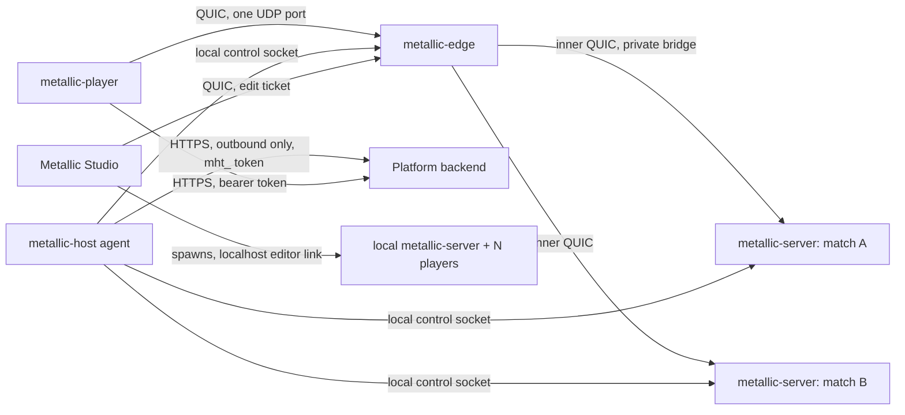

# Milestone 2 multiplayer: design

Date: 2026-10-30. Status: **design, for owner approval**. Implements milestone 2 of
`2026-10-30-metallic-studio-design.md` ("test with a friend, dedicated server, several people editing one game at once,
standard and proximity voice chat"). Section 9 of that spec left networking to "when milestone 2 starts"; this is it.

Built on (read these for sources and longer reasoning; this document decides, they explain):
- `docs/research/2026-10-30-networking-m2.md`: transport, protocol, replication, prediction, Team Create, voice.
- `docs/research/2026-10-30-self-hosted-game-servers.md`: home hosting, edge, tickets, DDoS, player-count estimates.
- `docs/research/2026-10-30-platform-architecture.md`: Game Server, matchmaker, outbound-only control, Studio modes.
- The platform OpenAPI (`Metallic-Club/plateform`, 0.1.2, branch `platform/4-game-server-contract`) for endpoint names.

Labels: **Owner** = the owner decided. **Lead** = the lead session decided. **Call** = this document's decision; the
owner may overturn it. Section 11 lists the open owner questions.

---

## 1. Decisions in short

| # | Topic | Decision | Label |
|---|-------|----------|-------|
| 1 | Hosting | Owner's home servers first (central US, 340 Mbps up, IPv4 only, no IPv6). Paid regions later with the same software and a region tag | Owner |
| 2 | Front door | One forwarded UDP port to `metallic-edge`, which **ends** the QUIC connection, checks the ticket and routes to the right game server on the host | Lead |
| 3 | Transport | QUIC (`quinn`, `rustls`, TLS 1.3). Reliable data on streams, snapshots and inputs on datagrams | Lead |
| 4 | Join ticket | Ed25519-signed by the backend, at most 60 s, single use. The edge verifies it with the public key only. The game server then redeems it online for identity and permissions | Lead + Call |
| 5 | No DNS for games | The host agent's outbound connection tells the backend the host's public address. The Player gets address, port and a pinned certificate hash from the backend | Lead |
| 6 | Isolation | Each game server is one unprivileged container, no route from the internet, no backend credentials. Only the host agent talks to the backend, outbound | Lead + Call |
| 7 | Authority | Server-authoritative for everything. The client predicts only its own character. **No client network ownership in M2** | Call |
| 8 | Replication | Built on the world change journal (extended to record what changed). Reliable ordered event stream for the tree; unreliable delta snapshots for moving things | Call |
| 9 | Rates | Server simulation 60 Hz. Snapshots 30 Hz near, 15 Hz mid, 5 Hz far, filled by a priority accumulator to a byte budget | Call |
| 10 | Scale target M2 | 50 players per server must pass, 100 is the target, 200 is the design ceiling; 300-500 players across the home host. The bot load test produces the real numbers | Lead + Call |
| 11 | Beyond one process | Zone sharding behind the edge (one client connection, many zone servers). Not built in M2; the protocol keeps room for it (section 5.3) | Call |
| 12 | Studio | One-click "Team Test": one server and N players on localhost (M2a). "Test with a friend" through the platform (M2b). Team Create as an edit-mode server session with a server-ordered operation log (M2c) | Call |
| 13 | Voice | Opus through the game server (forward only, no mixing), proximity and channels. Last part of M2 (M2d), off for under-13 and unknown age | Call; age rule is an owner question |

Sub-milestones, each ending in something the owner can try:
- **M2a: two processes, one PC or a LAN.** `metallic-server`, the protocol, replication, prediction, remotes, Studio
  Team Test, the bot load test.
- **M2b: play with a friend over the internet** on the home server. Edge, host agent, tickets, backend, hardening.
- **M2c: Team Create.** Several people edit one place at once; Team Test from the shared session.
- **M2d: voice.** Standard and proximity voice.

---

## 2. What we start from (code on `main`, 2026-10-30)

- `metallic_core::World`: generational `InstanceId`, class registry with typed properties, and a **change journal**
  that records only ids (`changes_since(cursor) -> Changes::Ids | Overflow`, 16,384 entries). It does not say what
  changed. No `ServerStorage`, `ModuleScript`, `RemoteFunction` or `UnreliableRemoteEvent` classes yet. `Value` has no
  CFrame; parts store `Position` and `Orientation` (Vector3).
- `metallic_runtime::Game`: fixed 60 Hz ticks with an accumulator; per tick: character controller, physics, touch
  events, scripts, physics re-sync from the journal. One process holds the whole game and the renderer.
- `metallic_script::ScriptHost`: server and client VMs over **one shared** `World`, one local `Player1`. RemoteEvent
  arguments already pass through a VM-independent `Wire` value with limits (32 args, 1 MiB of strings, depth 16).
- `metallic_physics::CharacterController::step` moves a kinematic capsule; its per-character motion state is private.
- Input is actions (`docs/design/input-actions.md`); section 5.5 there already says `Move`, `Jump` and `Run` go in the
  input datagram in M2, and input is client-only.

What M2 must change first: the journal must record the kind of change, the runtime must run without a renderer, the
script host must split into a server role and a client role in different processes, and the character state must be
saveable for prediction replay.

---

## 3. Processes and crates

### 3.1 New crates and binaries (Call)

| Crate | Kind | Job |
|-------|------|-----|
| `metallic_net` | library | Protocol types, encoders, `Transport` trait (quinn and in-memory), link conditioner, ticket verify (`ticket` module), replication server and client logic, prediction buffers. Depends on `metallic_core`, not on the runtime or render |
| `metallic_server` | binary `metallic-server` | Headless game server: one match or one edit session. Links `metallic_runtime` without render, plus `metallic_net`. Modes: `--local` (Studio, LAN; accepts direct connections with locally signed tickets) and `--hosted` (accepts only the edge) |
| `metallic_edge` | binary `metallic-edge` | Ends client QUIC on the host's one public UDP port. Retry, ticket check, limits, routing, splice to the right server. Knows nothing about games |
| `metallic_host` | binary `metallic-host` | Host agent. Outbound HTTPS to the backend: register, heartbeat, orders (start, drain, stop). Starts and stops server containers, feeds the edge its routing table and keys, rotates the edge certificate, ships logs and crash dumps |
| `metallic_client` | library | The client side: join flow, connection, replica world, prediction, interpolation, editor-link client. Used by `metallic-player` and Studio (the platform document's planned split of the player) |

Rejected: one combined "server + edge" binary. A crash or exploit in one match must not take the port down for the
other matches, and the edge is the same program later on a relay or a paid region host.

### 3.2 Changes to existing crates

| Crate | Change |
|-------|--------|
| `metallic_core` | Detailed journal: each entry records `Created`, `Destroyed`, `Reparented` or `Property(index)`; new `changes_since_detailed`. `ServerStorage` service, `ModuleScript`, `RemoteFunction`, `UnreliableRemoteEvent` classes. A replication flag per property (section 4.2). A stable registry hash (classes, properties, types, order) for version checks |
| `metallic_runtime` | Split a headless `Simulation` (world, physics, characters, scripts, fixed tick) out of `Game`; `Game` keeps camera, avatar drawing, GUI and render. A `Role`: `Combined` (today's in-process Play), `Server`, `Client`. A `NetDriver` hook called at fixed points of each tick (receive before scripts, send after). Cargo feature so the server build has no wgpu, winit or egui |
| `metallic_physics` | `CharacterController::save_state` / `restore_state` (`CharacterState`: position, vertical and inherited velocity, state, ground part, yaw, timers); `step` exactly repeatable for a fixed `dt` |
| `metallic_script` | `ScriptHost` roles: `Server` (server VM only; one `Player` per connection, real user ids) and `Client` (client VM only; `Players.LocalPlayer` from the server). Today's combined mode stays for in-process Play. Remote queues are drained and fed by the network driver. New classes' Luau API and limits (section 4.9) |
| `metallic_player` | `--connect <launch-uri>` join flow through `metallic_client`; `--local host:port --ticket T` for LAN and Studio; `--headless --bot <behaviour>` for bots; reconnect and error screens |
| `metallic_studio` | "Team Test" (spawn server + N players, merged Output, Stop), network simulation menu, editor link; Team Create client (M2c); "Test with a friend" publish flow (M2b) |

---

## 4. Replication

### 4.1 Model (Call)

The server is the only source of truth. Clients send inputs and remote calls; the server runs scripts, physics and
characters and sends results. A client may change its own copy (local effects, GUI), but those changes never reach
the server or other players (Roblox's FilteringEnabled rule). Roblox itself moved this way in 2026 with its
server-authority mode (networking research, section 4.1).

Two paths, both per client:
1. **Event path** (reliable, ordered, one stream): create, destroy, reparent, every property change except transforms
   of moving parts, and server-to-client remote calls. Ordering with the tree is guaranteed: a `FireClient` that passes
   a Part created a moment earlier always arrives after the Part.
2. **Snapshot path** (unreliable datagrams): position, orientation and velocity of things that move, each character's
   root and state, the owner's own character state for reconciliation, input acks, server tick. Only the newest value
   matters, so loss costs nothing.

Rejected: lockstep (Luau, Rapier and floats are not deterministic across machines, and one slow player stalls all);
sending full state every tick (bandwidth); a client-authoritative character (cheating on a platform for young players).

### 4.2 What replicates (property filtering)

Rules, checked in this order:
1. **Never sent:** everything under `ServerScriptService` and `ServerStorage`; the source of every `Script` (server
   script) wherever it lives; properties marked `ServerOnly` in the registry (engine-internal values).
2. **Sent to one player only:** the `PlayerGui` and `PlayerScripts` of a player go only to that player.
3. **Sent to everyone:** everything else in `Workspace`, `ReplicatedStorage`, `Players`, `Lighting`, `StarterGui`,
   `StarterPlayer`, plus `LocalScript` and `ModuleScript` sources in those places (clients run them).
4. **Interest filter** (section 4.4) then decides what and how often for Workspace things.

Registry change: `PropDef` gains `repl: Repl::{Replicated, ServerOnly}`; default `Replicated`. Creators get the
Roblox containers, not per-property switches, in M2; a later per-instance "visible only to these players" mode can
use rule 2's mechanism. Studio warns when a server `Script` sits in a replicated container (it runs, its source never
leaves the server, but creators usually meant a LocalScript).

### 4.3 Feeding replication from the journal

Each server tick, after scripts and physics:
1. Read `changes_since_detailed(cursor)`. On `Overflow` (over 16,384 changes in one tick), fall back to a full compare
   for affected clients (rare; counted in metrics).
2. Drop never-sent instances and properties (4.2).
3. Route: transform properties of moving parts and character roots go to the snapshot path; everything else to the
   event path.
4. Coalesce: several changes to one property within a tick send only the last value.
5. Encode once per change, then copy the encoded bytes into each client's event stream that should see it (cheap fan
   out; per-client work is only the filter).

The client applies events to its replica `World` with the ordinary `create`, `set`, `set_parent`, `destroy` calls, so
its renderer, physics sync, audio and client scripts see normal changes.

**NetId:** the server gives each replicated instance a `NetId` (varint on the wire; most cost 2-3 bytes). A freed
NetId is not reused for 10 s. The wire type is 64-bit so a zone server can later own a NetId range (section 5.3).
Properties travel as a `u16` index fixed by the registry hash, never as names.

### 4.4 Interest management (per-player relevancy)

- **M2a: snapshot interest.** A uniform grid on the XZ plane, 64-stud cells. Each moving entity is in one cell. A
  player's focus is its character root (or `Player.ReplicationFocus`). Each snapshot considers cells by distance,
  nearest first. Distance bands: near (up to 128 studs) 30 Hz, mid (to 512) 15 Hz, far (to 1,024) 5 Hz; beyond 1,024
  studs moving entities are not sent. Always relevant: the player's own character, and anything the game marks.
- **Event path in M2a/M2b:** every client holds the whole replicated tree (no streaming). Fine for template-sized
  places (hundreds to a few thousand parts).
- **StreamingEnabled (stretch, end of M2; required before zones):** Roblox semantics creators know:
  `StreamingMinRadius` 64, `StreamingTargetRadius` 1,024, stream-out to nil parent, model streaming modes; regions
  travel on their own reliable streams.

### 4.5 Snapshots: delta, quantization, priority

- One snapshot packet per two ticks (30 Hz), one datagram of at most 1,200 bytes; a second datagram if the per-client
  budget allows.
- **Delta against what the client acknowledged** (Quake 3): the server keeps the last 32 snapshots' per-entity state
  per client; acks come back in input datagrams as `ack` + 32-bit `ack_bits`, so one lost ack rarely matters. No
  baseline: send full values.
- **Quantization:** position in cell-relative fixed point at 1/64 stud; orientation smallest-three (2 + 3 x 10 bits);
  linear velocity 3 x 12 bits only while moving; an "at rest" bit, then silence. The local character's own state uses
  full precision.
- **Priority accumulator:** each tick every candidate adds `class weight x distance band x recent-contact boost` to its
  accumulator; the server sends highest first until the client's byte budget for the tick is used, then resets what it
  sent. Nothing starves; far things just come less often.
- **Budgets per client:** 50 KB/s typical cap, 100 KB/s peak down (performance document 3.5); up under 10 KB/s.
  Expected typical use in Parkour-like games is well below the cap; the load test reports it.
- **Characters:** only the root (position, yaw), Humanoid state and a few Humanoid properties replicate. The client
  places the limbs and runs the animation itself. Eight transforms become one.

### 4.6 Physics ownership (Call)

**The server owns every physics body in M2.** No automatic Roblox-style handoff of unanchored parts to nearby
clients. Reasons: Roblox documents that it "cannot verify physics calculations on client-owned parts" (teleporting
parts, fake touches), the character is kinematic so it needs no ownership, and Roblox's own newest mode is
server-only. Cost: a pushed crate reacts a round trip late for the pusher. Accepted.

`BasePart:SetNetworkOwner` exists and accepts only `nil` (server) in M2, with a warning otherwise. After M2, opt-in
ownership for vehicles: the owner client sends the assembly state; the server checks speed, acceleration and bounds
against creator limits and takes ownership back on a violation.

### 4.7 The local character: prediction and reconciliation

1. Each tick the client samples input into an `InputCmd` (`tick`, move x/z 8 bits each, jump, run, yaw 16 bits,
   16 action bits): about 7 bytes. Input packets go 30 times a second with the 2 newest inputs plus up to 6 older
   unacknowledged ones.
2. The client runs the same `CharacterController::step` for its own character at the fixed tick and keeps
   `(tick, input, CharacterState)` for 2 s.
3. The server buffers about 2 ticks of input per player. Empty buffer: reuse the last input and count a starve. It
   sends a buffer hint; the client speeds its tick up or down by up to 5 % (Overwatch, Rocket League).
4. Each snapshot to the owner carries `last_input_tick` and the full server `CharacterState` at that tick. Within
   0.01 stud and the same state: drop history. Otherwise restore and replay later inputs; hide the snap with a render
   offset that decays 10 % per frame.
5. Moving platforms (Parkour's core risk): when the predicted character stands on a mover, the client extrapolates
   that mover to the predicted tick from its replicated velocities.

### 4.8 Other players and moving parts: interpolation

Render remote things at `server time - interpolation delay`. Delay = two snapshot intervals plus measured jitter,
clamped to 50-200 ms (about 100 ms on a good link). Hermite position with replicated velocity, slerp orientation.
Missing data: extrapolate one interval (33 ms), then hold.

### 4.9 RemoteEvent and RemoteFunction (Luau API)

Roblox names and behaviour: `RemoteEvent:FireServer/FireClient/FireAllClients`, `OnServerEvent`, `OnClientEvent`;
`RemoteFunction:InvokeServer/InvokeClient`, `OnServerInvoke`, `OnClientInvoke`; `UnreliableRemoteEvent` with the same
calls. Arguments are copied (`Wire` values); an Instance the receiver cannot see arrives as nil.

| Rule | Value |
|------|-------|
| Client-to-server rate | 500 calls per second per client per remote type (Roblox) and 50 KB/s with a 200 KB burst |
| Over the limit | Queue up to 1 s of excess, then drop; one warning per second in the client Output |
| Payload size | 64 KiB up per call (larger fails on the client: "remote payload too large"); 1 MiB down |
| UnreliableRemoteEvent | 1,000 bytes; never queued; sequenced per remote (stale ones dropped) |
| No handler connected yet | Queue 256 calls or 1 MiB per remote for 30 s, then drop with an error |
| `InvokeServer` | 30 s timeout raises an error (Roblox has none; a stuck server must not hang a client) |
| `InvokeClient` | 10 s timeout, errors on timeout or disconnect; Studio marks it as risky |
| Ordering | Reliable remotes keep firing order; server-to-client remotes are ordered with tree changes |
| Server script errors | Go to the game's editors (Studio, later the Developer Console), never to players |

Creator guidance (in `docs/luau-api.md` and every template): treat every `OnServerEvent` argument as hostile; send
intent ("buy item 12"), never results ("give me 100 coins"); keep logic in `ServerScriptService`.

### 4.10 Join, late join, reconnect

- **Join snapshot:** the full replicated tree as of a tick boundary, zstd-compressed, on its own reliable stream; the
  event stream continues from that tick. Target: playable in 5 s on a warm cache, 10 s cold. Scripts travel as source
  (Luau compiles fast; keeps the protocol independent of the Luau version).
- **Late join** is the same as join; there is no special case.
- **Connection blips:** QUIC keeps the connection through short loss and NAT rebinding (connection migration on). Idle
  timeout 10 s.
- **Reconnect (Call):** a lost connection ends the session with Roblox semantics (`PlayerRemoving` at once). The Player
  shows "Reconnecting..." and asks for a ticket to the same server; on success the player joins fresh. A "keep my
  character for 20 s" resume is a later option; it changes script semantics, so not in M2.

### 4.11 Time sync and lag compensation

- **Time:** every snapshot carries the server tick. The client keeps a filtered estimate of server time and runs its
  own simulation ahead by `RTT/2 + input buffer`. RTT from quinn.
- **Lag compensation basics (M2b):** the server keeps 1 s of hit-volume history per character (head, torso, limbs as
  boxes). A server script calls `workspace:RaycastRewound(player, origin, direction, params)`; the server rewinds
  targets to that player's last reported view time (capped at 200 ms), casts, and restores. The origin must be within
  8 studs of that player's head. Projectiles stay in present time. Everything else keeps plain `workspace:Raycast`.

---

## 5. Scale

### 5.1 Targets per server process (Lead + Call)

| | Players per process | Measured by |
|---|---|---|
| M2 must pass | 50, tick p99 at most 16.7 ms on one core | Bot load test (task A14) |
| M2 target | 100 | Same test; may need parallel snapshot building (task B9) |
| Design ceiling (no rewrite needed) | 200 | Load test after B9; the backend already caps `maxPlayers` at 200 |
| Home host total, M2 | 300-500 players across processes | Bounded by free cores; bandwidth is not the limit (below) |

Why CPU, not bandwidth, limits first: the game's upload is capped at 200 Mbps (about 140 Mbps planned average, the
rest kept for the household; self-hosting research 5.1). At the 50 KB/s per-client cap that is about 350 players; at
expected typical use (15-25 KB/s) 700 to 1,100. CPU per player per tick (simulation, interest query, snapshot
building) is the unknown, so the numbers above stay estimates until A14 prints real ones.

**The bot load test is a deliverable of M2, with numbers as its acceptance output:** players, tick p50/p99/max,
CPU per core, memory, bytes per client up and down, input starves and corrections, for 25, 50, 100, 150 and 200 bots
on a Parkour-like place and on a crowded arena place. Results go in `docs/agents/` and set the real `maxPlayers`.

### 5.2 How one process gets to 200

1. Interest grid and distance bands (M2a), so per-client work grows with what is near, not with everyone.
2. Encode each change once and fan out bytes (4.3).
3. Build per-client snapshots in parallel after the simulation step (the world is read-only then); network I/O on its
   own thread (B9). One process may then use several cores; containers get a core limit per match to match.
4. Graceful overload, in this order: lower far and mid rates, lower everyone's rate, slow game time (EVE-style time
   dilation, floor 50 %), and only then refuse new joins (`joinable: false`). Never random lag.

### 5.3 The path to 1,000+ in one world (not built in M2)

Zone sharding: the world is split into zones, each simulated by its own `metallic-server`. The client keeps **one**
connection to the edge; the edge forwards to whichever zone servers the player needs. Zones hold read-only "ghost"
copies of entities near their borders; an entity crossing a border is handed over with a sequenced message and a
confirm. Static zones (maps or areas joined by portals) come first; grid zones later.

What M2 does now so this needs no protocol rewrite:
- The client connection ends at the edge, not at a game server.
- Every reliable message and snapshot block carries a 1-byte `source` (always 0 in M2), so a client can receive the
  world from several servers at once.
- NetIds are 64-bit on the wire; a zone server will get its own range.
- Interest management is spatial from the start; StreamingEnabled (stretch) is the client side zones need.
- Scripts reach shared game state only through engine services (later DataStores, messaging), not process globals,
  so a zone-aware script runtime has a clean boundary.

---

## 6. Studio: Team Test, test with a friend, Team Create

### 6.1 Play (unchanged)

In-process Play stays exactly as in M1: one process, combined script host, fastest loop.

### 6.2 Team Test: server + N players on localhost, one click (M2a)

- Toolbar: **Team Test** with a player count (1-8, default 2). Studio saves the place to a temp folder, makes a
  throwaway Ed25519 key pair, starts `metallic-server --local --listen 127.0.0.1:0` (public key in an environment
  variable) and N `metallic-player --local 127.0.0.1:<port> --ticket <locally signed ticket>` windows, all with
  `--editor-link 127.0.0.1:<studio port>`.
- Same ticket code as production, so the local path tests the real check. No edge locally: in `--local` mode the
  server accepts direct connections and verifies tickets itself.
- Windows Job Object: closing Studio or pressing Stop ends every process within 2 s. Stop discards their state.
- **Editor link:** TCP on 127.0.0.1, length-prefixed frames, a random session token first. Commands: stream logs, list
  and read and set properties, insert and delete, replace script source, pause/step/resume, screenshot. Edits do not
  persist; Stop throws them away.
- Output shows server and player logs side by side, tagged by process.
- **Network simulation** menu (latency, jitter, loss) applies the link conditioner on the test server, so creators
  feel 150 ms before players do.

### 6.3 Test with a friend over the internet (M2b)

"Test with a friend" in Studio: upload the current place as a private test version, ask the backend for a test session
on the home fleet, and get an invite link. Only invited accounts (and the place's editors) can get tickets for it. The
friend clicks the link, the Player joins through the normal path (section 7). No port forwarding on the creator's PC.

### 6.4 Team Create (M2c)

An edit session is `metallic-server --edit` (scripts and physics off) on the home fleet, reached through the edge
with an **edit ticket** (ALPN `metallic-edit/1`). The backend starts it on the first editor's request and stops it 10
minutes after the last editor leaves.

**Operation log, conflict rule (Call):**
- Ops: `Create {id, class, parent, after, props}`, `Destroy {id}`, `Set {id, props}`, `Move {id, parent, after}`,
  `ScriptText {id, text}`, `Batch {ops}` (one Studio `Command` = one batch = one undo step, applied all or nothing).
- Studio applies a command at once (optimistic) and sends it. The server validates (exists, class may live there, no
  cycle, types and limits, Edit permission, script lock), gives it the next global sequence number, appends, applies
  and broadcasts to all editors (the sender's copy is its ack). A rejected batch comes back with a reason; Studio
  reverts it and shows a short note.
- **Conflicts:** the same property edited by two people: server order wins (last writer). Different properties: both
  apply. Edit or move of a deleted instance, create under a deleted parent, or a move that makes a cycle: rejected.
  While a client has an unacknowledged edit to a property it ignores incoming values for it (Figma's rule).
  New ids are `(client id, counter)`, so there is no id remapping.
- **Undo** stays per person and sends the inverse as a new batch. If someone else changed a property since, undo
  skips that property and says so.
- **Scripts:** M2c uses edit locks (a lease renewed every 20 s, dropped on disconnect); others watch the text update
  once a second. Live co-editing with a text CRDT (`yrs`, MIT) is after M2.
- **Presence:** colour, camera, selection, open script; "jump to"; idle after 5 minutes. Unreliable, not logged.
- **Saving:** ops are sent to the platform in batches every second; a full scene snapshot (scene text format) every
  5 minutes or 2,000 ops becomes a place version. A crash loses at most about a second. A reconnecting Studio
  compares a tree hash and reloads if it diverged. The home host is never the only copy.
- **Team Test from a session:** any editor starts a test server from the session's current state for the editors who
  accept.

Rejected: a CRDT for the whole tree. Moves in a tree CRDT are hard, history grows, and permissions and class rules
need an authority anyway. Team Create needs a server for saving and permissions, so the server orders the log.
Offline Team Create editing is out of scope (owner question 5).

---

## 7. Connection and security, end to end

### 7.1 Join flow (hosted)

1. Website or Launcher calls `createJoinTicket`. If no server is ready the backend answers `pending` with a retry
   time and starts one (heartbeat order to a host). When ready: a signed ticket and `launchUri`.
2. Player (signed in, bearer token) calls `connectJoinTicket`: edge address and port (the host's current public
   IPv4, learned from the host agent), the edge certificate SHA-256, ALPN, engine version.
3. Player opens QUIC to the edge. The edge **always answers the first Initial with a Retry** (stateless address check).
4. TLS 1.3 handshake. The client accepts exactly the pinned certificate (custom rustls verifier: hash and validity
   window; no CA, no DNS). SNI carries a short form of the pinned hash so the edge can serve the current and next
   certificate during rotation.
5. Within **2 s** the client sends `Hello {ticket, protocol minor, engine version, registry hash}` on stream 0, or the
   edge closes the connection.
6. The edge checks the ticket: signature (key by `kid`), `aud = metallic-server`, `exp`, `iat` not in the future,
   `exp - iat` at most 60 s, `jti` not seen (replay set until expiry), `server` is a live, joinable server on this host.
   Bad ticket: close with one generic error code.
7. The edge opens an inner QUIC connection to that server over the private bridge (mutually pinned host-local
   certificates) and sends `Admit {claims, raw ticket, client address}`. From then on it splices streams and
   datagrams one to one, enforcing the per-connection limits.
8. The server asks the host agent to redeem the ticket (`redeemJoinTicket`: global single use, user name, display name,
   age band, permissions). Only then `Welcome` and the join snapshot. If the backend cannot be reached within 3 s the
   join fails closed ("platform unavailable"); running players are unaffected.
9. Version mismatch: protocol major is in the ALPN (fails in the handshake); a different registry hash gets
   `UpdateRequired`.

Why the edge ends QUIC instead of forwarding raw UDP: it must read the ticket to route, the game servers then never
touch the internet, and the same program becomes the relay (phase 3) and the paid-region front door.

### 7.2 Layers

| Layer | Protection |
|-------|------------|
| Router | One UDP port forwarded (team picks a number above 1024). UPnP off. No DMZ. No TCP forwarded |
| Host firewall (nftables) | Default drop; allow that port to the edge, admin SSH only from the home network; rate meters per source (M2b hardening) |
| Edge | Retry always; 2 s auth deadline; at most 256 half-open handshakes in total and 4 per source IP; new connections per IP 5 per second, burst 10; ban list checked before any crypto; generic errors only |
| Under-attack mode (fallback, M2b) | If the load test or a real flood shows handshake CPU is the weak spot: the edge drops QUIC Initials from unknown addresses. A client first sends one 1,200-byte `Knock` datagram (first byte 0x00, never valid QUIC) with an IP-bound knock token from `connectJoinTicket`; a valid knock allowlists that address for 10 s. The reply is smaller than the knock (no amplification). netcode.io's first-packet idea, kept in front of QUIC |
| Inner link | Mutually pinned QUIC between edge and servers on a private bridge; servers accept nothing else in hosted mode |
| Game server container | Unprivileged LXC, no devices, read-only game files, CPU, memory and process limits, no route from the internet, egress only to the edge and host agent (not even the backend). Holds no keys except its own inner-link certificate |
| Host agent | The only process with a backend credential (`mht_` host token, stored hashed by the backend). Outbound only; nothing listens on the internet |
| Script sandbox | Luau budgets (time per resume, memory cap), no file, network or OS access; server scripts only in `metallic-server` |
| Server authority | Clients send inputs and remote calls only |

### 7.3 Validation of every client message

| Message | Check | On failure |
|---------|-------|-----------|
| Anything before `Welcome` | Only `Hello`, once, within 2 s | Close |
| Reliable message | Size at most 64 KiB, known kind, decodes completely | Close ("protocol error") |
| Unknown NetId or property index | Counted | Drop; close after 100 in 10 s |
| Datagrams | At most 120 per second per client | Drop excess, count |
| Streams | At most 4 open from a client (QUIC flow control) | Refused by QUIC |
| `InputCmd` | Finite numbers, move length at most 1, tick within `[last+1, last+8]`, one input per tick | Drop the input; repeated offences kick |
| Remotes | Section 4.9 limits | Queue then drop |
| Fire/rewind | Rate from server weapon data, origin near the head, rewind at most 200 ms | Refuse the shot |
| Teleports | Only by server scripts; the client applies them as corrections | n/a |

Every decoder has a `cargo fuzz` target run nightly. Rate limits key on user id and ticket id, not only IP (shared
addresses on phones and schools).

### 7.4 Cheating

Speed, fly and teleport hacks have nothing to change: the server runs movement. Remote abuse is capped by limits and
by creator validation. Server code and `ServerStorage` never reach clients. Interest bands limit how far a wall hack
can see moving players. Aimbots and input automation are not solved in M2; the server keeps per-player stats for a
later detector. Repeat offenders are kicked and reported to the backend.

### 7.5 Encryption and privacy

- All game traffic is TLS 1.3 inside QUIC, client to edge and edge to server. Backend calls are HTTPS.
- Tickets are bearer secrets for 60 s: never logged, redacted in crash reports.
- **The home IP is visible to players in direct mode** (phases 1 and 2). It is hidden only from phase 3, when the edge
  runs on a relay with a WireGuard tunnel home. Recommended before any public launch (owner question 3).
- A home link cannot survive a large flood (anything over its 452 Mbps download). M2 is a closed test; the relay and
  paid regions with provider filtering are the answer, not software on the home host.
- No end-to-end encryption for voice: the server must be able to act on abuse (section 9).

---

## 8. Backend contract

The platform team builds these from this section. Names follow the backend's OpenAPI and the backend session's
work in progress; where their names differ, theirs win, and the meaning here is the contract. Ids are the platform's
string ids. Errors are `application/problem+json`. "**Backend must add**" marks fields the backend does not have today.

### 8.1 Ticket format

- Ed25519 signature over the claims. Byte format and test vectors are the backend's document; `metallic_net::ticket`
  tests against those vectors in CI.
- Claims (backend has): `kid`, `jti`, `user`, `place`, `server`, `region`, `iat`, `exp` (at most 60 s after `iat`),
  `aud = "metallic-server"`.
- **Backend must add:** `kind` (`play | edit | test`), so the edge routes edit tickets only to edit sessions;
  optional `ip` claim (off by default).
- **Backend must change:** the ticket string pattern and length in `JoinTicket`, `connectJoinTicket` and
  `redeemJoinTicket` (today `^jt_...`, at most 128 characters) to fit a signed ticket (allow up to 512 base64url
  characters).

### 8.2 Player-facing endpoints

| Endpoint | Request | Response |
|----------|---------|----------|
| `POST /v1/games/{gameId}/join` (`createJoinTicket`) | `{serverId?, followUserId?, region?}` | `201 {status: "ready", ticket, launchUri, placeId, expiresAt}` or `202 {status: "pending", retryAfterSecs}`; `409 server_full`. **Backend must add** the `status`/`pending` form if not already there |
| `POST /v1/join-tickets/connect` (`connectJoinTicket`) | `{ticket}` with bearer token | `200 {serverId, host, port, certSha256, protocol, engineVersion, buildId, expiresAt}`. `host`/`port`/`certSha256` are the **edge's** (from the host agent), not a process's. **Backend must add** `sni` (first 16 hex digits of `certSha256`) and, for under-attack mode, `knockToken` (Ed25519-signed `{ip as seen by the backend, server, exp}`) |
| `GET /v1/net/keys` | none | JWKS-like: `{keys: [{kid, alg: "Ed25519", x (base64url public key), status: "active" or "next" or "retired", notBefore, notAfter}]}` |
| `POST /v1/places/{placeId}/edit-session` (M2c) | bearer; caller needs Edit permission | Same shape as `createJoinTicket`, with a `kind: edit` ticket |
| `POST /v1/places/{placeId}/test-sessions` (M2b) | `{versionId, invitees: [userId]}`; caller needs Edit | `201 {sessionId, inviteUri, expiresAt}`; invitees and editors then call `createJoinTicket` with `serverId` of the session (kind `test`) |

### 8.3 Host agent endpoints (internal, `mht_` host token, outbound only)

| Endpoint | Request | Response |
|----------|---------|----------|
| `POST /internal/v1/hosts/register` | `{region, agentVersion, engineBuilds: [buildId], capacity: {cores, memoryMiB, maxServers, maxPlayers}, edge: {port, certSha256, certSha256Next?, publicHost?}}` | `201 {hostId, heartbeatIntervalSecs, observedAddress}`. The edge address is the agent's observed public IPv4 unless `publicHost` is given (relay phase) |
| `POST /internal/v1/hosts/{hostId}/heartbeat` | `{load: {cpu, memoryMiB, upMbps}, edge: {certSha256, certSha256Next?}, servers: [{serverId, kind, status: "starting" or "ready" or "draining" or "stopped", players: [userId], joinable, tickP99Ms, exitCode?}]}` | `200 {orders: [...], keysVersion, nextHeartbeatSecs}`. Orders: `{type: "start", serverId, gameId, placeId, placeVersionId, assetHash, maxPlayers, kind}`, `{type: "drain", serverId, reason, deadlineSecs}`, `{type: "stop", serverId}`, `{type: "rotateToken"}`. `410` = host unknown, register again |
| `POST /internal/v1/join-tickets/redeem` (`redeemJoinTicket`) | `{ticket, serverId}` | Existing fields plus, **backend must add**: `kind`, `canEdit`, `chatAllowed`, `voiceAllowed`, `accountStatus` |
| `POST /internal/v1/hosts/{hostId}/token/rotate` | none | `{token}`; the old token works 10 more minutes |
| `POST /internal/v1/edit-sessions/{serverId}/ops` (M2c) | `{fromSeq, ops: [opaque bytes, base64]}` | `204`; `409 {expectedSeq}` on a gap |
| `POST /internal/v1/places/{placeId}/versions` (M2c) | `{assetHash, baseVersionId, authors: [userId], opSeq}` (scene uploaded to the asset service first) | `201 {versionId}` |
| `POST /internal/v1/reports` (M2d) | `{serverId, reporter, reported, reason, evidence?: {voiceOpusBase64?, chatLines?}}` | `202` |

Rules the backend enforces:
- **Allocation:** the fullest server of that place with room, in the requested or nearest region; else a `start` order
  to a host with capacity in that region. Live counts exclude draining and dead servers.
- **Liveness:** a host silent for 30 s makes its servers not joinable; 120 s: they count as stopped.
- **Keys:** sign with the `active` key; publish a `next` key at least 1 hour before it becomes active; keep a retired
  key listed until 10 minutes after its last ticket expired. Agents fetch keys every 10 minutes and when `keysVersion`
  changes; the edge refetches once (rate limited) on an unknown `kid`.
- The existing per-server `registerGameServer` / `heartbeatGameServer` / `stopGameServer` stay for compatibility;
  host agents use the host heartbeat instead. Their `gameServerSecret` shared secret is replaced by the host token.

### 8.4 Contract summary

| Endpoint | Who calls | Purpose |
|----------|-----------|---------|
| `createJoinTicket` | Website, Launcher, Player | Allocate (or `pending`) and issue a signed ticket |
| `connectJoinTicket` | Player | Edge address, port, pinned cert hash, ALPN |
| `GET /v1/net/keys` | Host agent | Ed25519 public keys with rotation by `kid` |
| `hosts/register`, `hosts/{id}/heartbeat` | Host agent | Capacity, load, server states; orders come back in the response |
| `redeemJoinTicket` | Host agent for a server | Global single use, identity, permissions |
| `edit-session`, `test-sessions`, `ops`, `versions` | Studio, host agent | Team Create and friend tests |
| `reports` | Host agent | Abuse reports with evidence |

---

## 9. Voice (M2d)

Scope: standard (channel) and proximity voice inside a game. Voice outside games (parties, friends) is a platform
feature after M2.

- **Path:** clients send Opus frames as datagrams on the existing game connection (no second port or handshake). The
  game server forwards frames without decoding (a selective forwarding unit). Clients decode, mix and place each voice
  in 3D through `metallic_audio`.
- **Codec:** Opus, 48 kHz mono, 20 ms frames, about 24 kbit/s VBR, in-band FEC and silence suppression on. Crates:
  `opus` bindings (libopus, BSD-3-Clause), `nnnoiseless` for noise suppression, `cpal` for capture. Echo cancellation
  crate chosen in D1 with a licence check.
- **Proximity:** per listener, the server picks up to 4 speakers within `VoiceRadius` (default 80 studs), ranked by
  distance and loudness (a 6-bit level per frame). **Channels:** team or whole server, same cap of 4.
- **Bandwidth:** up to about 12 KB/s down per listener, 3 KB/s up while talking; within the client budget.
- **Safety (Call; the age rule is owner question 1):** off for `under_13` and unknown age, and off for everyone until
  the platform has age assurance. Opt in per user; push-to-talk default for 13-15. The server enforces it from the
  redeem response, not the client. Mute and block are instant; block also stops forwarding. A report sends the last
  30 s of the reported speaker's audio (kept in memory only) to `reports`. A moderator kill switch removes a user's
  voice at once.

Why M2d and last: voice needs the connection, the edge and redeem permissions from M2a-M2b, and the safety rules need
platform age data. Building it last loses nothing.

---

## 10. Tasks, in dependency order

Each task ends with a check someone can run. "CI" = `cargo test` in the repo with the in-memory transport and a seeded
link conditioner, unless it says otherwise. Item numbers are local to this document.

### M2a: two processes, one PC or LAN

| # | Task | Acceptance |
|---|------|-----------|
| A1 | Core: detailed change journal | Test: create, set, reparent, destroy, clone each produce the right `ChangeKind`; `cargo bench -p metallic_core --bench world` within 5 % of `main` |
| A2 | Core: replication rules and registry hash | `ServerStorage`, `ModuleScript`, `RemoteFunction`, `UnreliableRemoteEvent`, `PropDef.repl`; test that the registry hash is stable across runs and changes when a property is added; filter test for section 4.2 |
| A3 | Runtime: headless `Simulation`, roles, `NetDriver` hook | `cargo tree -p metallic_server` shows no wgpu, winit or egui; the existing Parkour route test passes in `Combined` role |
| A4 | Physics: `CharacterState` save/restore | Test: replay 600 recorded inputs from a saved state, positions equal within 1e-4 stud |
| A5 | `metallic_net`: transport and channels | Transport trait, quinn and in-memory transports, link conditioner. Tests: reliable stream delivers in order at 30 % loss; stale datagrams dropped; limits from 7.3 enforced |
| A6 | `metallic_net`: messages and encoding | postcard messages, `NetValue`, NetId table, bit writer/reader, quantization. Property tests round-trip; quantization error at most 1/128 stud; fuzz targets build |
| A7 | Replication: join snapshot and event path | Test: 3 clients; after 10,000 random edits and a quiet second, every client tree equals the server tree minus never-sent parts, at 0/100/250 ms and 0/2/10 % loss |
| A8 | Snapshots: deltas, acks, priority, grid, bands | Test: 24 bots on Parkour, every client stays under 50 KB/s down average and 100 KB/s peak |
| A9 | Prediction and interpolation | Test: scripted Parkour run at 100 ms and 2 % loss finishes within 0.01 stud of the server, under 10 corrections per minute on flat ground |
| A10 | Script host roles and remotes over the wire | Tests: firing order, 500/s throttle, 64 KiB cap, `InvokeServer` timeout, Instance-not-visible arrives as nil, server `Script` source never reaches a client |
| A11 | `metallic-server --local` and `metallic-player --local` | CI script: server plus 2 headless players run the Parkour input scripts; server log shows 2 finishes; no process left after exit |
| A12 | Studio Team Test and editor link | One click starts server + 3 players; Output shows 4 tagged streams; Stop leaves no process within 2 s (checked by a test that lists processes) |
| A13 | Templates on split worlds | Audit Parkour (and the other templates on `main`) for logic that relied on the shared M1 world. Owner check: two PCs on a LAN finish Parkour together |
| A14 | Bot load test | `metallic-player --headless --bot` behaviours (walk route, wander, spam remotes, bad packets). Output: a table of players (25-200) vs tick p50/p99/max, CPU, memory, bytes per client, committed to `docs/agents/`. Passes when 50 players hold p99 at most 16.7 ms; the measured maximum becomes the default `maxPlayers` |

### M2b: play with a friend over the internet

| # | Task | Acceptance |
|---|------|-----------|
| B1 | Ticket verify and replay set (`metallic_net::ticket`) | Backend test vectors pass; tampered, expired, future, wrong `aud`, unknown `kid`, reused `jti`, over-60 s lifetime all fail |
| B2 | `metallic-edge` | Integration test: valid tickets route to the right one of 3 servers; a connection with no ticket closes at 2 s; 1,000 handshakes from one address never exceed the caps; Retry seen on every first Initial; certificate rotation with no failed join |
| B3 | `metallic-host` agent | Against an in-repo mock backend: a `start` order gives a `ready` server in under 10 s; `drain` runs `BindToClose` and exits; a 60 s backend outage does not stop running matches; token rotation works |
| B4 | Server hosted mode | Redeem through the agent, fail closed after 3 s, drain and 410 handling, place download by asset hash into a read-only cache |
| B5 | Player join flow and errors | Mock-backend tests for `pending` retry, server full, update required, UDP blocked, server stopped, Rejoin; screenshots of each screen |
| B6 | Host hardening recipe | `tools/host/` scripts: nftables default-drop, LXC egress rules, upload cap. A check run inside a server container proves internet egress and backend access both fail; a scan from outside shows only the one UDP port |
| B7 | Lag compensation and `RaycastRewound` | Tests: hits register correctly at 0, 100 and 200 ms RTT; 300 ms is judged at 200 ms |
| B8 | Studio "Test with a friend" | Studio publishes a private test version and shows an invite link; an invited second account joins; an uninvited one is refused |
| B9 | Parallel snapshot building | Re-run A14; report the new numbers; target 100 players at p99 at most 16.7 ms |
| B10 | Under-attack mode (only if A14/B2 show handshake CPU is the weak spot) | With the mode on, a flood of Initials from unknown addresses costs no TLS work (counter stays 0); knocked clients still join |
| B11 | Internet acceptance | Owner and a friend on different networks join Parkour from the website and play 30 minutes; RTT, loss, corrections and bandwidth recorded in `docs/agents/`. Plus a run with bots on a second machine outside the home network at the A14/B9 player count |

### M2c: Team Create

| # | Task | Acceptance |
|---|------|-----------|
| C1 | Edit-mode server session | `--edit` server reached with an edit ticket; a play ticket is refused; join snapshot carries the log sequence |
| C2 | Operation log | Tests for every conflict rule in 6.4 (same property, deleted target, cycle, missing anchor, permission); two simulated editors with 5,000 random ops converge to the same tree hash |
| C3 | Studio Team Create client | Optimistic apply, pending rule, revert on reject, reconnect and resync; undo that skips other people's changes (test) |
| C4 | Presence and script locks | Two Studio instances see each other's selection and camera; a locked script is read-only for the other; the lock drops 20 s after a disconnect |
| C5 | Saving and versions | Kill the edit server mid-session; the restarted session loses at most 1 s of ops; versions list shows authors |
| C6 | Team Test from a session | An editor starts a test; the other editors get the join prompt; the test runs the session's current state |

### M2d: voice

| # | Task | Acceptance |
|---|------|-----------|
| D1 | Capture, Opus, playback, 3D placement | Loopback test at 5 % loss: no gap in decoded audio longer than 60 ms (FEC and concealment), capture-to-playback under 150 ms on localhost; mic indicator on whenever audio is sent |
| D2 | Forwarding, proximity, channels | Test: with 10 talking bots, each listener receives at most 4 voices, nearest and loudest first; block stops forwarding at the server |
| D3 | Safety gates and reports | Under-13 and unknown-age bots cannot send or receive voice (server-side test); a report delivers 30 s of only the reported speaker's audio to the mock backend |

### After M2 (planned, not committed)

StreamingEnabled (required before zones), opt-in vehicle ownership, live script co-editing, the relay (phase 3), paid
regions (phase 4), zone sharding (phase 5).

Order: A1-A2 first, then A3-A6 in parallel, then A7-A10, then A11-A14. M2b needs A11 and the backend's endpoints
(section 8); B1 can start as soon as the backend publishes test vectors. M2c needs A7 and B2-B4 for remote sessions
(a local edit session works after A11). M2d needs B4 and the audio engine.

---

## 11. Owner questions

1. **Voice age rule:** 13+ with age assurance only (Roblox's rule), or also friends-only voice for younger players with
   parental consent? This document assumes the first.
2. **CGNAT check** (self-hosting research 3.2): if the home link is behind CGNAT, M2b starts with the relay instead of a
   port forward.
3. **Relay before public launch?** Recommended yes: the home IP is visible to every player until then.
4. **Cores and memory the game host may use:** this sets the real home total (300-500 is an estimate).
5. **Offline Team Create** (edit while disconnected, merge later): assumed not needed. If needed, the CRDT option
   returns for the tree.

## 12. Calls the owner may overturn

QUIC with quinn and a netcode-style knock as fallback; edge splices to servers over inner QUIC; servers hold no backend
credentials; redeem fails closed; server owns all physics in M2; 60 Hz simulation with 30/15/5 Hz snapshot bands;
50 KB/s client budget; reconnect as a fresh join; scripts sent as source; remote limits in 4.9 (64 KiB up, timeouts on
RemoteFunction); server-ordered op log with script locks for Team Create; voice through the game server, 4 voices per
listener, off until age assurance.
